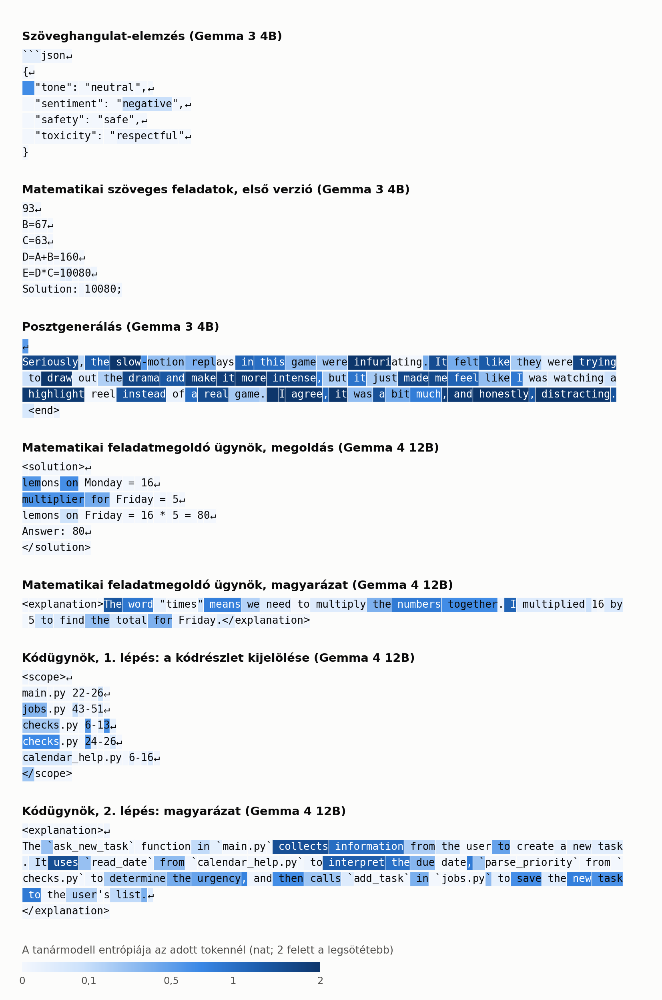
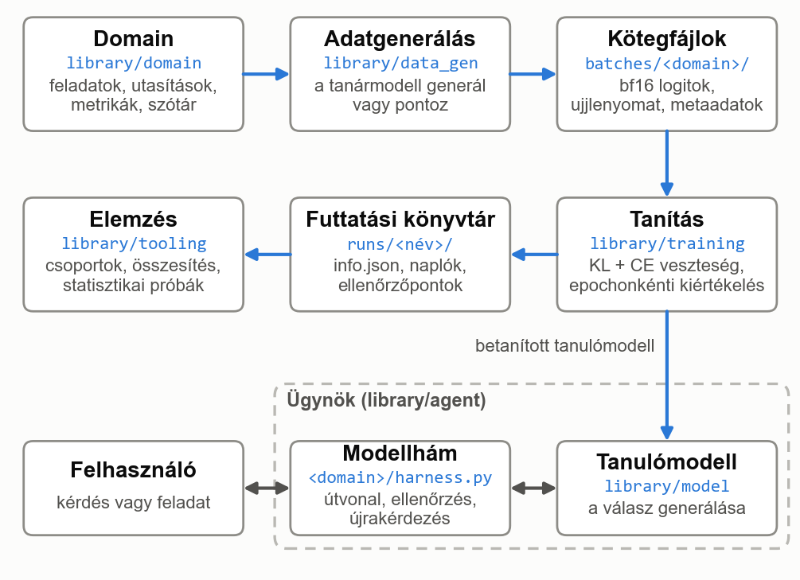
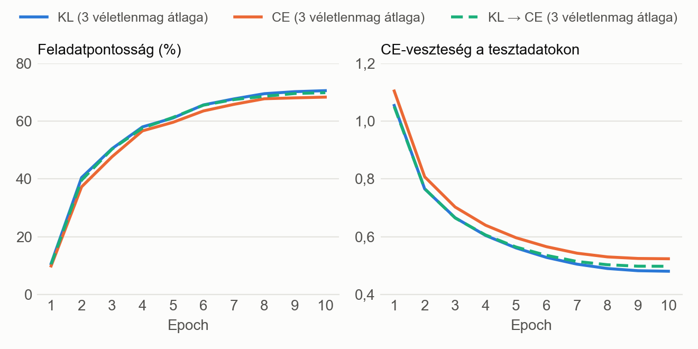

Absztrakt (magyar) + Abstract (angol)

Magyar cím: Nagy nyelvi modellek domain-specifikus desztillációja alapoktól tanított kis modellekbe
Angol cím: Domain-Specific Distillation of Large Language Models into Small Models Trained from Scratch

A nagy nyelvi modellek megjelenésével az intelligencia, a problémamegoldás és a döntéshozatal soha nem látott egyszerűséggel vált beépíthetővé a különböző szoftveres megoldásokba. Ezzel egyidejűleg az ilyen alkalmazások számításigénye és így futtatásának költsége is jelentősen megnőtt. Sok esetben fontos az ilyen modelleket lokálisan futtatni, akár szenzitív adatok, offline elérhetőség vagy megbízhatóság miatt. Ezeknél a feladatoknál viszont általában nincs szükség a modell teljes tudására, hiszen csak egy bizonyos feladatot lát el.
A dolgozat a domain-specifikus tudás desztillálását vizsgálja alapoktól tanított, jelentősen csökkentett paraméterszámú modellekbe és ügynökökbe. A vizsgált modellek elkészítéséhez és kiértékeléséhez használt saját keretrendszer jelentősen leegyszerűsíti a desztillálás folyamatát: a domain definiálását követően mindössze konfigurálással beállítható a tanítóadatok előállítása, maga a tanítás és a tanulómodell architektúrája. A tanítóadatok újrahasználhatóak több modell betanítására is.
A dolgozat több domaint is vizsgál: alapfeladatokat (text sentiment classification, posztgenerálás), illetve ügynökfeladatokat is (matematikai feladatok megoldása és magyarázata, kódbázisban végrehajtott keresés és magyarázás), és ezek mentén igyekszik megválaszolni olyan kérdéseket, mint például: kis méretű tanulómodellek mennyire képesek elsajátítani a tanármodell viselkedését? Különböző entrópiájú domaineknél hogyan érdemes a különböző veszteségeket használni vagy vegyíteni? Milyen módszerrel érdemes ügynököket desztillálni? Hogyan javul a teljesítmény a modell méretének függvényében? Milyen következtetések vonhatóak le nagyobb büdzséjű desztillálásokra?
A dolgozat több tanármodellt (Gemma 3 4B, Gemma 4 12B) használ, öt domaint vizsgál részletesen, és ezek közül kettőnél saját modellhám (harness) segítségével önálló ügynököket hoz létre.

1. Bevezetés

1.1 A megoldandó probléma, motiváció
Az utóbbi években a mesterséges intelligencia és ezen belül a természetes nyelv feldolgozására képes modellek iránti igény jelentősen megnőtt egyéni és vállalati körökben is [1]. Ilyen modelleknek gyakori felhasználási területe lehet a kódírás, döntések programatikus meghozatala vagy a tanulás támogatása. Az ilyen feladatok ellátásához jelenleg a legegyszerűbb és sok esetben az egyetlen elérhető mód, ha a különböző felhőszolgáltatóktól vásárlunk hozzáférést, legyen egy előfizetés vagy API-hívás alapú számlázás. Ez viszont sok problémát felvet, például szenzitív adatoknál vagy kritikus infrastruktúra kódjánál nem feltétlenül használhatóak az ilyen megoldások, hiszen az adatok egy külső szolgáltató szerverein kerülnek feldolgozásra, tehát kikerülnek a vállalat ellenőrzése alól. Egy másik probléma lehet a megbízhatóság, hiszen ha a modellre infrastruktúraként tekintünk, sebezhetőséget jelenthet, ha a modell válaszminősége a kontrollunkon kívül változik, például mert a szolgáltató eltérő architektúrájú hardverről szolgálja ki a modellt [2], vagy mert új védőkorlátokat vezet be [3]. Újabb probléma lehet az ilyen modellek költsége vagy elérhetősége [3]. Ahogy a legmodernebb és legjobb modellek egyre drágább áron vagy csak előfizetések mögé rejtve lesznek elérhetőek, nem feltétlenül lesz az intelligencia mindenki számára elérhető.
Nyílt súlyú modellek is elérhetőek, igaz, a legtöbb benchmarkon és valós tapasztalatok alapján a zászlóshajó zárt súlyú modellektől jelentősen elmaradnak, legalábbis ez tapasztalható 2026 októberéig [4]. Ha felhőszolgáltató infrastruktúrájáról szolgáljuk ki ezeket, a fent említett problémák csak részben mérsékelhetőek, lokális hardveren a hihetetlen memória- és grafikus számításigény miatt pedig sokszor nem lehetséges a megfelelő minőségben kiszolgálni ezeket a modelleket. A 2026 júliusában megjelent Kimi K3, az egyik legjobb benchmarkeredményt elérő nyílt súlyú modell [5], 2,8 billió paraméterből áll, amelyből tokenenként 104 milliárd aktív, és a súlyai még a kiadott, 4 bites (MXFP4) formátumban is nagyjából 1,56 TB-ot foglalnak [6]. Pusztán a súlyok betöltéséhez tehát 80 GB-os A100 adatközponti minőségű GPU-kból is legalább húszra lenne szükség.
Erre kínál megoldást a desztillálás, amikor is egy nagyobb modell viselkedését próbáljuk meg közelíteni egy jelentősen kisebb számítási kapacitást igénylő tanulómodellel. Ez a folyamat veszteségesen tömöríti a tanármodell tudását, tehát általában elmondható, hogy a kisebb tanulómodell válaszminősége (a tömörítés mértékétől függően) rosszabb lesz.
A modern LLM-ek egyik legértékesebb tulajdonsága, hogy egy modell szinte bármire használható. Ha erről hajlandóak vagyunk részben lemondani, és csak egy specifikus képességét szeretnénk megtartani, a tömörítés során sokkal nagyobb hatékonysággal tudjuk megőrizni az adott domainen az eredeti modell válaszminőségét.
A dolgozat ezért egy olyan általános megoldást mutat be, amely lehetővé teszi a domain-specifikus desztillálást. Mindezt olyan példákon keresztül, melyek bemutatják a módszer hatékonyságát és előnyeit. Bemutatásra kerül például egy olyan matematikai feladatmegoldó ügynök, amely a mérete alapján akár egy középkategóriás okostelefonon is offline futtatható lehet, vagy akár egy középkategóriás laptopon is, lokálisan futtatható kódügynök.

1.2 A dolgozat célja
A dolgozat célja egy olyan keretrendszer megtervezése és implementálása, amellyel egy nagy nyelvi modell adott szakterületre vonatkozó tudása kis méretű, alapoktól tanított nyelvi modellekbe vagy ágensekbe desztillálható. A dolgozat vizsgálja a tudásdesztilláció és a kis méretű nagy nyelvi modellek tanításának módszereit, a nyelvi modellekre épülő ágensek felépítését, valamint a rendelkezésre álló eszközöket. A keretrendszer funkcionalitása lefedi a tanítóadatok előállítását a tanármodellel, a tanulómodell tanítását és a tanítás kiértékelését. A keretrendszer lehetővé teszi a kis modell architektúrájának és a tanítási folyamat finom szabályozását, és a desztilláció lefolyásáról részletes elemzést ad. A rendszer moduláris szemlélettel lett megtervezve, új szakterületek és ágensek külön modulként hozzáadhatóak.

1.3 A dolgozat felépítése
Ebben az alfejezetben a dolgozat további részének felépítése kerül ismertetésre.
A 2. fejezetben az alapfogalmakról, az öt vizsgált domainről, a probléma felosztásáról, vagyis a desztillálás különböző lépéseiről, a nyílt súlyú modellek fontosságáról, a lehetséges buktatókról és a követelményekről lesz szó. A 3. fejezetben a feldolgozott szakirodalomról, a különböző LLM-tömörítő és -optimalizáló módszerekről, más megvalósításokról, azok összehasonlításáról és az ezekből levont konklúzióról lehet olvasni. Az ezt követő 4. fejezet a kiválasztott módszert, az ügynököket és a modellhámot, a kiválasztott tanármodelleket, domaineket és technológiákat mutatja be. Az 5. fejezet a keretrendszert, annak struktúráját és részeit mutatja be. A 6. fejezet a munkafázisokat és a levont következtetések egy részét mutatja be. A 7. fejezet a megvalósítást fejti ki. A 8. fejezet a keretrendszer és a modellek tesztelését tárgyalja. A 9. fejezet az eredményeket és további konklúziókat mutatja be. A 10. fejezetben a keretrendszer elemzéséről, felhasználásáról és továbbfejlesztési ötleteiről lehet olvasni. A 11. és a 12. fejezet magyarul, illetve angolul összegzi a munkát.

2. Háttér, a probléma elemzése és a specifikáció

Az LLM-ek egyre nagyobb szerepet játszanak a különböző digitális rendszerekben. Gyorsíthatnak vagy automatizálhatnak bizonyos szoftverfejlesztési és kiberbiztonsági feladatokat, tehát eszközként válhatnak az állami, vállalati vagy személyes infrastruktúra részévé. Vagy lehetnek egy szoftver beépített elemei, például különböző moderációs eszközökben. Az is előfordulhat, hogy az LLM maga a szoftveres megoldás fő része, például egy oktató-magyarázó alkalmazásban. Az 1.1 fejezetben részletesebben kifejtett kiszámíthatósági, megbízhatósági és költségbeli okok miatt sok esetben ideális vagy szükségszerű lenne a lokális kiszolgálás. Szintén az 1.1 fejezetben kifejtett óriási hardverigény vagy a meglévő hardveren elfutó, de jelentősen rosszabb válaszminőségű modell miatt a lokálisan futtatott általános LLM-ek nem feltétlenül jelentenek megoldást.

2.1 Alapfogalmak
2.1.1 Nagy nyelvi modellek (LLM), transformer
Az LLM-ek olyan nagy, tanított statisztikai modellek, amelyeket általában óriási mennyiségű természetes szövegen és természetes szöveggel kapcsolatos feladaton tanítottak be [7]. A rövidítés az angol Large Language Model, vagyis nagy nyelvi modell kezdőbetűiből áll össze. Tanított statisztikai modellként a mesterséges intelligencia (Artificial Intelligence, röviden AI) egyik fajtája. A legtöbb ilyen modell a neurális hálók egy speciális architektúráját, a transformert használja. Az ilyen LLM-ek működtetik a modern chatbotokat, mint például a ChatGPT. További példa LLM-ekre az Anthropic Claude modellcsaládja, a Google Gemini és Gemma modelljei vagy az OpenAI GPT és gpt-oss modelljei. Az ilyen modellek képesek követni a természetes nyelven kiadott utasításokat, és válaszaikat is képesek természetes nyelven megfogalmazni. Nem teljes lista a képességeikről: fordítás, problémák megoldása, programkód írása, matematikai feladatok levezetése és megoldása, érvelés, beszélgetés.
Transformer (decoder-only).
A transformer egy, a Google által 2017-ben bemutatott speciális neurális háló architektúra, amelyet elsősorban szövegek fordítására hoztak létre [8]. Az OpenAI kutatói kimutatták [9], hogy ha ezt az architektúrát tovább skálázzák (nagyobb modell, több adat és több számítás), az így kapott modell teljesítménye kiszámítható módon javul. A transformer architektúra újítása a figyelemmechanizmusra való kizárólagos támaszkodás volt [8]. Ennek lényege, hogy a szöveget tokenekre bontjuk, és ezek a tokenek jelentésük szerint elhelyezésre kerülnek egy nagy dimenziójú térben. Az irányoknak jelentése is van, például kimutatták [10], hogy bizonyos reprezentációkban a király és a királynő közötti különbségvektor ebben a térben nagyon hasonlít a férfi és a nő közötti különbségvektorra. Ahogy a szöveg áthalad a modellen, a tokenek térbeli reprezentációja folyamatosan mozoghat, ahogy a többi token befolyásolja a jelentésüket. Ez az egymásra "figyelés" és befolyásolás a figyelemmechanizmusnak köszönhető. Egy egyszerűsített példa lehet egy képzeletbeli modell, amely "zöld" és "macska" tokenre bontja ezt a kifejezést: "zöld macska". A modell elején a "macska" token térbeli elhelyezése az eredeti helyén lesz, de a modell végére átkerül a térbeli reprezentációja egy olyan helyre, hogy a "zöld" jelentést is magába enkódolja.
Az eredeti transformer két részből áll: egy kódolóból (encoder), amely a teljes bemeneti szöveget egyszerre dolgozza fel, így minden token az összes többi tokent figyelembe veheti, illetve egy dekódolóból (decoder), amely a kimenetet tokenenként állítja elő, és minden token csak az előtte lévőket látja [8]. Később elterjedtek az olyan modellek is, amelyek csak az egyik részt használják. A csak kódolót használó (encoder-only) modellek, mint például a BERT [11], a szöveg reprezentációját állítják elő, ezért elsősorban szövegek osztályozására és elemzésére alkalmasak, szöveg generálására viszont nem. A csak dekódolót használó (decoder-only) modellek, mint például a GPT- és a Gemma-modellek, autoregresszív módon generálnak szöveget [7], [12]. A mai LLM-ek többsége ilyen felépítésű [7]. A dolgozatban használt tanulómodellek is decoder-only transformerek.
A dolgozatban többször előkerül a bf16 és az NF4 formátum. Ezek számábrázolási formátumok, amelyek azt határozzák meg, hogy a modell súlyai, illetve a mentett logitok hány biten és milyen pontossággal kerülnek tárolásra. A bf16 (bfloat16) egy 16 bites lebegőpontos formátum, amely a 32 bites lebegőpontos számokkal azonos értéktartományt fed le, viszont csak 7 bites mantisszával, így nagyjából 2–3 értékes jegy pontosságú [13]. Az NF4 (4-bit NormalFloat) egy 4 bites kvantálási formátum, amelyben minden súly 16 lehetséges érték egyikére kerül kerekítésre, a súlyok blokkjaihoz pedig külön skálázótényező tartozik [14]. Egy paraméter így bf16-ban 2 bájtot, NF4-ben nagyjából fél bájtot foglal: a dolgozatban használt, közel 12 milliárd paraméteres Gemma 4 12B tanármodell súlyai bf16-ban körülbelül 24 GB, NF4-ben körülbelül 6 GB helyet igényelnek.

2.1.2 Token, be- és kimeneti szótár
A tokenek általában kis, szótag vagy szó méretű karakterláncok, de lehetnek önálló betűk vagy formázást segítő karakterek is [15]. Az LLM a szöveget tokenekre bontva kapja meg, ez azért fontos, mert így a szövegdarabokat el tudja helyezni térben, és már szám formájában tud velük dolgozni. A szöveg tokenekre bontását tokenizálásnak hívjuk. A folyamatot a tokenizer hajtja végre, amely modellenként eltérhet. Az eltérő tokenizerek különbözőképpen bonthatják fel a szöveget. Például a dolgozat egyik tanármodelljeként használt Gemma 4 12B tokenizerje ezt a szöveget: "Laczkó Örs youtube csatornájára érdemes feliratkozni" a következőképpen bontja fel: Lac | zk | ó | ▁Ö | rs | ▁youtube | ▁cs | ator | ná | j | ára | ▁é | rd | emes | ▁fel | irat | koz | ni (18 token, a ▁ jel a szóközt jelöli).
Általában a modell ugyanazt a tokenizert használja a szöveg értelmezésére és kimenetként is, a következő token generálásához. Általában a modell ki- és bemenete ugyanazokat a tokeneket tartalmazza, vagyis azokat a tokeneket, amelyeket képes olvasni, írni is tudja. Azoknak a tokeneknek az összességét, amelyeket a modell olvasni tud, bemeneti szótárnak, azokét pedig, amelyeket írni tud, kimeneti szótárnak hívjuk. A dolgozatban használt egyik optimalizációs módszer ezeknek a szótáraknak az aszimmetrikus, domainhez mért szűkítése.

2.1.3 Autoregresszív generálás, kimeneti eloszlás, hőmérséklet
Az autoregresszív modellek olyan statisztikai modellek, ahol a következő predikció függ az előtte lévőktől. Az LLM-eknél ez azt jelenti, hogy a generálás általában tokenenkénti, a generált token hozzáfűzésre kerül az eddigi szöveghez, és ezt a folyamatot az úgynevezett válaszlezáró tokenig (end-of-sequence token) folytatjuk [7]. Egyszerűbben fogalmazva, a modell tokenenként írja meg a válaszát, egy bizonyos lezáró token generálásáig, vagy valamilyen más külső lezáró ok miatt.
A modell szöveg generálásakor minden egyes tokennél ad egy becslést az összes, a kimeneti szótárában szereplő tokenre. Ez a becslés nyers számokban érkezik, úgynevezett logitokban. Ezt utána egy softmax függvénnyel valószínűségekké tudjuk alakítani, ahol az összes token valószínűségének összege 1 lesz [16]:
pᵢ = exp(zᵢ) / Σⱼ exp(zⱼ) (2.1)
ahol zᵢ az i-edik token logitja, pᵢ a valószínűsége, az összegzés pedig a kimeneti szótár összes tokenjére történik.
A softmax függvény egy T hőmérséklet (temperature) paraméterrel is kiegészíthető, amellyel a logitokat a valószínűségekké alakítás előtt elosztjuk [16]:
pᵢ = exp(zᵢ / T) / Σⱼ exp(zⱼ / T) (2.2)
T = 1 esetén a (2.1) képletet kapjuk vissza. Nagyobb hőmérséklet laposabb, „puhább” eloszlást ad, kisebb hőmérséklet pedig élesebbet, amely egyre inkább a legvalószínűbb tokenre koncentrálódik. Ez azért fontos, mert magasabb hőmérséklet mellett jobban kirajzolódnak a tanármodell kisebb valószínűségei is, így a tanulómodell jobban elsajátíthatja a tanármodell gondolkodását [16].
Azt, hogy egy eloszlás mennyire éles vagy puha, az entrópia méri [17]. Melynek számítási módja:
H = −Σᵢ pᵢ · ln pᵢ (2.3)
ahol pᵢ az i-edik token valószínűsége, az összegzés pedig a kimeneti szótár összes tokenjére történik. Ha a modell egyetlen tokenben teljesen biztos, az entrópia 0, és minél inkább megoszlik a valószínűség több token között, annál nagyobb. Kisebb entrópia tehát élesebb, nagyobb entrópia puhább eloszlást jelent. Természetes alapú logaritmussal számolva az entrópia mértékegysége a nat. A dolgozatban a tanármodell entrópiáját tokenenként számoljuk, majd a válaszok összes tokenjére átlagoljuk.

2.1.4 Tudásdesztilláció, tanár- és tanulómodell
Ha szeretnénk egy nagy modell tudását egy kisebbe átültetni, a desztillálás jó megoldás lehet. A desztillálás egy olyan tömörítő eljárás, amely során azt próbáljuk elérni, hogy egy kisebb modell (függvény) ugyanúgy viselkedjen, mint a nagyobb, több számítást igénylő modell [16]. A nagy modellt tanármodellnek, a kis modellt tanulómodellnek hívjuk. A desztilláció bővebb kifejtése a 3.1.1. fejezetben található. A tanulómodell a tanármodell predikcióiból tanul. Arra optimalizálunk, hogy valamilyen szempont szerint minél inkább kövesse a tanár viselkedését.

2.1.5 Veszteségek
A tanítás során szükségünk van valamilyen módszerre, amivel számszerűsíteni lehet a modell hibáját. Ezt a feladatot látják el a veszteségfüggvények, amelyek gradiense valamilyen szempont szerint optimalizációs irányt mutat az optimalizálónak. LLM-ek desztillálásánál több veszteségfüggvény is elérhető számunkra. A keresztentrópia (cross-entropy, röviden CE) a modellt kizárólag a tanítószövegben szereplő következő tokenre (desztillációnál a tanármodell által választottra) tanítja [17]. Ezzel szemben a Kullback–Leibler-divergencia (röviden KL) veszteség a tanulómodell teljes eloszlását a tanármodell eloszlásával hasonlítja össze [17], és így az optimalizálni kívánt cél nem csupán a következő helyes token eltalálása lesz, hanem az úgynevezett "dark knowledge" többlettudás is átadásra kerülhet. A dolgozat elsősorban ezzel a két veszteséggel foglalkozik, illetve ezeknek vegyítésével, amikor is valamilyen arányban a két veszteséget keverjük, ezáltal többcélú optimalizációt elérve [16]:
L = α · KL + (1 − α) · CE (2.4)
ahol α a KL-veszteség aránya, amelyet a keretrendszer a tanítás során fokozatosan változtathat. CE-veszteség használatával a tanármodell következő tokenjének minél pontosabb becslése érhető el, míg KL-veszteséggel a teljes eloszlás is követhető.

2.1.6 Ügynök, modellhám, kontextus
Az ügynökök (vagy ágensek) olyan megvalósításokat írnak le, ahol egy LLM-nek egy modellhám (harness) képességeket ad, ezzel cselekvőképessé téve azt [18]. A modellhám figyeli a modell kimenetét, és ha észrevesz egy speciális tokensorozatot, valamilyen funkciót hajt végre. A hám által adott képességek általában elmagyarázásra kerülnek a modell kontextusában. Például egy hám biztosíthat olyan képességet a modellnek, hogy visszautasítson egy kérést: ilyenkor, ha a modell válaszában megjelenik mondjuk az <out_of_scope> token, a hám egy előre programozott üzenettel automatikusan elutasítja a kérést, és az üzenet nem kerül be a modell kontextusába. Egy másik példa lehet, ha a modell szeretné megjelölni egy fájl bizonyos sorait, mondjuk megmutatásra vagy magyarázásra, akkor ez így nézhet ki: <scope> storage.py 9-11 </scope>, vagyis a storage.py fájl 9–11. sora.
A modell kontextusa (context) mindazon szövegek összessége, amelyeket a modell egy adott pillanatban lát. A kontextus hossza (context length) a benne lévő tokenek számával egyezik meg. A kontextuslimit (context limit) pedig az a szám, amennyi tokent a modell a kontextusában képes kezelni [7].

2.1.7 Kiértékelés
Ha van egy modellünk, hogyan tudjuk eldönteni, hogy jól vagy rosszul teljesít? Ha a veszteséget nézzük, vagyis hogy mekkora tévedés van a modell kimeneti valószínűségében, abból csak irányt tudunk olvasni, hogy tényleg fejlődött-e a modell. A különböző veszteségek és veszteségvegyítések során még kevésbé válik értelmezhetővé önmagában egy veszteség értéke. Ráadásul minket nem is feltétlenül a veszteség értéke érdekel, még ha kontextusba is tudnánk helyezni, hanem hogy a modell mennyire teljesít jól a tényleges tesztfeladatokon. Erre a dolgozat három fő metrikát használ. A helyes előzménnyel mért tokenpontosság (teacher forced) során a modell minden lépésben a helyes szöveget kapja, és ez alapján kell a következő tokent megjósolnia [17]. Ebből százalékos eredményt kapunk, vagyis hogy ha a modell kap valamilyen szöveget, mekkora valószínűséggel fog helyes következő tokent jósolni. Egy másik metrika a saját előzménnyel mért tokenpontosság (student only), ahol a modell saját magának állítja elő a szöveget, amely alapján a következő tokent is meg kell jósolnia. Egy korai hibás token könnyen elronthatja a modell teljes válaszát, a hiba úgymond eszkalálódik (compounding errors) [19]. Ez a metrika valamivel pontosabban tükrözi a modell valós tudását, hiszen azt mondja meg nekünk, hogy ha a modell teljes válaszát nézzük, a tokenek hány százaléka fog pozíciónként megegyezni a helyes válasszal (desztillációnál a tanármodell válaszával). Az is előfordulhat, hogy arra vagyunk kíváncsiak, hogy a modell helyesen oldotta-e meg a feladatot. Ez olyan feladatokon releváns, mint például a matematikai feladatok megoldása, egy szöveg hangulatának elemzése JSON-objektummal vagy a megfelelő kódrészlet kijelölése. Ez a metrika a feladatpontosság (task accuracy), vagyis hogy a modell a feladatok hány százalékát képes helyesen elvégezni (a dolgozatban a modell saját maga által generált válasza alapján, a tanármodell válaszához mérve).

2.1.8 Modellméretek
A dolgozatban gyakran történik hivatkozás a modellek paraméterszámára, más néven a modell méretére. Ha a paraméterszám millióban kerül megadásra, például egy 140 millió paraméteres modell esetében, a dolgozat az "M" jelölést használja, vagyis az előbb említett modellméret 140M-ként jelenik meg. A nagyobb modelleknél a paraméterszám milliárdban is megadható, ilyenkor egy 12 milliárd paraméteres modell 12B-ként van jelölve (1B = 1000M). A "B" az angol billion szóból ered, ami magyarul milliárdot jelent, nem billiót.

2.2 A vizsgált domainek
A következő alfejezetekben rövid bemutatásra kerülnek a dolgozatban vizsgált domainek. A kiválasztásukról részletesebben a 4.4. fejezetben lehet olvasni.

2.2.1 Szöveghangulat-elemzés
Az első vizsgált domain a szöveghangulat-elemzés (text sentiment classification). A modell kap egy Reddit-kommentet, amelyet utána 4 tengely mentén kell kiértékelnie, egy JSON-objektumot használva. A kommentek egy Kaggle-adatbázisból [20] származnak. A kommentekből az URL-ek és a betűkön, számokon és alapvető írásjeleken kívüli karakterek törlésre, a törölt ([deleted], [removed]) kommentek, valamint a 3 tokennél rövidebb és a 25 tokennél hosszabb kommentek pedig kiszűrésre kerültek.
Egy példa a feladatra:

````
You only need 1 friend now, they changed how the Friend boost works

```json
{
  "tone": "neutral",
  "sentiment": "negative",
  "safety": "safe",
  "toxicity": "respectful"
}
````

A modell feladata a \n\n karakterek utáni rész generálása, és a "}" token állítja le a generálást. A domain strukturált, a Gemma 3 4B tokenenkénti átlagos entrópiája 0,02 nat, amely arra utal, hogy a domain eloszlása éles, tehát általában a tanármodell biztos a döntésében.

2.2.2 Matematikai szöveges feladatok (első verzió)
A következő domain a matematikai szöveges feladatok megoldásáról szól. A tanítópéldák 260 különböző sablont használva készültek. A sablonok 13 művelettípusba voltak bontva, például összeadás, kivonás, szorzás, osztás, két műveletből álló feladatok (például összeadás, majd szorzás) és összehasonlítás. A modell feladata a megadott levezetési váz kitöltése és a helyes megoldás leírása a "Solution:" után. A sablonok miatt fennáll a veszélye, hogy a modell a sablonok mintáját tanulja meg, és új szerkezetű feladatokat kevésbé képes megoldani (lásd 2.5.2. alfejezet).
Egy példa a feladatra:

```
Problem: "Olivia has 93 seeds and buys 67 more. Each seed grows 63 flowers. How many flowers total?"
A=?
B=?
C=?
D=A+B=?
E=D*C=?
Solution: ?;

93
B=67
C=63
D=A+B=160
E=D*C=10080
Solution: 10080;
```

A modell feladata a \n\n karakterek utáni rész generálása, és a ";" token állítja meg a generálást. A domain strukturált, a Gemma 3 4B tokenenkénti átlagos entrópiája kb. 0,003 nat, amely arra utal, hogy a domain eloszlása éles, tehát általában a tanármodell biztos a döntésében.

2.2.3 Posztgenerálás
Az utolsó vizsgált, nem ügynök domain, a posztgenerálás. A modell kap egy, a 2.2.1. alfejezetben megismert kommentet, és az a feladata, hogy generáljon egy olyan posztot, amelyre érkezhetne ez a komment.
Egy példa a feladatra:

```
Main problem was they showed it in slow motion. I thought it was a bit much by Bish

Seriously, the slow-motion replays in this game were infuriating. It felt like they were trying to draw out the drama and make it more intense, but it just made me feel like I was watching a highlight reel instead of a real game.  I agree, it was a bit much, and honestly, distracting. <end>
```

A modell feladata a \n\n karakterek utáni rész generálása, és az "<end>" jelölés állítja meg a generálást. A domain strukturálatlan, a Gemma 3 4B tokenenkénti átlagos entrópiája kb. 1,0 nat, amely arra utal, hogy a domain eloszlása puha, tehát általában a tanármodell több válasz között vacillál.

2.2.4 Matematikai feladatmegoldó ügynök
Ez a domain a matematikai szöveges feladatok első verziójának továbbfejlesztett, ügynökösített változata. A modellnek egy szöveges feladat levezetése és megoldása a feladata. A feladatok valódi, matematikai feladatokat tartalmazó adatbázisok (ASDiv [21], MAWPS [22]) feladataiból kiindulva készültek, ezeket mesterséges intelligencia (Claude Opus 5.5) ügynökök bővítették a megfelelő példaszám elérése érdekében. A modellnek ezenfelül kezelnie kell a saját kontextusát egy modellhám segítségével, el kell döntenie, hogy következő részfeladatot vagy kiegészítő kérdést lát. Amennyiben kiegészítő kérdésről van szó, a következő részfeladatnál a kiegészítő kérdések törlésre kerülnek a kontextusból, így a modell kontextusa nincs túlterhelve. Ezenfelül a modell megtanulja az oda nem illő kérdéseket elutasítani, amelyek be sem kerülnek a kontextusba.
Egy példa, a feladat megoldása után egy kiegészítő kérdéssel:

```
<task>The restaurant's Monday schedule calls for 16 lemons. Friday's schedule, with its fish special, calls for 5 times as many lemons. How many lemons does the Friday schedule call for?</task>
<solution>
lemons on Monday = 16
multiplier for Friday = 5
lemons on Friday = 16 * 5 = 80
Answer: 80
</solution>
<message>what did you do with 16 and 5? I don't get it</message>

<explanation>The word "times" means we need to multiply the numbers together. I multiplied 16 by 5 to find the total for Friday.</explanation>
```

Egy másik példa elutasított kérdésre:

```
<task>The restaurant's Monday schedule calls for 16 lemons. ...</task>
<solution>
...
</solution>
<message>this is the most boring day of my life</message>

<out_of_scope>
```

Ilyenkor a modell csak az <out_of_scope> jelölést írja le, a modellhám pedig egy előre megírt mondattal ("This question is outside the scope of this task.") válaszol. A <task> és <solution> blokkokban szereplő szövegek végig megmaradnak a modell kontextusában, a <question> és <explanation> blokkok a következő <task> blokknál törlődnek, az elutasított üzenet pedig be sem kerül a kontextusba. A magyarázatok miatt a feladatoknak csak egy része strukturált, a Gemma 4 12B tokenenkénti átlagos entrópiája 0,17 nat, amelyből az olvasható le, hogy a modell nem minden tokenben volt teljesen biztos, volt, ahol több megoldást is választott volna.

2.2.5 Kódkereső és -magyarázó ügynök
Ebben a feladatban, vagyis a kódügynöknél, a modell 20 (16 Python- és 4 HTML-) példaprojekt valamelyikének teljes kódját kapja meg egy előre meghatározott formátumban. A modell feladata, hogy megkeressen vagy megmagyarázzon egy kódrészletet. Ha magyaráznia kell, a modell akkor is először leszűkíti a kontextust a <scope> blokkot használva, majd a modellhám által leszűkített kontextus alapján megválaszolja a rá vonatkozó kérdést.
Egy példa a feladatra (kevesebb fájllal, rövidített fájlokkal bemutatva), 1. lépés:

```
<project>
<file name="main.py">
 1: """To-do list in the terminal."""
 2:
 3: from calendar_help import read_date
...
22: def ask_new_task(username):
23:     title = input("What needs doing? ")
24:     due = read_date(input("Due (today, tomorrow, YYYY-MM-DD or Enter): ") or "none")
25:     priority = parse_priority(input("Priority (h/m/l): ")) or "medium"
26:     print(add_task(username, Task(title, due, priority)) or "Added.")
...
</file>
<file name="jobs.py">
...
</file>
...
</project>
<message>How does ask_new_task work?</message>

<scope>
main.py 22-26
jobs.py 43-51
checks.py 6-13
checks.py 24-26
calendar_help.py 6-16
</scope>
```

2. lépés:

```
<context>
<file name="calendar_help.py">
 6: def read_date(text):
...
</file>
<file name="checks.py">
 6: def parse_priority(text):
...
</file>
<file name="main.py">
22: def ask_new_task(username):
23:     title = input("What needs doing? ")
24:     due = read_date(input("Due (today, tomorrow, YYYY-MM-DD or Enter): ") or "none")
25:     priority = parse_priority(input("Priority (h/m/l): ")) or "medium"
26:     print(add_task(username, Task(title, due, priority)) or "Added.")
</file>
<file name="jobs.py">
43: def add_task(username, task):
44:     """Put a new task on the user's list. None when it worked, otherwise why not."""
45:     problem = title_problem(task.title)
46:     if problem:
47:         return problem
48:     jobs = tasks_of(username)
49:     jobs.append(task.to_data())
50:     save_tasks(username, jobs)
51:     return None
</file>
</context>
<message>How does ask_new_task work?</message>

<explanation>
The `ask_new_task` function in `main.py` collects information from the user to create a new task. It uses `read_date` from `calendar_help.py` to interpret the due date, `parse_priority` from `checks.py` to determine the urgency, and then calls `add_task` in `jobs.py` to save the new task to the user's list.
</explanation>
```

A modell a \n\n rész után kezdi meg a válaszadást. A Gemma 4 12B tokenenkénti átlagos entrópiája itt is 0,17 nat, amely gyakorlatilag megegyezik a matematikai feladatmegoldó ügynökével.

2.2.6 A példák tokenenkénti entrópiája
A 2.1. ábrán a fenti példák válaszai láthatók tokenenként, a tanármodell adott lépésbeli entrópiája szerint színezve.

2.1. ábra. A 2.2. alfejezet példaválaszai a tanármodell tokenenkénti entrópiájával színezve
Minél sötétebb egy token, annál bizonytalanabb volt a tanármodell az adott helyen. A strukturált részek, például a JSON-objektum, az első verzió levezetése és a megoldás számai szinte fehérek, a bizonytalanság a szóválasztásoknál jelenik meg. A matematikai feladatmegoldó ügynök megoldásában a mennyiségek elnevezésénél ("lemons on", "multiplier for"), a kódrészlet kijelölésében főleg annál, hogy melyik fájl kerüljön bele, a magyarázatokban és a posztban pedig szinte minden tartalmas szónál. Mérve is ez látszik, a magyarázatoknál a tanármodell tokenenkénti átlagos entrópiája 0,24–0,32 nat, a megoldásoknál és a kijelöléseknél csak kb. 0,04 nat.

2.3 A probléma elemzése
A megoldandó feladat tehát egy nagy modell sokrétű tudásának hatékony, egy domainre koncentrált kinyerése. Gyakorlatilag a tanármodell oly módú tömörítése, ahol nem számít a modell teljesítményének romlása más területeken, csak az számít, hogy a vizsgált területen a lehető legjobban másolja a tanárát. A probléma több részre bontható.

2.3.1 A domain
Először is szükség van domainek definiálására. Itt megadhatjuk azt az utasítást, amit a tanármodell követve a tanítóadatokat elő tudja állítani. A domain feladata a kimeneti szótár tokenjeinek meghatározása (a bemeneti szótárat a keretrendszer a domain adataiból automatikusan állítja elő), a megállást jelző token szolgáltatása, illetve ügynökdesztillálás esetén a modellhám biztosítása.

2.3.2 A tanítóadatok előállítása
Ha van egy domainünk, ahhoz, hogy a tanár viselkedése másolható legyen, szükségünk van a tanártól adatokra. A tanítóadatok a következőképpen kerülnek előállításra: a keretrendszert használva bekonfigurálhatunk akár több adatgenerálási feladatot egy sorban, amelyek szekvenciálisan végrehajtódnak. Minden adatgenerálási feladat meghatározza, hogy melyik tanármodellt használva melyik domainen mennyi példát generáljon a keretrendszer. Az adatgenerálás során a tanármodell megkap egy feladatot, amelyre lépésenként (autoregresszív módon) választ ad. Minden lépésben mentésre kerül a tanár kimeneti eloszlása, vagyis hogy a tanármodell milyen valószínűséggel hogyan folytatná a szöveget. Ha a domain optimalizációs okokból így határozza meg, a tanármodell egy megadott választ pontoz egyetlen futtatással, az eloszlás ilyenkor is minden tokennél mentésre kerül. Egy később kifejtett optimalizációs stratégiának köszönhetően (a kimeneti szótár csökkentése) nem szükséges a teljes eloszlást elmenteni. Ez tovább optimalizálható: a mentett adatok mérete tovább csökkenthető, ha tokenenként csak a k legvalószínűbb token logitja kerül mentésre (top-k), vagy ha a tokeneket a tanármodell valószínűségei alapján mintavételezzük. A Gemma 3 modellek tanításánál például tokenenként 256, a tanár valószínűségei szerint mintavételezett logitot használtak [12]. Szükségesség híján a dolgozat ezt a stratégiát nem vizsgálja. A válaszadás akkor ér véget, amikor a tanármodell a domainben megadott záró tokent vagy a saját, szöveg végét jelző tokenjét használja. Ezenfelül, ha túllépi a megengedett válaszhosszt, a generálás leáll, és a példa elvetésre kerül.

2.3.3 A tanulómodell és a tanítás
A következő kérdés a tanulómodell architektúrájának megválasztása. A keretrendszer alapértelmezett modellje egy sűrű, decoder-only transformer modell, amely a Gemma-modellekben is használt elemekre épül (RMSNorm normalizálás, rotary pozíciókódolás, kapuzott GELU előrecsatolt réteg), és amelynek konfigurálhatjuk rejtett dimenzióját (hidden dimension), figyelemfejeinek (attention head) és rétegeinek (layers) számát sok egyéb mellett. Ezenfelül a tanítási sorban saját modellt is átadhatunk a keretrendszernek, ha saját architektúrával szeretnénk kísérletezni, hiszen a keretrendszernek a könnyű, gyors, kontrollált és költséghatékony kísérletezésnek az elősegítése is célja.
A tanítóadatok előállításához hasonlóan a tanítás is egy soralapú szekvenciális rendszerre épül. A tanítóadatok előállításához és a tanulómodellhez hasonlóan a desztilláció ezen része is teljes mértékben konfigurálható kell hogy legyen, hiszen a kísérleteket csak így lehet nagy számban, megbízhatóan és pontosan végrehajtani. Beállítható kell legyen a vizsgált veszteségvegyítésen felül számos más paraméter.

2.3.4 A kiértékelés
A modell betanulása után pedig fontos lépés a tanítás és a modell eredményeinek a kielemzése. A keretrendszer alaposan naplózza az összes fontos paramétert adatgenerálás és tanítás közben is. Visszakövethetjük a különböző folyamatokkal eltöltött időt, tanulás folyamán a veszteség- és pontosságértékeket, epochok közben a mini tesztadatsoron történő kiértékelést, epochok végén a teljes tesztadatokon történő értékelést.
Mivel a tanulómodell tanítása nem determinisztikus, általában több futtatás átlagával és szórásával, statisztikai próbával tudjuk igazolni a különböző módszerek hatékonyságát, így egy kísérletcímke-rendszer (experiment tag) is szükséges, amelynek segítségével több futtatás eredménye összevonható egy adatsorrá.

2.3.5 Integráció
Az utolsó problémakör pedig a kész modellek integrálása különböző felületekbe, legyen az egy terminálos alkalmazás, amelyben a betanított ügynökkel beszélgethetünk, vagy egy webalkalmazás, amely mutatja a modell és a modellhám által tett lépéseket egy chatfelületen.

2.4 Miért fontos nyílt súlyú LLM-et használni
A projekt a Hugging Face-ről letölthető, nyílt súlyú modellekre alapoz. A 3.1.1. fejezetben kifejtett általános LLM-desztillációs módszerek alapján két fő desztillációs módszer érhető el. Az egyik, amikor a modell kimeneti szövegén tanítjuk a tanulómodellünket, a másik pedig, amikor a kimeneti szöveg generálása közben a modell eloszlásán is. Az előbbi módszer zárt súlyú modellek kimenetén is elvégezhető, bár ez a felhasználási feltételekbe (terms of use) ütközhet [23]. A nyílt súlyú modelleknél általában nincs ilyen megkötés [24]. További előnye a nyílt súlyú modelleknek, hogy ha mi telepítettük ki (deployment), hozzáférhetünk a modell kimeneti eloszlásához, azt el tudjuk menteni, és így a modell kimeneti eloszlásában rejlő többletinformáción, a Hinton-féle "dark knowledge"-en [16] is taníthatjuk a tanulómodelleinket. Ráadásul az LLM-eknél ez az eloszlás különösen fontos (lásd 3.1.1. fejezet).

2.5 Lehetséges buktatók

2.5.1 A redukált szótár korlátai
A dolgozatban vizsgált tanulómodellek be- és kimeneti szótára optimalizációs célból, a domainhez igazítva, redukálva van. Ennek a módszernek fundamentális limitációja, hogy a modell bizonyos tokeneket nem tud olvasni vagy írni. Ez problémát okozhat, hiszen ha a modell olyan szöveget lát, amely nincs benne a bemeneti szótárában, akkor azt nem tudja felismerni, olyan szöveget pedig szintén nem képes generálni, amelyhez olyan tokent kellene használnia, amely nincs benne a kimeneti szótárában. Ezek ellen a problémák ellen kétféleképpen védekezhetünk, jól összeállított szótárakkal, illetve a kérés átirányításával vagy elutasításával. A szótárak felépítését a 7.2 alfejezet mutatja be. A legtöbb esetben a bemeneti szótár a tanító- és a tesztrekordokban előforduló összes token és a kimeneti szótár alapján került előállításra, kiegészítve egy ismeretlen (unknown) tokennel, amelyre a szótáron kívüli bemeneti tokenek leképeződnek. Az ismeretlen token sora nincs tanítva, így egy ilyen szó a modell számára gyakorlatilag üres helyként jelenik meg. Összességében tehát, ha a domain feladatai kellőképpen jól fel vannak építve, domainen belül csekély eséllyel kellene előfordulnia szótárhibának. Amennyiben mégis ilyen történne, a kérést tovább lehet irányítani egy olyan modellnek, amelynek nincsenek ilyen limitációi, vagy akár egy hibaüzenet is megjeleníthető. Szótárcsökkentés nélkül sem tudna a modell mit kezdeni azokkal a tokenekkel, amelyek a tanítóadatban nem fordulnak elő, mert ezek beágyazása nem kap tanítójelet. Hasonló a helyzet a kimeneti oldalon. Ha egy token sosem helyes válasz, a modell csak azt tanulja meg, hogy ne írja le, így a hozzá tartozó súlyok gyakorlatilag fölösleges költséget jelentenek a modellben. A tesztadatoknál előfordulhat, hogy van olyan token, amelynek a modellben van ki- vagy bemeneti sora, de a tanítóadatban sosem szerepelt. A redukált kimeneti szótárnak van egy kevésbé szembetűnő következménye is. A tanármodell eloszlásából csak a megtartott tokenekhez tartozó logitértékek kerülnek mentésre, a szótáron kívüli tokenekre jutó valószínűség elvész. A gyakorlatban ez csak minimális problémát jelent, hiszen a tanármodell valószínűségének túlnyomó része általában a szótárban szereplő tokenekre esik. Egy saját mérés szerint a Gemma 4 12B valószínűségének átlagosan 99,96%-a a matematikai feladatmegoldó ügynök, 99,89%-a a kódügynök kimeneti szótárán belül maradt (ügynökönként 500 tesztválaszon, bf16 pontossággal futtatva).

2.5.2 Programozottan előállított feladatok
A matematikai szöveges feladatok első verziójának feladatai sablonokból készültek. A mesterséges intelligenciát használó megoldások egyik óriási előnye, hogy olyan helyen is találnak mintákat, ahol az emberek nem, viszont a sablonos megoldásnál ez hátrány, abból a szempontból, hogy a modell nem feltétlenül csak azt tanulja meg, amit szeretnénk, hanem a sablonok logikáját is [25]. Ez azt eredményezheti, hogy ha a sablontól eltérő sorrendben szerepelnek egyébként jól ismert tokenek, a modell teljesítménye jelentősen romolhat [26]. Ennek veszélyét csökkentve a második verzióban már publikusan elérhető feladatbázisok (ASDiv [21], MAWPS [22]) feladataiból kiindulva, mesterséges intelligencia (Claude Opus 5.5 ügynökök) által írt feladatok lettek használva, így növelve a feladatszerkezetek változatosságát. A kódügynöknél hasonló, mesterséges intelligenciával bővített feladatadatbázis lett létrehozva, a korábbi programatikus feladatgenerálási hozzáálláshoz képest. Ha ezeket a modelleket élesben szeretnénk használni, több, nagyobb varianciájú adatra lenne szükség, mert most is megfigyelhető egyfajta "túltanulás", például a matematikai feladatmegoldó ügynök tanulómodellje a tanítás során nem látott feladattípusokon jóval ritkábban jutott a tanárral azonos eredményre (lásd 9.4). A módszer működőképességének bemutatására viszont megfelelően a feladatbázisok.

2.5.3 A tanármodell hibáinak átvétele
Költséghatékonysági okokból a dolgozat 4B, illetve 12B paraméteres tanármodelleket használ. Ezeknél vannak nagyságrendekkel nagyobb és jobban teljesítő nyílt súlyú modellek [5], [6], a legjobb zárt súlyú modellek pedig még ezeknél is jobban teljesítenek [4]. Ennek eredményeként a tanármodell válaszai néha hibásak. A desztillációs módszerek vizsgálatánál viszont ez kevésbé fontos, hiszen nem egy olyan rendszert szeretnénk létrehozni, amely jobb, vagy másképp viselkedik, mint a tanármodell, egyszerűen csak tömöríteni szeretnénk a tudását, a lehetséges hibáival együtt is. Ez azt is jelenti, hogy a tanármodell képességei egyfajta felső korlátot jelentenek a tanulómodell számára. Egyben viszont azt is jelenti, hogy ha egy módszer jól működik 4B, illetve 12B paraméternél, akkor feltételezhetjük, hogy nagyobb modelleket is desztillálhatunk hasonlóan, tehát a felső korlát egy jobb tanármodellel tovább emelhető.

2.5.4 Az alapoktól tanítás adatigénye
Az alapoktól tanítás azt jelenti, hogy a modell véletlenszerűen van inicializálva, nincs semmilyen előtudása sem a nyelvről, sem az adott domainről, szemben például a finomhangolás módszerével, ahol egy meglévő modell meglévő tudása van tovább erősítve, bővítve (lásd 3.1.3. fejezet). A finomhangolás viszont elveszi a lehetőséget a saját méret és architektúra megválasztására, amelyre a dolgozat alapoz (be- és kimeneti szótár, rendkívül kis méret). Az alapoktól tanított modellnek így mindent a desztillációs adatokból kell megtanulnia, ezért jóval nagyobb mennyiségű adatra van szüksége. A matematikai feladatmegoldó ügynök domainen egy 224 beszélgetésből álló, 1345 tanítóválaszos próbatanítás végén az 5,9M paraméteres tanulómodell az 54 tesztfeladatból egyet sem oldott meg helyesen, pedig mindig a leggyakoribb választ adva 4 is helyes lett volna. Ugyanekkora tanulómodellt egy nagyobb tesztkészlettel futtatott sorozatban egyre több tanítóválaszon tanítva a tesztadatokon mért CE-veszteség egyenletesen csökkent (2.2. ábra). Rendre 576, 1344, 3136 és 5383 tanítóválasszal a veszteség 2,96, 2,56, 2,18 és 1,86 volt, vagyis a tanítóadat minden megduplázása átlagosan 0,34-dal csökkentette a veszteséget, és a vizsgált adatmennyiségeknél ez a javulás még nem lassult le.

2.2. ábra. A tesztadatokon mért CE-veszteség a tanítóválaszok számának függvényében
A feladatpontosság ennyi adattal viszont az utolsó epochban 0,8 és 2,4% között volt, ami kevesebb, mint a mindig a leggyakoribb választ adva elérhető 6,1%. Nagyobb adatmennyiségnél már a feladatpontosság is jól mutatja az adat szerepét. Egy 16,4M paraméteres tanulómodell 10 epoch alatt 64 554 tanítóválaszon a tesztfeladatok 49,5%-át oldotta meg helyesen, az azonos felépítésű, 16,5M paraméteres modell a háromszor ennyi, 195 980 tanítóválaszon pedig a veszteségtől és a futtatástól függően 68–72%-át, miközben mindig a leggyakoribb választ adva kb. 4% érhető el. A két mérés tesztkészlete eltérő méretű, de mindkettő a tanítás során nem látott feladatcsaládokból áll.

2.5.5 Helyes formátum, helytelen válasz
A strukturált domaineken félrevezető lehet a tanítás közben mért és a helyes előzménnyel mért pontosság. Például a szöveghangulat-elemző domainen meglehetősen gyorsan, pár száz példa alatt megjegyzi a modell a JSON-struktúrát. A saját előzménnyel mért és a feladatpontosságból viszont hamar kiderül, hogy míg a formátumot helyesen használja a modell, addig a mezők értékei nem feltétlenül helyesek. Sőt, nem csak a strukturált domaineken, de a matematikai feladatmegoldó ügynök domainen is előfordult a próbatanítás során, hogy a modell helyes formátumban, de a feladattól független, kitalált tárgyakkal és számokkal válaszolt. A szöveghangulat-elemző domainen ráadásul vannak címkék, amelyek alulreprezentáltak, ez a 2.3. ábrán látható tévesztési mátrixokból (confusion matrix) is kiderül.

2.3. ábra. Tévesztési mátrixok a szöveghangulat-elemző domainen
A 2.3. ábrán egy Gemma 3 4B tanármodellből desztillált, 4,9M paraméteres tanulómodell mezőnkénti tévesztési mátrixai láthatók. A tanulómodell 489 984 Reddit-kommenten tanult 3 epochon keresztül. A sorok a tanármodell, az oszlopok a tanulómodell címkéit mutatják. A mátrixok a 10 016 tesztkommentből azt a 8210-et tartalmazzák, amelyre a tanulómodell feldolgozható JSON-választ adott. A ritka hangnemcímkék közül a "rude" (durva) címkét a tanulómodell 129 esetből csak 2-szer, a "friendly" (barátságos) címkét 56 esetből 16-szor találta el, a gyakori "neutral" (semleges) és "aggressive" (agresszív) címkéket viszont nagyrészt eltalálta. Összességében a feldolgozható válaszokban a modell az értékek 86%-át találta el, szemben a mindig a leggyakoribb címkét adó megoldás 64%-ával.

2.5.6 A helyes és a saját előzménnyel mért pontosság eltérése
A 2.5.5. alfejezetben is olvasható, hogy a modell gyakran megjegyez struktúrákat. Ez nem csak a JSON-formátumra, de az objektum kulcsaira és azok értékeire is vonatkozik. A helyes előzménnyel mért pontosságnál előfordulhat, hogy például a 2 tokenre bomló "harmful" (káros) szó ("harm" és "ful") első tokenjét nem találja el a modell, de ha megkapja az érték első tokenjét, ez alapján egyszerűen be tudja fejezni. Az első token döntési pont, a második csak befejezi a döntést. Ezért fontos a saját előzménnyel mért pontosság is, amely azt is mutatja, ha a modell hibája eszkalálódik [19], vagyis egy korai hiba a teljes modellválaszt elrontja.

2.5.7 Az LLM nem mindig a legjobb megoldás
Fontos még megjegyezni, hogy a dolgozatban vizsgált domaineken nem feltétlenül egy LLM a legjobb megoldás. Például a szöveghangulat klasszifikálására egy klasszifikáló modell, mint például a BERT [11], valószínűleg jobban teljesítene. A dolgozatban viszont mégis LLM-mel vannak az ilyen problémák megoldva, ugyanis relatíve könnyebb kutatási felszínt biztosítanak, hiszen például a szöveghangulat-elemző domainen valódi Reddit-kommentek [20] vannak klasszifikálva, amelyek így nagyrészt mentesülnek a sablonok okozta problémáktól, amelyek részletesebben a 2.5.2. alfejezetben kerültek kifejtésre. Röviden tehát a könnyebben előállítható domainek és a kutatási szempontból megfelelő mennyiségű és minőségű adatok teszik indokolttá, hogy olyan domaineken is vizsgálja a dolgozat az LLM-eket, amelyekre más megoldások talán hatékonyabbak lennének. Az így leszűrt tanulságok viszont más problémákra is alkalmazhatóak.

2.6 Funkcionális és nem funkcionális követelmények
A rendszerrel szemben támasztott követelmények két csoportra bonthatóak. A funkcionális követelmények azt írják le, hogy mit kell tudnia a rendszernek, a nem funkcionális követelmények pedig azt, hogy milyen minőségben és milyen korlátok között. A követelmények a keretrendszerre és a rá épülő két ügynökre vonatkoznak.
Funkcionális követelmények:
Új domain külön modulként hozzáadható. A domain megadja a feladatokat, a kiértékelés módját, a tanármodellnek szóló utasítást, a kimeneti szótár tokenjeit és a megállást jelző tokent, ügynök esetén pedig a modellhámot is.
Tanítóadat generálható egy domain és egy tanármodell kiválasztása után. A tanármodell kimenete tokenenként, a kimeneti szótár tokenjeinek nyers logitértékeiként kerül elmentésre.
Tanulómodell tanítható be az előállított tanítóadatokon, a modell architektúrájának fontosabb paraméterei állíthatóak, vagy akár az interfésznek megfelelő saját modell is tanításra kerülhet.
Tanulómodell betanítása során a tanítófolyamat konfigurálható fontosabb paraméterek, például a veszteség típusa, veszteségvegyítések, vagy a bemelegítés ütemezése mentén.
A tanulómodell kiértékelésre kerül a tanítás közben, követhető a veszteség(ek) és a pontosság a tanító- és tesztadatokon is, az epochok végén pedig kiértékelésre kerül a modell pontosságmetrikák és eloszlásmetrikák alapján is.
A könyvtár képes több futtatást egy kísérletként kezelni, statisztikai szórást és átlagot számolni a futtatások eredményeiből, így magabiztosabb következtetések levonására ad lehetőséget módszerek összehasonlításakor.
A könyvtár képes ügynököket kezelni, modellhámot használva a tanítóadat előállítása és a kiértékelés során, ha a modellhám a könyvtárban foglalt szabályokat követi.
Tanítás közben aktívan frissül egy adatlap, amelyről leolvashatók a tanulás menetének fontosabb értékei.
Nem funkcionális követelmények:
Megbízhatóság: megszakításkor legfeljebb az utolsó mentés óta végzett munka vész el, a felhalmozott adatfájlok soha nem íródnak felül, és a keretrendszer elutasítja a nem egyező szótárral készült tanítóadatokat, illetve a nem egyező állapotból történő folytatást.
Visszakövethetőség: a futtatások pontos beállításai rögzítésre kerülnek, az adatsorrend pedig véletlenmaggal rögzíthető.
A rendszer képes különböző platformokon (Windows otthoni számítógép, bérelt GPU / GPU-szelet) is megfelelően működni.

2.7 Felhasználási lehetőségek
A dolgozatban leírt rendszer és a futtatásokból származó eredmények többféle módon is felhasználhatóak. Használhatják kutatók különböző architektúrák szisztematikus tesztelésére tanármodell által generált adatokon, domainenként. Használható különböző desztillációs módszerek és tömörítő módszerek tesztelésére és összehasonlítására is. Használhatják fejlesztők, akik különböző vállalati, infrastrukturális vagy személyes feladatokra vagy problémákra keresnek egy hatékony, lokálisan futtatható megoldást. A kész modelleket pedig természetesen használhatják végfelhasználók különböző felhasználási területeken.

3. Szakirodalmi áttekintés

A következőkben bemutatásra kerülnek a jelenlegi módszerek, azok hiányosságai, illetve a domain-specifikus desztilláció által kínált megoldás.

3.1 Meglévő megoldások, hasonló rendszerek
3.1.1 Általános LLM-desztillációs módszerek
A tudásdesztilláció (knowledge distillation) egy tömörítési módszer, amely egy kisebb modellel próbálja minél pontosabban közelíteni a desztillálni kívánt nagyobb modellt. A klasszikus tudásdesztilláció alapötletét Hinton és társai [16] fogalmazták meg, melynek lényege, hogy a tanulómodellt nemcsak a helyes válaszra tanítjuk meg, hanem a tanármodell teljes kimeneti eloszlására is. A tanulómodell így nemcsak a helyes választ, de a tanármodell bizonytalanságát, a "dark knowledge"-t is képes megtanulni. Ez a bizonytalanság érdekes többletinformációt is magában hordoz, hiszen azt is megmutatja, hogy melyik rossz válaszok állnak közel a jóhoz. Ráadásul a nagy nyelvi modellek működéséből fakadóan kifejezetten fontos ez az információ, ugyanis gyakran előfordul, hogy egy LLM használata közben nem a legvalószínűbb (greedy decoding), hanem valamelyik más valószínű szóval folytatja a válaszadást, mivel a szöveget a legvalószínűbb tokenek mintavételével (sampling) generáljuk.
Egy másik gyakran használt tudásdesztillálási módszer nagy nyelvi modelleknél az eloszlás nélkül, csak a tanármodell kimeneti szövegén történő tanítás, az úgynevezett szekvenciaszintű desztilláció [27].
A nagy nyelvi modelleknél a desztillációt ma jellemzően általános céllal használják, tehát a tanulómodelltől azt várjuk, hogy a tanár minden képességét megtartsa. Erre példa a Gemma 2 modellcsalád [28], ahol a 2B és 9B paraméteres modelleket már desztillációval tanították. A szerzők kísérletében egy 7B paraméteres tanárból desztillált 2B paraméteres modell három benchmark átlagában 67,7 pontot ért el, szemben az ugyanannyi tokenen, desztilláció nélkül tanított változat 60,3 pontjával.
Vannak természetesen specifikusabban desztillált modellek, ilyenek például a DeepSeek-R1-Distill modellek [29], amelyeknél nagyjából 800 ezer, főként a DeepSeek-R1 érvelő (reasoning) modell által generált példán tanították tovább a kisebb, 1,5B és 70B paraméter közötti Qwen és Llama modelleket, kifejezetten az érvelési képességek átadására fókuszálva. Ebben a kísérletben eloszlás nélkül, csak a tanármodell szövegén tanították a tanulómodelleket.
Busbridge és társai [30] szerint a desztillált modell teljesítménye előre jelezhető a tanulómodell méretéből és a tanításra fordított számítási keretből, és ha a modell általános képességeit nézzük, akkor ez a tömörítés veszteséges. Ha viszont lemondunk az általánosságról, és csak egy szűk feladatra (domainre) szeretnénk fókuszálni, a szükséges tudás egy jóval kisebb modellbe is beférhet.
Kis, csak egy feladatra tanított tanulómodellekbe történő desztilláció már a nagy nyelvi modellek előtt is létezett. Kim és Rush [27] a tanár tokenenkénti eloszlását 8–84M paraméteres, csak fordításra tanított modellekbe is desztillálták, Tang és társai [31] pedig a BERT logitjait egy 0,96M paraméteres BiLSTM-hálózatba desztillálták szöveghangulat-elemzésre, 349-szer kevesebb paraméterrel. A nagy nyelvi modellek megjelenése után ez az irány már előtanított, legalább 220M paraméteres tanulómodellekkel folytatódott [32], [33]. Fu és társai [33] például kifejezetten az általános képességek rovására szakosítottak kisebb modelleket matematikai feladatokra, ami ugyanaz az alapötlet, mint amelyre ez a dolgozat is épül. Busbridge és társai [30] azt is kimutatták, hogy ha a tanármodell már rendelkezésre áll, a desztilláció egy, a tanulómodell méretével növekvő számítási keretig hatékonyabb a desztilláció nélküli tanításnál. Mivel már számos nyílt súlyú modell elérhető, sok esetben a desztilláció kifizetődőbb lehet, mint a desztilláció nélküli tanítás.

3.1.2 Kvantálás
A desztillálás egy olyan tömörítőmódszer, amely a paraméterszám csökkentésére koncentrál, ezzel szemben a kvantálás (quantization) a meglévő súlyok helyigényét csökkenti. Míg egy nem kvantált LLM súlyait általában 16 biten szokták tárolni, kvantáláskor ez lecsökkenhet 8 vagy 4 bites precizitásra. A kvantálás a modell teljesítményének romlásával járhat, viszont így jelentősen nagyobb paraméterszámú modelleket is képesek vagyunk futtatni lokálisan, ezért az ilyen modellek futtatására ez az egyik legelterjedtebb módszer.
Előnye, hogy nem szükséges újratanítani a modellt: a GPTQ módszerrel [34] például egy 175B paraméteres modell nagyjából négy GPU-óra alatt 3 vagy 4 bitesre kvantálható, elhanyagolható pontosságvesztéssel, így egyetlen GPU-n is futtatható.
A kvantálás viszont csak a modell számábrázolásának pontosságát csökkenti, a modell felépítése és így a paraméterek száma változatlan marad, ugyanúgy a teljes modelltudás lesz tömörítve, csak kevesebb memóriát foglal. Dettmers és Zettlemoyer [35] kutatásából az is kiderül, hogy az adott memóriakeret mellett szinte mindig a 4 bites pontosság adja a legjobb eredményt. Tehát a kvantálással nagyjából négyszeres memóriacsökkenés érhető el, a dolgozatban vizsgált domain-specifikus desztillálásnál viszont a tanulómodellek a tanármodellnél akár 220–4500-szor kevesebb paraméterből álltak. A desztillálás és kvantálás nem feltétlenül kizáró optimalizációs módszerek, tehát egy desztillált modellt lehet kvantálni is.

3.1.3 Modellfinomhangolás
A finomhangolás (fine-tuning) során egy már előtanított nagy nyelvi modellt tanítunk tovább egy szűkebb szakterületre, a domainnek megfelelő adatokon vagy környezetben (environment), például megerősítéses tanulással (RL). Előnye, hogy nem kell a modellt alapoktól tanítani, hiszen az alapvető nyelvi képességeket a modell már elsajátította. Ez a technika viszont a már létező előtanított (pre-trained) modellekhez köt, amelyek sok esetben nem is léteznek a dolgozatban vizsgált méretekben.
A finomhangolás költsége jelentősen csökkenthető paraméterhatékony módszerekkel. Ezek közül az egyik legelterjedtebb a LoRA [36], amely az eredeti súlyokat befagyasztja, és csak kis, alacsony rangú mátrixokat tanít mellettük. A szerzők ezzel a módszerrel a 175B paraméteres GPT-3 esetén a tízezred részére csökkentették a tanítandó paraméterek számát és a harmadára a szükséges GPU-memóriát. Az így kapott mátrixok utólag pedig beolvaszthatóak az eredeti súlyokba, így a folyamat végére nem változik a modell mérete.
A QLoRA [14] ezt a 3.1.2 fejezetben bemutatott kvantálással kombinálja. A módszer a modell súlyainak 4 bitesre kvantálása után, befagyasztott modell mellett tanítja a LoRA-mátrixokat. Így egy 65B paraméteres modell finomhangolásának memóriaigénye több mint 780 GB-ról 48 GB alá csökken, lényeges teljesítményromlás nélkül. A finomhangolás viszont csak a súlyok értékét változtatja meg, azok számát és elrendezését nem, tehát a finomhangolt modell futtatásához ugyanakkora hardver kell, mint az általános, nem finomhangolt modellhez.
Ezenfelül a domainre hangolás az általános képességek rovására is mehet: Biderman és társai [37] például a Llama-2-7B modellt finomhangolták tovább programozási és matematikai feladatokra, és azt tapasztalták, hogy a modell teljes finomhangolásakor jobban tanul a célterületen, viszont többet felejt a többi mért képességéből. Ezzel szemben a LoRA kevesebbet felejt, de kevesebbet is tanul.

3.1.4 Ügynökdesztillálás
A mai modern LLM-rendszerek nemcsak válaszolnak, hanem cselekedni is tudnak. Ez a modellhámnak köszönhető, amelynek az LLM szöveges formában, például tagek segítségével képes utasításokat adni, a hám pedig végrehajtja ezeket. Ennek egyik meghatározó korai példája a ReAct [18], ahol a modell felváltva generál gondolatmenetet és cselekvéseket, a cselekvésekkel pedig külső forrásokat, például egy egyszerű Wikipédia-API-t ér el. A modellek cselekvőképessége, vagyis hogy ügynökként tudnak viselkedni, a lehetőségek új osztályát nyitja meg. Erre példa a Claude Code [38], amely lehetővé teszi, hogy a modell fájlokat hozzon létre és szerkesszen, kezelje a saját kontextusát, és Bash-parancsokkal vezérelje a számítogép bizonyos funkcióit. A dolgozatban különös figyelmet kapott ez a terület, hiszen meglepően hasznos tud lenni egy cselekvésre képes kis LLM is.
Az ügynökök desztillálása már létező kutatási terület: Kang és társai [39] például egy 32B paraméteres tanármodell ügynökként végzett lépéssorozatain finomhangoltak 0,5B és 7B paraméter közötti előtanított modelleket, és már a 0,5B paraméteres ügynök is versenyképes volt a következő méretkategóriába tartozó, csak a tanár gondolatmenetén (chain-of-thought) tanított modellel. A TinyAgent [40] egy 1,1B paraméteres előtanított modellt finomhangolt a GPT-4-Turbo által generált eszközhívási terveken. Így a szerzők tesztjén 80,06%-os sikerességet ért el, szemben a GPT-4-Turbo 79,08%-ával. Belcak és társai [41] szerint a kis méretű nyelvi modellek (small language model, SLM) az ügynöki rendszerek számos részfeladatát képesek ellátni, és olcsóbban üzemeltethetők, mint a nagy modellek. Az itt bemutatott tanulómodellek mind előtanítottak és legalább 0,5B paraméteresek, a dolgozat matematikai feladatmegoldó ügynökének tanulómodelljei viszont ennél 9–187-szer kisebbek (2,7–54M paraméter), és alapoktól tanulnak.

3.1.5 Kis méretű nyelvi modellek
A kis méretű nyelvi modelleknek jelenleg nincs egységes definíciója. Lu és társai [42] a 100M és 5B paraméter közötti modelleket nevezik így, Belcak és társai [41] pedig azokat, amelyek egy átlagos fogyasztói eszközön is futtathatók, ami 2025-ben nagyjából a 10B paraméternél kisebb modelleket jelenti. Az ismert kis modellek többsége általános célú, hatalmas mennyiségű szövegen előtanított modell. Ilyen a SmolLM2 modellcsalád [43] is, amelynek legkisebb változata 135M paraméteres [44].
A dolgozatban vizsgált tanulómodellek jellemzően a 100M paraméteres méretet sem érik el. Ilyen méretben a TinyStories [45] kísérleteiben már 10M paraméternél kisebb, alapoktól tanított modellek is folyékony, egyszerű angol történeteket írtak. Ezeknek a modelleknek a tanítása viszont csak a GPT-3.5 és a GPT-4 által írt történetek szövegén történt, és általános nyelvi képességet célzott. A dolgozat tanulómodelljei ezzel szemben nem próbálnak megtartani semmit a tanár általános tudásából, csak egyetlen feladatot tanulnak meg, elsősorban a tanármodell eloszlásán (logitjain) keresztül, nem csupán a szövegén. Vannak természetesen olyan alapoktól tanított kis nyelvi modellek is, amelyek részben egy nagy tanármodell logitjain tanultak, például a 140M paramétertől felfelé elérhető MobileLLM-R1 modellcsalád [46], amely tanításának egyik szakaszában a Llama-3.1-8B-Instruct eloszlását követi. Ezek a modellek viszont előtte általános előtanításon (pretraining) estek át nagyjából 4200 milliárd tokenen, és a teljes, 128 ezer tokenes be- és kimeneti szótárukat is megtartották.
A kis modelleknél a be- és kimeneti szótár a paraméterek aránytalanul nagy részét adja. A MobileLLM [47] 125M paraméteres modelljében ez több mint 20%, Kim és Rush [27] 84M paraméteres tanulómodelljében nagyjából 63%. A dolgozat matematikai feladatmegoldó ügynökének 16,5M paraméteres tanulómodelljében a csökkentés után is a paraméterek 61,7%-a tartozik a szótárhoz. A Gemma teljes, 262 144 tokenes szótárával viszont ugyanez a modell 140,8M paraméteres lenne, és ennek 95,5%-át a szótár képezné. A VocabTailor [48] ezt a problémát úgy kezeli, hogy egy előtanított kis modell kimeneti szótárát egy rögzített, a feladathoz tartozó tokenhalmazra szűkíti, matematikai feladatoknál például 32 000 tokenről 5135-re. Ezt viszont tanítás és desztilláció nélkül, csak a futtatás (inferencia) során teszi. Ez a megoldás áll a legközelebb a dolgozatban használt csökkentett szótárhoz.
Összességében tehát a dolgozatban használt módszerek külön-külön ismertek vagy részben már kutatottak. Az áttekintett szakirodalomban viszont nem szerepelt olyan megoldás, amely ezeket egyben alkalmazza, vagyis egy nagy nyelvi modell eloszlását csökkentett be- és kimeneti szótárú, 100M paraméternél kisebb, alapoktól egyetlen domainre tanított modellekbe desztillálja, így ez a terület alulkutatottnak mondható.

3.1.6 Desztillációs keretrendszerek és eszközök
A nagy nyelvi modellek desztillációjára ma már több nyílt forráskódú eszköz is létezik. A Hugging Face TRL könyvtára [49] tartalmazza például a GKD módszert [50], amelyben a tanulómodell a saját maga által generált válaszokon tanul, a tanármodell pedig ezekre adja meg a saját eloszlását. Ezenfelül a tanár által írt vagy a helyes válaszokon is lehet vele tanítani. Az Arcee DistillKit [51] a tanár logitjait futás közben és előre eltárolva is fel tudja használni, a torchtune [52] rögzített arányban keveri a KL- és a CE-veszteséget, de 2025 óta már nem fejlesztik aktívan, az EasyDistill [53] pedig szöveg- és logitalapú desztillációt is támogat. Az eltárolt tanárlogitok, a különböző divergenciák (KL, fordított KL, JS), a konfigurációval vezérelt tanítás, a KL és a CE keverése, illetve a tanár által írt és a helyes válaszokon történő tanítás tehát már a meglévő eszközökben is megtalálható.
A TRL 2025 novembere óta a GOLD módszerrel különböző tokenizert használó modellek között is képes desztillálni, amely Boizard és társai ULD-veszteségére [54] épül, 2026 augusztusa óta pedig eszközhívásra képes tanulómodellek tanítását is támogatja [49]. A dolgozat első tanításai viszont már 2025 szeptemberében elindultak, így ezek a funkciók már futó desztillálások közben jelentek meg. A tokenizerek közötti desztillációra a dolgozatban nincs is szükség, mivel a tanulómodellek a tanármodell saját tokenizerét használják, csak kisebb szótárral.
Az eszközök dokumentált példái mind legalább 0,5B paraméteres, előtanított, teljes kimeneti rétegű tanulómodelleket használnak. A tanár eloszlásának egy tokenhalmazra szűkítése önmagában nem új, a DistillKit és az EasyDistill például csak a legvalószínűbb tokenek logitjait tárolja. Anshumann és társai [55] szerint viszont ez torzítja a tanulómodell által látott eloszlást. A dolgozat rögzített szótára is hasonló hatással jár, amelynek mértéke attól függ, hogy a tanár valószínűségének mekkora része esik a szótáron kívülre, ahogy azt a 2.5.1 fejezet is tárgyalja.
A KL és a CE arányának ütemezése sem új ötlet. A BAM [56] a tanítás során fokozatosan a tanár eloszlásától a helyes címkék felé tolja a tanítási célt, a TextBrewer [57] pedig már 2020-ban lehetővé tette a veszteségek arányának és a hőmérsékletnek az ütemezését. Az áttekintett, nagy nyelvi modellekhez készült jelenlegi eszközök viszont csak a KL és a CE rögzített arányát és rögzített hőmérsékletet dokumentálnak.
Az áttekintett eszközök (2026 novemberi állapot szerint) nem dokumentálják, hogy a tanár tokenjeinek egy feladatból származó részhalmaza legyen a tanulómodell teljes kimeneti rétege, és hogy a tanár logitjai ennek minden tokenjére el legyenek tárolva. A szótár ujjlenyomatának (fingerprint) a tanítóadattal együtt történő eltárolása sem szerepel bennük, a TRL például csak a szótárak méretét hasonlítja össze. A 100M paraméternél kisebb, alapoktól tanított generatív tanulómodellek sem jellemzőek. A TextBrewer ugyan használt véletlenszerűen inicializált, 14–17M paraméteres tanulómodelleket, de ezek osztályozásra használt enkóderek voltak.
Ezen okok miatt a dolgozathoz saját keretrendszer készült. Egy alapoktól felépített keretrendszer ráadásul egyszerűbbnek bizonyult, mint egy meglévő eszköz átalakítása, mivel alacsony szintű kontrollt ad a tanulómodell felépítése, a szótár és a tanítás felett, és gyorsan ki lehet benne próbálni új ötleteket, például a különböző veszteségek vegyítését és arányuk ütemezését. A keretrendszer emellett tartalmazza az ügynökök modellhámját, amely ellenőrzi a modell válaszait, és hiba esetén újrakérdez, valamint a kiértékelést is, amely a különböző véletlenmagokkal (seed) futtatott tanításokat statisztikai tesztekkel hasonlítja össze.

3.2 Technológiák, módszerek összevetése
A 3.1. táblázat a 3.1 alfejezetben bemutatott megközelítéseket és a dolgozat módszerét veti össze. A táblázatban egyedül a dolgozat módszere kis méretű, alapoktól tanított, egy nagy nyelvi modell eloszlásából tanuló és szűkített kimeneti szótárú.

3.1. táblázat. A meglévő megközelítések és a dolgozat módszerének összevetése

| Megközelítés                                                     | Méret                     | Alapoktól | LLM eloszlásából      | Szűkített kimeneti szótár | Cél                        |
| ---------------------------------------------------------------- | ------------------------- | --------- | --------------------- | ------------------------- | -------------------------- |
| Általános LLM-desztilláció [28], [29]                            | 1,5–70B                   | részben   | részben               | nem                       | általános                  |
| LLM előtti feladatspecifikus desztilláció (2016–2019) [27], [31] | 1–84M                     | igen      | nem (nem LLM a tanár) | részben                   | egy feladat                |
| Feladatspecifikus desztilláció LLM-ből [32], [33]                | 0,22–11B                  | nem       | részben               | nem                       | egy feladat                |
| Kvantálás, finomhangolás [34], [35], [36], [14]                  | változatlan               | nem       | nem                   | nem                       | általános vagy egy terület |
| Ügynökdesztilláció [39], [40]                                    | 0,5–7B                    | nem       | nem                   | nem                       | ügynöki feladatok          |
| Kis nyelvi modellek [43], [45]                                   | 1M–1,7B                   | igen      | nem                   | részben                   | általános                  |
| Desztillációs eszközök [49], [51]                                | legalább 0,5B a példákban | nem       | igen                  | nem                       | bármilyen                  |
| A dolgozat módszere                                              | 2,7–54M                   | igen      | igen                  | igen                      | egy domain                 |

A kvantálás és a finomhangolás megtartja a modell méretét, az előtanított modellekből induló megközelítések tanulómodelljei pedig mind 100M paraméternél nagyobbak. Az LLM előtti feladatspecifikus desztilláció és a TinyStories azt mutatja, hogy egy szűk feladathoz egy nagyon kis modell is elég lehet. Kim és Rush, illetve Tang és társai tanulómodelljei ugyan a tanár eloszlásából tanultak, de a tanár nem nagy nyelvi modell volt, a TinyStories modelljei pedig csak a GPT-3.5 és a GPT-4 által írt szövegből tanultak. A dolgozat módszere az általánosságot áldozza fel, cserébe a matematikai feladatmegoldó ügynök tanulómodelljei 220–4500-szor kisebbek a tanármodellnél, és GPU nélkül is futtathatók. Ennek ára, hogy minden új domainhez új tanítóadat és új tanítás kell. A módszerek kombinálhatók is, a desztillált tanulómodell például a 3.1.2 fejezetben leírtak szerint tovább kvantálható.

3.3 Következtetések
A meglévő megközelítések vagy megtartják a modell méretét, vagy előtanított, teljes szótárú modellekhez kötnek. A dolgozat elemei külön-külön mind megtalálhatók a szakirodalomban. Kis, egy feladatra tanított tanulómodellekbe már korábban is desztilláltak [27], [31], kisebb modelleket az általános képességek rovására is szakosítottak már [33], és a tanár eloszlásának tokenhalmazra szűkítése, a csökkentett szótár, a KL és a CE keverése és ütemezése [56], [57], illetve az ügynökdesztilláció [39], [40] sem új.
Az áttekintett szakirodalomban viszont nem szerepelt ezek kombinációja, vagyis hogy egy nyílt súlyú nagy nyelvi modell eloszlását a saját tokenjeinek egy feladatból származó részhalmazán 2,7–54M paraméteres, alapoktól tanított generatív tanulómodellekbe desztillálják, amelyek modellhámba építve ügynökként működnek. A dolgozat hozzájárulása ez a kombináció, az így szerzett tapasztalatok és az ezt megvalósító keretrendszer.
A 9. fejezet eredményei szerint a kombináció működik. A matematikai feladatmegoldó ügynök domain 16,5M paraméteres, a tanármodellnél nagyjából 730-szor kisebb tanulómodellje három véletlenmaggal átlagosan 70,5%-os feladatpontosságot ért el a 4,2%-os alapvonal mellett (az alapvonal az a pontosság, amelyet a modell mindig a leggyakoribb választ adva érne el). Ez valószínűleg több tanítóadattal és így több számítási idővel (compute) tovább javítható lenne, hiszen a 2.2. ábrán a tesztveszteség csökkenése a tanítóválaszok számának duplázásával nem lassult. A dolgozat büdzséjébe ennyi fért bele, de az eredmények ígéretesek.

4. A megoldási módszer kiválasztása

4.1 Domain-specifikus desztillálás alapoktól tanított kis méretű modelleknél
A fenti módszerekkel szemben a dolgozatban tárgyalt, alapoktól tanított kis méretű modellekbe történő domain-specifikus desztillálás lehetővé teszi, hogy egy, az adott feladatra szabott, a nagy nyelvi modellek világában kis méretűnek számító modellel megtartsuk a tanármodell domain-specifikus tudásának nagy részét. Tekinthetünk a módszerre egy olyan tömörítési eljárásként, amelynek nem célja a modell teljes tudásának megőrzése, a tanulómodell a teljes kapacitását egy specifikus, szűk területre fordíthatja, így a méretéhez képest kifejezetten jó teljesítményt nyújthat. Mivel a modell alapoktól tanul, ezért a tanulómodell architektúráját is szabadon választhatjuk. A dolgozatban tárgyalt megoldás ezt ki is használja: például a modell be- és kimeneti szótárának redukciójával jelentősen csökkenthető a szükséges paraméterek száma, hiszen kis modelleknél a szótárhoz tartozó beágyazások a paraméterek jelentős részét teszik ki. A Gemma 3 270M modell 270M paraméteréből például 170M a 262 144 tokenes szókincs beágyazásaihoz tartozik [58]. Az alapoktól tanulás hátránya, hogy a modell nem indul "alap megértéssel". Ez viszont a megfelelő veszteségek vegyítésével, például Kullback–Leibler-divergencia alapú veszteséggel, a tanármodell "dark knowledge"-ének átvételével valamelyest javítható. Hinton és társai [16] egy beszédfelismerési kísérletében például a tanármodell eloszlásán (soft targets) tanított modell a tanítóadatok mindössze 3%-ával is 57,0%-os pontosságot ért el, szemben a csak a helyes válaszokon tanított változat 44,5%-ával és a teljes adathalmazon tanított modell 58,9%-ával. Ráadásul ezek a modellek olyan kis méretűek is lehetnek, hogy a tanítóadatok előállításának és a modell betanításának költségeit akár egy magánszemély is fedezni tudja: a dolgozat két ügynökének tanítóadatai összesen kevesebb mint 150 dollárnyi bérelt GPU-időbe (A100 és RTX PRO 6000) kerültek, a tanulómodellek tanítása pedig többnyire lokálisan, egy RTX 4070 videokártyán, néhány tíz óra alatt történt.
A dolgozatban bemutatott keretrendszer a teljes desztillációs folyamatot kezeli, melynek lépései a következők:
(1) a domain definiálása (feladatok, kiértékelés, be- és kimeneti szótár stb.),
(2) a tanítóadatok előállítása (konfigurációval, soralapú megoldással, ahol többek között a tanármodell is beállítható),
(3) a tanulómodell definiálása és tanítása (a tanítás folyamata szintén soralapú, számos paraméter konfigurálható),
(4) a kiértékelés.

4.2 Az ügynökök felépítése: tanulómodell és modellhám
A dolgozat két fő példán keresztül mutatja be az ügynökdesztillálást. Az egyik egy egyszerű matematikai feladatokat megoldó és magyarázó LLM, ahol az ügynöknek kezelnie kell a saját kontextusát: el kell döntenie, hogy egy kérdésre válaszol, vagy a következő feladatra tér át, illetve el kell utasítania a feladathoz nem kapcsolódó üzeneteket. A másik vizsgált ágens egy olyan modell és hám kombinációja, amelynek feladata egy 12–15 fájlból álló HTML- vagy Python-projektben megtalálni és szükség esetén megmagyarázni bizonyos kódrészeket.
Könnyen látható, hogy ezek a feladatkörök egyszerűen bővíthetőek és skálázhatóak úgy, hogy rendkívül hasznosak legyenek. Képzeljünk csak el egy offline, ingyenesen, akár telefonon is futtatható matematikai feladatmegoldó ügynököt, amely a lemaradó gyerekeket segíthetné a tanórára való készülésben. Vagy egy olyan kódügynököt, amely lokálisan, egy laptop videokártyáján pillanatok alatt ellátja az egyszerűbb feladatokat, ezzel megspórolva a külső szolgáltató költségét.

4.3 A tanármodellek kiválasztása
A kísérletek elkezdésekor szükség volt egy olyan nyílt súlyú modellre (lásd 2.4. alfejezet), amely lehetőség szerint nagy kihasználtság mellett, de kényelmesen elfért a rendelkezésre álló 12 GB-os RTX 4070 videokártyán. Több modell vizsgálata után az akkoriban viszonylag újnak mondható, 2025 márciusában kiadott Gemma 3 családra esett a választás, a jó benchmarkeredmények [12] és a sikeres korai tesztek alapján. Hasonló méretben más modellcsaládok is elérhetők voltak. A 2025 áprilisában kiadott, Apache 2.0 licencű Qwen3 családnak 0,6B és 8B paraméter közötti változatai is voltak [59], így valószínűleg ez is megfelelt volna, a Llama 3.2 1B és 3B paraméteres modelljei viszont a projekt kezdetekor már egyévesek voltak [60]. A választás tehát elsősorban gyakorlati volt.
Az első három vizsgált domainhez, a szöveghangulat-elemzéshez, a matematikai szöveges feladatokhoz (első verzió) és a posztgeneráláshoz a Gemma 3 4B lett használva. A 4B-s modell gond nélkül futott a kártyán, és jó eredményeket adott. A nehezebb, többlépéses ügynökfeladatokhoz később már erősebb tanármodellre volt szükség, ezért a matematikai feladatmegoldó ügynök, illetve a kódügynök domainjén a Gemma 4 12B lett használva. Ez 4 bitesre (NF4) kvantálva szintén futtatható volt lokálisan, a nagy adatgenerálások pedig bérelt GPU-kon, teljes (bf16) pontossággal futottak. A Gemma 4 már Apache 2.0 licenc alatt jelent meg, amely a desztillációt sem korlátozza [24].

4.4 A vizsgált domainek kiválasztása
Az LLM-desztillálás vizsgálatához szükség volt domainekre is. Olyan feladatokra, amelyek viszonylag szűkek, rendelkezésre áll vagy létrehozható hozzájuk feladatanyag, megoldhatók egy 4B, illetve 12B paraméteres modellel, és viszonylag kevés lépésből állnak. Így készült el az első domain, a szöveghangulat-elemzés (lásd 2.2.1. alfejezet), ahol a modellnek egy Reddit-kommentet kell egy leíró JSON-objektummal jellemeznie. Az első pár desztilláció sikeres volt, viszont korlátok is előkerültek, például a válasz strukturált jellegéből adódóan a tanármodell eloszlása éles, alacsony entrópiájú volt. Emiatt a KL- és a CE-veszteség elméletben gyakorlatilag ugyanazt a célt adja, és a modellnek sosem volt igazán feladata a szabad szövegalkotás. Eközben készülőben volt egy másik domain, a matematikai szöveges feladatok (első verzió, lásd 2.2.2. alfejezet), ahol a modellnek egy sablont kitöltve kellett szöveges feladatokat megoldania. Ez a domain is strukturált, éles eloszlású volt.
Így készült el a posztgenerálás domainje (lásd 2.2.3. alfejezet), ahol a modell teljesen szabad szöveget generál. Az entrópia ezen a domainen a legnagyobb az összes vizsgált közül (átlagosan kb. 1 nat), és itt már valóban mérhető különbség volt a KL- és a CE-veszteséggel történő tanítás sikeressége között (lásd 9.1).
A következő cél az volt, hogy az így szerzett desztillációs tapasztalatok és tudás olyan domainekbe is átültethetők legyenek, amelyek relevánsabbak, hasznosabbak, és tükrözik a modern, ügynökalapú hozzáállást. Így a matematikai szöveges feladatok domainje kapott egy frissítést (lásd 2.2.4. alfejezet), ahol a modellnek sablonok helyett magától kell követhető levezetést írnia, illetve kérdésekre is válaszolnia, mindezt úgy, hogy egy modellhámot használva a saját kontextusát is kezelnie kell. Végül elkészült a kódügynök domainje (lásd 2.2.5. alfejezet). Ezen a domainen a kódértés és az úgynevezett "tű a szénakazalban" (needle in a haystack) képesség is tesztelhető, vagyis hogy a modell egy hosszú kontextusban is megtalálja-e a lényeges részt, illetve az, hogy ezek a nehéz képességek mennyire ültethetők át desztillációval. Mindkét ügynökös domainen szükség van szabad szöveg generálására, magyarázatok írására is.

4.5 Választott technológiák
A fő programozási nyelv választása a Pythonra esett. A Python kód nem köt platformhoz, ugyanúgy futtatható Windowson, Linuxon és macOS-en is. Erre szükség is volt, hiszen a lokális futtatások Windowson, a felhőben történők Linuxon zajlottak. A Python emellett 2024-ben a GitHub leggyakrabban használt programozási nyelve lett, elsősorban a mesterséges intelligenciával kapcsolatos projekteknek köszönhetően [61], így rengeteg fejlesztést segítő eszköz, például keretrendszer és könyvtár érhető el hozzá. Erre példa a PyTorch, amely alacsony szintű kontrollt ad a saját architektúra elkészítésénél (RMSNorm, RoPE, GeGLU stb.) és a veszteségek felett (KL, CE stb.), valamint lehetőséget ad további saját modellek elkészítésére. A tanármodell letöltéséhez a Hugging Face Hub, az így letöltött modell futtatásához, a szöveggeneráláshoz és a megadott válaszok pontozásához pedig a Hugging Face Transformers és Accelerate könyvtárak lettek használva. Emellett több más eszköz is szerepet kapott, például a NumPy a tanítóadatok (logitok) tárolásához, a bitsandbytes könyvtár a tanármodell 4 bites (NF4) futtatásához, a Python standard könyvtárának unittest modulja a teszteléshez, illetve a matplotlib az adatvizualizációhoz. A számítások nagy része a CUDA platformon történt, lokálisan egy 12 GB-os RTX 4070-en, a felhőben pedig a RunPod szolgáltatónál bérelt A100 és RTX PRO 6000 GPU-kon. A korai kísérletek egy része, a tanítóadatok előállítása és a tanulómodellek tanítása, például a szöveghangulat-elemzés méretskálázási futásai, a HUN-REN Cloud [62] egy virtuális gépén futott, egy A100 GPU 20 GB-os virtuális szeletén (vGPU). A verziókövetéshez Git volt használva.

5. Részletes specifikáció
   Ez a fejezet a 2.6 alfejezet követelményei és a 3. fejezet következtetései alapján rögzíti a keretrendszer részeit, azok kapcsolódási pontjait és adatformátumait. A megvalósítás részleteit a 7. fejezet mutatja be.

5.1 A rendszer felépítése
A keretrendszer egy Python-könyvtárból (library) és az azt használó, közvetlenül futtatható szkriptekből, vagyis belépési pontokból (entry point) áll. Az adatok egy irányba haladnak (pipeline). A domain definiálja a feladatokat, az adatgenerálás ezekből a tanármodellel előállítja a desztillációhoz szükséges adatokat kötegfájlok formájában, a tanítás a kötegfájlokból tanulómodellt tanít, és közben epochonként ki is értékeli, az elemzés pedig a tanítás naplóiból dolgozik (5.1. ábra). Az ügynököknél továbbá egy modellhám kerül a felhasználó és a modell közé. A könyvtár csomagjai ezt a felosztást követik (5.1. táblázat). A fő belépési pontok a generate_data.py (adatgenerálási feladatok listája), a train.py (tanítások listája), a kísérletenkénti experiments/<kísérlet>.py szkriptek, az analyze.py (elemzés) és a progress.py (a futó tanítás követése). A domainhez tartozó lépések, például a matematikai feladatmegoldó ügynök tanítóadatainak előkészítése és a két ügynök kipróbálására szolgáló demók, a domain saját csomagjában találhatók, és modulként (python -m) futtathatók.

5.1. ábra. A keretrendszer fő részei és az adatok útja

5.1. táblázat. A könyvtár csomagjai

| Csomag           | Feladat                                                                                 |
| ---------------- | --------------------------------------------------------------------------------------- |
| library/shared   | konfiguráció és elérési utak, szótár, kötegfájlok, metrikák, naplózás                   |
| library/domain   | a beépített domainek (domainenként egy csomag) és a név szerinti nyilvántartásuk        |
| library/agent    | az ügynökök domainfüggetlen része (kérések, kérdéssablonok, munkamenetek futtatása)     |
| library/model    | a beépített transformer és betöltése, illetve a saját tanulómodell-hálózatok interfésze |
| library/data_gen | a tanítóadatok előállítása (generálás és pontozás)                                      |
| library/training | tanítás, veszteségek, ütemezések, kiértékelés, ellenőrzőpontok                          |
| library/tooling  | elemzés, kísérletek összesítése, statisztikai tesztek                                   |

5.2 A domain
A domain egy önálló csomag a library/domain/<név>/ könyvtárban, amely a Domain absztrakt osztályt valósítja meg. Megadja a tanármodellnek szóló utasítást (teacher_prompt) és a tanulómodell bemenetét (student_prompt), a megállást jelző tokent (stop_token), a válasz leghosszabb megengedett hosszát (max_steps), a feladatpontosság számítását (task_metric), a formai ellenőrzést (structural_validity) és a bemeneti korpuszt (corpus_path, build_corpus). A max_steps a leghosszabb várható válasz nagyjából 1,35-szöröse, és egyetlen célja csak az elszabaduló generálás megállítása. A kimeneti szótárhoz a domain a példaválaszok, az utasítás és a kiegészítő tokenek szakaszait adja, a bemeneti szótárat a keretrendszer a domain adataiból állítja elő. A könyvtár tetszőleges valid domain objektummal képes dolgozni.

5.3 A tanítóadatok előállítása
Egy adatgenerálási feladatot a GenerationJob egy példánya ír le. Fő mezői a domain, a tanármodell (teacher_model), a példák száma (max_examples, alapértelmezetten 8000) és a kötegméret (batch_size, 32). A tanár kétféle módon dolgozhat. Generáló módban maga írja a választ, pontozó módban egy megadott helyes választ olvas végig egyetlen lépésben. A kimenet a batches/<domain>/<tanármodell> könyvtárba kerül .npz kötegfájlokként. Egy kötegfájl minden példája tartalmazza a feladatot szövegként, a modell válaszát szövegként, illetve egy steps listát, amelyben lépésenként el van mentve a válasz következő tokenje, a tanármodell által legvalószínűbbnek tartott token sorszáma a kimeneti szótárban, valamint a kimeneti szótár összes tokenjéhez tartozó nyers logitértékek, amelyekből az eloszlás kiszámolható. A logitok bf16 bitmintaként tárolódnak, így a visszaolvasás bitre pontos, a fájl pedig nagyjából ötször kisebb a szöveges JSON-formátumnál. Minden köteg tartalmazza a kimeneti szótár ujjlenyomatát, vagyis a tokenlista SHA-1 lenyomatát, és a példánkénti metaadatokat (tanító- vagy tesztkészlet, feladatazonosító, a tanár módja).

5.4 A tanulómodell és a tanítás
Egy tanítást a TrainingRun egy példánya ír le (5.2. táblázat), ebből csak a futtatás neve (run_name) és a domain kötelező. A tanítások a train.py listájában sorban futnak le. A beépített tanulómodell egy decoder-only transformer (2.3.3), amelynek bemeneti beágyazása és kimeneti rétege külön súlyokat használ (nincs weight tying), mert a két szótár mérete és tartalma eltér. A kimeneti réteg mérete a domain kimeneti szótárának méretével egyezik meg.

5.2. táblázat. A tanítás fő paraméterei

| Paraméter                                                    | Jelentés                                              | Alapérték      |
| ------------------------------------------------------------ | ----------------------------------------------------- | -------------- |
| run_name, domain                                             | a futtatás neve és a domain                           | kötelező       |
| experiment                                                   | kísérletcímke, ez alapján vonhatók össze a futtatások | default        |
| hidden_dim, num_layers, num_heads, dropout                   | a beépített transformer méretei                       | 48; 3; 1; 0,08 |
| model, model_settings                                        | saját tanulómodell-hálózat és annak beállításai       | nincs          |
| epoch_count, batch_size                                      | az epochok száma és a kötegméret                      | 3; 32          |
| learning_rate, lr_warmup_ratio                               | a tanulási ráta és a bemelegítés aránya               | 0,0015; 0,1    |
| max_training_examples, max_test_examples                     | a tanító- és a tesztpéldák felső korlátja             | 8000; 1024     |
| shuffle_seed                                                 | a keverés véletlenmagja, megadás nélkül fájlsorrend   | nincs          |
| kl_ratio_start, kl_ratio_end                                 | a divergencia aránya a veszteségben                   | 0,99; 0,5      |
| distillation_temperature_start, distillation_temperature_end | a desztillációs hőmérséklet                           | 1,0; 1,0       |
| eval_top_k                                                   | a top-k egyezés k értéke                              | 20             |

A veszteség a divergencia és a keresztentrópia súlyozott összege. Az arányt és a hőmérsékletet a tanítás során egy koszinuszgörbe vezeti a kezdőértékről a végértékre. A divergencia a hőmérséklettel skálázott eloszlásokon számolódik, és a hőmérséklet négyzetével szorzódik [16], a keresztentrópia hőmérséklete pedig mindig 1. A tanulási ráta lineáris bemelegítés után koszinuszgörbe szerint csökken.
Minden futtatás a runs/<run_name>/ könyvtárba ír. Az info.json többek között a teljes konfigurációt, a modell paraméterszámát, a futtatás állapotát és a szótár ujjlenyomatát, a logs/training.jsonl a lépésenkénti és kiértékelésenkénti metrikákat, a checkpoints könyvtár pedig az epochonkénti ellenőrzőpontokat. Leállításkor a tanítás elmenti a tanítás és a tanulómodell állapotát, majd kilép, újraindításkor onnan folytatja.

5.5 Az ügynökök
Az ügynökök tanulómodellből és egy domainhez tartozó modellhámból állnak, a közös, domainfüggetlen rész a library/agent csomagban található. A modell első kísérlete mindig mohó (greedy) dekódolással készül. Ha a modellhám ellenőrzése hibát talál, egyszer újrakérdez, ekkor változatlan kontextussal, 0,7-es hőmérsékletű mintavételezéssel.
A matematikai feladatmegoldó ügynök kontextusa blokkokból áll (<task>, <solution>, <question>, <explanation>), a legújabb bemenet a <message> blokkba kerül. A modell háromféle blokkal válaszolhat, annak függvényében, hogyan értelmezi a felhasználó üzenetét. Ha az üzenet új feladat vagy egy korábbi feladat feltételes változata, a modell egy <solution> blokkban oldja meg. Ha az üzenet a megoldásra vonatkozó kérdés, egy <explanation> blokkban válaszol rá. Ha pedig az üzenet nem a feladatokhoz kapcsolódik, a modell csak az <out_of_scope> taget generálja, és a modellhám egy rögzített mondattal válaszol.
A kódügynök két lépésben dolgozik. Először a teljes projektet olvassa, és egy <scope> blokkban fájlokat és sortartományokat jelöl ki, amelyeket a modellhám ellenőriz. Ezután a modellhám a kontextust a kijelölt részekre szűkíti, a modell pedig egy <explanation> blokkal vagy a <found/> taggel válaszol. A kijelölés a valódi helyekhez mérve (pontosság és fedés), a magyarázat a tanármodell magyarázatához mérve kerül pontozásra.

5.6 A kiértékelés
A kiértékelés a 2.1.7 alfejezetben bemutatott metrikákat számolja, vagyis a helyes és a saját előzménnyel mért tokenpontosságot, a feladatpontosságot és a formai helyességet. Az epochonként történő kiértékelés naplózásra kerül, kiegészítve az eloszlásmetrikákkal és egyéb statisztikákkal (lásd 7.1. táblázat). Az ügynököknél a saját előzménnyel mért pontosság a helyes előzménnyel mért mellett szerepel, a kettő különbsége a halmozódó hibákból fakad. A tesztkészlet a kötegkönyvtár rögzített vége (training_test_ratio, max_test_examples), a példánkénti készletcímke viszont ezt felülírja, ha meg van adva.
A legtöbb elemzés egy fő felületen (Analysis) érhető el. A futtatások a kísérletcímke és a véletlenmagon kívüli konfiguráció alapján csoportosulnak, a csoportok átlaga és mintaszórása csak a befejezett futtatásokból számolódik, a csoportok páronkénti összehasonlítása pedig Welch-próbával és Bonferroni-korrekcióval történik.

6. Munkafázisok és tapasztalatok
   6.1 Munkafázisok
   Az első desztillálás a Reddit-kommentek szöveghangulat-elemzésének domainjén történt, és annak tesztje volt, hogy a rendszer és a módszer egyáltalán működik-e. Az első tanulómodell 470M paraméteres volt, és ekkor még csak a kimeneti szótár csökkentése volt a vizsgálat tárgya. A nagy méretet az indokolta, hogy egy esetleges sikertelen tanulás ne a kapacitás hiányán múljon. Az első eredmények igazolni látszottak a kapacitáshiánytól való félelmet, hiszen viszonylag magas pontossági mutatók mellett a modell egyszerűen nem volt képes értelmes JSON-t generálni. Mint kiderült, ezt egy tokenizálási hiba okozta, amelynek javítása után a nagy modell, majd a jóval kisebb modellek is sikeresen el tudták sajátítani a domaint (lásd 2.5.5). Ezt követően két új domain következett, a levezetési lépéseket tartalmazó matematikai szöveges feladatok (lásd 2.2.2) és a posztgenerálás (lásd 2.2.3). A technika elsajátítását követően ideje volt a domainek minőségét és komplexitását javítani, hogy egy sikeres desztillációból messzebb menő következtetéseket lehessen levonni. Az új domainek kiválasztásánál szempont volt az utóbbi év (2025–2026) trendje, amely szerint a modellek egyre inkább ügynökként működnek. A megnövekedett igények és tanulságok alapján a könyvtár is sokat fejlődött, több átstrukturálás is történt. A korai kísérletek során a kimeneti szótár a lehetséges válaszok listájából vagy egy tanármodell által előre generált mintaszövegből készült (a későbbi megoldást lásd 7.2). A szükséges adatok előállítása és a tanulómodellek betanítása az óriási számítási igény miatt több platformon zajlott.

6.2 Mérés és kiértékelés
Klasszikus gépi tanulási probléma az alul- vagy éppen túlreprezentált példák jelenléte, amely miatt a modell akkor is jó eredményt érhet el, ha mindig a leggyakoribb vagy a gyakoribb válaszokat adja. Ez a legerőteljesebben a szöveghangulat-elemzés domainjén, az osztályokba sorolás feladatán jött elő. A kis tanítóadattal (2048 példa) tanított tanulómodellek itt az esetek 93–100%-ában a leggyakoribb címkét adták, így 60–62%-os pontosságuk gyakorlatilag megegyezett azzal a 62,6%-kal, amelyet a mindig a leggyakoribb címkét adó modell is elérne. Sok adattal viszont már a címkéket is megtanulták (lásd 2.5.5). Árnyaltabban, de ugyanez a probléma a matematikai feladatmegoldó ügynöknél is előkerült, ahol a leggyakoribb szám az esetek 4,1%-ában volt a helyes megoldás. A legkisebb, 2,7M paraméteres modell, mivel bonyolultabb mintákat nem tudott megtanulni, ehhez közeli, 5,0%-os pontosságot ért el, a 6,1M paraméteres viszont már 34%-ot. Egy másik fontos buktató a hibák halmozódása (compounding errors), amely a modell autoregresszív (lásd 2.1.3) működéséből adódik. Ha a modell korán hibázik, az a későbbi tokenek helyességét is ronthatja (lásd 2.5.6). Ezért fontos a 2.1.7 alfejezetben bemutatott mindhárom pontossági mutatót követni. Az ilyen modellek tanítása emellett függ a tanítóadatok sorrendjétől, a kezdeti inicializálástól és a véletlenmagtól, ezért két módszer összehasonlításánál több, kontrollált kísérlettel érdemes megvizsgálni, hogy az egyik ténylegesen jobb-e a másiknál.
6.3 Adatok
A kísérletek legnagyobb korlátja a hardverigény volt. Ez kiterjedt az összesen több mint 600 GB-nyi tanítóadat, telemetria és modell tárolására, valamint az ezek előállításához szükséges nyers számítási kapacitásra. A matematikai feladatmegoldó ügynöknél tokenenként 19 502 darab 2 bájtos logit, vagyis kb. 39 KB kerül mentésre, így a 30 997 beszélgetésből készült 204 808 rekord közül a megtartott 204 395 rekord 6389 kötegfájlt és kb. 265 GB-ot tett ki. A kódügynök 12 960 kéréséből 25 783 rekord és kb. 18 GB adat készült, bérelt GPU-n kb. 15,6 óra alatt. Ennek megfelelően egyes domainek még profitáltak volna több adatból (lásd 2.5.4). A matematikai feladatmegoldó ügynöknél a próbatanítás egyetlen tesztfeladatot sem oldott meg, 64 554 tanítóválasszal viszont az 53,7M paraméteres tanulómodell már 58%-os feladatpontosságot ért el. A szűk keresztmetszet tehát elsősorban az adat mennyisége volt. Egy kísérlet azt is megmutatta, hogy a matematikai feladatmegoldó ügynöknél az új feladatok többet érnek, mint a meglévők átszámozott változatai. Azonos számítási költség mellett az eredeti 1,80-as tesztveszteség új feladatokkal 1,48-ra, átszámozott másolatokkal csak 1,59-re csökkent (két véletlenmaggal). Ha tehát a cél a teljesítmény javítása, és a számítási kapacitás a legnagyobb költség, a keretet jobban megéri új feladatokra fordítani. Ha a tanítóadatok több korpuszból készülnek (például több feladatgyűjteményből), különösen fontos, hogy a tanító- és a tesztadatok közötti határ ne vágjon ketté feladatcsaládokat, hiszen így egy tesztfeladat átfogalmazott változatai a tanítóadatba is bekerülnének, és a teszt a valódi általánosítás helyett az emlékezést mérné. A matematikai feladatmegoldó ügynöknél egy 2026. októberi kódáttekintés 402 ilyen esetet talált, ezért a felosztás azóta feladatcsaládonként történik.

6.4 Megbízhatóság
A keretrendszer egyik fontos pillére a megbízhatóság. Erre példa a szótárak kezelése. A kimeneti szótár domainenként csökkentett, és ha a domain adatai változnak, újraépülhet. Ilyenkor a tokenek sorrendje is megváltozhat, és a korábban eltárolt tanári logitok oszlopai hibaüzenet nélkül rossz tokenekhez kerülnének. Azt, hogy a tanítóadat és a tanítás szótára megegyezik, a keretrendszer egy egyedi "ujjlenyomattal" biztosítja, eltérés esetén pedig a tanítás el sem indul. A leállításnál, hibánál vagy felhőbeli futtatásnál védő mechanizmusok pedig a hosszabb, éles futások előtt alapos tesztelésen estek át. A keretrendszer éppen ezért viszonylag nagy és alapos tesztkészlettel (test suite) rendelkezik. A tesztekről a 8. fejezet szól részletesebben.

6.5 Hatékonyság és költség
A projekt szintén fontos tanulsága, hogy a lassú kód többet számít, mint a lassú hardver. Egy korai kísérletnél a mért sebesség alapján a 470M paraméteres modell tanítása az adatgenerálással együtt az RTX 4070-en 39 napig tartott volna. Egy későbbi optimalizáció 40–50-szer gyorsabbá tette a veszteség számítását. A korai változat minden tokenre külön előremenő lépést (forward pass) futtatott, a causal mask miatt azonban a teljes szekvencia egyetlen lépésben kiértékelhető. A matematikai feladatmegoldó ügynök 16,5M paraméteres tanulómodelljének tanítása 195 980 tanítóválaszon, 10 epochon keresztül az RTX 4070-en nagyjából 15 órát vett igénybe. Gyakran előfordult az is, hogy egy tanítás mellett a GPU-n még maradt elég memória, így több tanulómodell is tanítható volt egymás mellett. A 6.4 alfejezetben említett megbízhatósági mechanizmusok egyike epochonként és leállításkor is mentést készít. Egy 16,5M paraméteres tanulómodellnél a mentési fájl így 197,6 MB helyett 65,9 MB lehetett, mert az AdamW paraméterenként két további értéket, a gradiens és a gradiensnégyzet mozgóátlagát tárolja, és ezek csak az újraindításhoz szükséges mentésbe kerülnek.

7. Megvalósítás

Ez a fejezet a keretrendszer és a rá épülő domainek megvalósításának azokat a részleteit mutatja be, amelyek a korábbi fejezetekből nem derülnek ki.

7.1 A tanármodell futtatása és az adatgenerálás
A tanármodell futtatása a Hugging Face Transformers könyvtáron keresztül lett megvalósítva. A keretrendszerben lehetőség van a modellt a rendelkezésre álló GPU-memória alapján megfelelő kvantálás mellett futtatni, hogy például a Gemma 4 12B-vel lokálisan, egy RTX 4070-en is lehessen tesztelni. A végső megvalósításban az adatok (a felhős futtatásoknak köszönhetően) nem kvantált modellekkel készültek. Az ilyen beállításbeli különbségek eltérő logitokat adhatnak, így a keretrendszer gondosan ügyel, hogy ez az információ tárolva legyen metaadatként, és egy fájlon belül ne történhessen keveredés.
A tanár tokenenkénti generálása key-value gyorsítótárral (kv cache) történik, vagyis a korábbi tokenekhez tartozó köztes értékek nem számolódnak újra minden lépésben.
A tanár teljes, 262 144 tokenes eloszlása nem hagyja el a GPU-t. A generálás minden lépésében egy, a generálási ciklusba illesztett osztály (LogitsProcessor) csak a csökkentett kimeneti szótár oszlopait másolja át a processzor memóriájába, a matematikai feladatmegoldó ügynöknél 19 502 oszlopot, vagyis a teljes szótár kb. 7%-át. A pontszámokat változatlanul adja tovább. Egy megadott válasz pontozásakor (lásd 5.3) a modell eleve csak a válasz pozícióira számol logitokat.
A tanármodell néhány sajátosságát is kezelni kellett. A Gemma 4 a válasza előtt néha egy üres gondolkodási blokkot (thought channel) nyit, ezt a keretrendszer átugorja. A kódügynök második lépésében a válasz elejére ékelt "<" karakter kisiklatta a modellt (például "<int>" kezdetű válaszokat írt), ezért a válasz eleje szabad maradt, és a modellhám az első generált 40 karakterből keresi ki a helyes taget.
Az adatgenerálás órákig, a nagyobb domaineken napokig tart, ezért a mentésnek egy váratlan leállást is el kell viselnie (lásd 2.6). Egy kötegfájl először ideiglenes néven íródik ki, és csak a teljes kiírás után kapja meg a végleges nevét, így félig megírt fájl nem kerülhet a tanítóadatok közé. A munka haladását követő állapotfájl csak a tanítóadat végleges mentése után kerül frissítésre, tovább csökkentve egy hirtelen leállás okozta problémákat.

7.2 A szótárak
A kimeneti szótár a tanármodell válaszai alapján került felépítésre. Először a tanármodell előállítja a válaszait, majd ezeket pontozó módban (lásd 5.3) olvassa vissza. Mint kiderült, összességében messze adat- és számításkapacitás-hatékonyabb megoldás volt ez, hiszen nem kellett válaszokat eldobni azért, mert olyan tokeneket tartalmaztak, amelyek nem voltak benne az előre elkészített kimeneti szótárban.
A kimeneti szótár négy, rögzített sorrendű szakaszból áll. Az első a példaválaszok tokenjei, ezt követik a szóköz- és sortörésváltozatok, a tanármodellnek szóló utasítás tokenjei, végül néhány gyakori angol kiegészítő szó.
A matematikai feladatmegoldó ügynök kimeneti szótára így 19 502, a kódügynöké 11 007 token lett.
A bemeneti szótárba (lásd 2.5.1) a kimeneti szótár tokenjei is bekerülnek, mert a modell generáláskor a saját kimenetét is olvassa. A tanár tokenazonosítói folytonos sorszámokat kapnak, az ismeretlen token pedig az utolsó sor, így a matematikai feladatmegoldó ügynöknél 20 115 + 1 sor van. A szótárcsökkentés paraméterszámra gyakorolt hatását a 3.1.5 alfejezet mutatja be.
Az ujjlenyomatot (lásd 5.3 és 6.4) a keretrendszer egy betanított modell betöltésekor is összeveti az aktuális szótáréval.

7.3 A tanulómodell
Az alapértelmezett tanulómodellben (lásd 2.3.3 és 5.4) a forgatásos pozíciókódolás (rotary encoding) szögei igény szerint, az aktuális bemenet hosszáig számolódnak, ezért a modellnek nincs rögzített bemeneti hosszkorlátja (context length). A matematikai feladatmegoldó ügynök 16,5M paraméteres tanulómodelljének leghosszabb tanítószekvenciája 681 token volt, a kódügynök bemenete egy teljes projekttel kb. 5300–7200 token. A 16,5M paraméteres tanulómodell rejtett dimenziója 256, 6 rétegből és rétegenként 4 figyelemfejből áll, az előrecsatolt (feed forward) réteg mérete 1024.
A figyelemszámítás a PyTorch összevont (fused) scaled_dot_product_attention függvényével történik, amelynek memóriaigénye a bemenet hosszával csak lineárisan nő. Generáláskor a tanulómodell is rétegenként eltárolja a korábbi pozíciók kulcs mátrix értékeit (key) és érték mátrix értékeit (value), így minden új tokennél csak az új pozíció számolódik.
Saját hálózat egy interfész megvalósításán keresztül adható át, amelyet a custom_student.py ír le.

7.4 A tanítás
A modell kötegenként egyszer frissül az AdamW optimalizálóval, a köteg összes választokenjére átlagolt veszteség alapján.
Minden epoch végén a kiértékelés két részből áll. Az első a helyes előzménnyel végzett futtatás, amely a veszteséget, a tokenpontosságot és az eloszlásmetrikákat adja. A második a saját előzménnyel végzett generálás, amelyben a tanulómodell egyedül írja meg a válaszait. Minden példánál külön, mohó dekódolással generál a modell, a domain megállási szabályáig vagy a maximum engedett válaszhosszig.
A tanítás Ctrl+C-vel szabályosan leállítható (graceful shutdown). Leállításkor a tanítás a folyamatban lévő köteg után egy folytatási pontot (check point) ment, az optimalizáló állapotával együtt (lásd 6.5). Újraindításkor a keretrendszer csak akkor folytatja a tanítást, ha a folytatási pont lépésszáma megegyezik az állapotfájlban (state.json) tárolttal, különben a folytatást elutasítja. A folytatási pont betöltés után törlődik.

7.5 Az ügynökök modellháma és feladatai
A matematikai feladatmegoldó ügynök modellháma (lásd 5.5) a beszélgetés blokkjaiból (<task>, <solution>, <question>, <explanation>) építi fel a kontextust, a válasz nyitó tagjéből pedig kiolvassa, merre halad tovább a beszélgetés. Ellenőrzi azt is, hogy a megoldás helyes formájú-e (csak tény- és számítássorokból áll, és egy Answer sorral zárul), illetve hogy minden számítás eredménye helyes-e. A beszélgetésekben a tanuló szerepét nem nyelvi modell játssza. A szimulált tanuló sorban elküldi a feladatot és a részfeladatait, egy-egy megoldás után pedig az esetek kb. 70%-ában egy–három további üzenetet ír. Ezek lehetnek például kérdések egy számítási lépésről, egy rossz eredménnyel érvelő ellenvetések, az utolsó részfeladatnál egy szám megváltoztatása, vagy a feladathoz nem kapcsolódó üzenetek. Az üzenetek 3418 előre megírt üzenetsablonból készülnek (például "why did you do {calculation}?"), amelyek üres helyeit a keretrendszer az adott beszélgetésben a tanármodell által írt megoldás számaival és lépéseivel tölti ki.
A kódügynök a 2.2.5 alfejezetben bemutatott 20 alapprojektből dolgozik. Ezekből véletlenmaggal vezérelt változatok készülnek, amelyekben a nevek átnevezésre, a függvények, a fájlok és a HTML-oldalak szakaszai pedig összekeverésre kerülnek. A keresett részek valódi helye minden változatban újra, a kód elemzésével (parsing) kerül meghatározásra, a Python-fájloknál a Python ast moduljával (függvények, osztályok, értékadások), a HTML-fájloknál az elemek azonosítói alapján. Így a megoldókulcs helyessége minden variánsnál biztosított. A modellhám a kijelölést elutasítja, ha az hiányos, nem létező fájlra vagy a fájlon kívül eső sorokra mutat, a magyarázatot pedig akkor, ha az a projektben nem szereplő, kódnak látszó nevet említ (például `nothing_like_this`, `NothingLikeThis` vagy `nothing()`). Elutasításkor a modellhám egyszer újrakérdez (lásd 5.5). Ha a második válasz sem megfelelő, a kijelölésből csak a létező fájlok fájlhosszra vágott tartományait használja, a magyarázatot pedig megtartja.

7.6 Kísérletek és elemzés
A tanítás a logs/training.jsonl fájlba minden köteg után egy rekordot ír a veszteséggel (a KL- és a CE-részével együtt), a tokenpontossággal, a tanulási rátával, a KL-aránnyal, a hőmérséklettel és a köteg idejével. Alapértelmezetten 1000 kötegenként egy rövid, 10 tesztkötegen végzett kiértékelés, minden epoch végén pedig a teljes tesztkészlet kiértékelése is bekerül (7.1. táblázat).

7.1. táblázat. Az epoch végi kiértékelés fő mezői és értékük a matematikai feladatmegoldó ügynök KL-veszteséggel tanított, 16,5M paraméteres tanulómodelljének utolsó epochjában (1. véletlenmag)

| Mező                                | Jelentés                                                                          | Érték        |
| ----------------------------------- | --------------------------------------------------------------------------------- | ------------ |
| kl_loss, ce_loss                    | KL-divergencia és keresztentrópia a tanárhoz mérve                                | 0,382; 0,481 |
| teacher_forced_accuracy             | tokenpontosság helyes előzménnyel                                                 | 87,1%        |
| student_accuracy                    | tokenpontosság saját előzménnyel                                                  | 38,2%        |
| task_accuracy                       | feladatpontosság                                                                  | 70,0%        |
| validity_rate                       | a végeredményt tartalmazó tesztválaszok közül a kiolvashatóak aránya              | 99,2%        |
| topk_accuracy                       | a tanár tokenje a tanuló 20 legvalószínűbb tokenje között (a pozíciók aránya)     | 99,1%        |
| teacher_student_overlap             | a két modell 20 legvalószínűbb tokenjének átfedése                                | 38,4%        |
| mean_target_rank                    | a tanár tokenjének átlagos helyezése a tanuló eloszlásában                        | 14,6         |
| teacher_entropy, student_entropy    | átlagos entrópia tokenenként (nat)                                                | 0,17; 0,42   |
| perplexity                          | a CE-veszteség exponenciálisa                                                     | 1,62         |
| termination_rate, mean_length_ratio | a hosszkorlát előtt leálló generálások aránya és a válaszhossz a tanáréhoz képest | 84,8%; 1,14  |

Az adatgenerálás során a generation.jsonl fájlba kerül kötegfájlonként a feldolgozott, a megtartott és a kihagyott példák száma, a kihagyás oka és a kötegfájl ideje.
Minden kísérlet egy önálló szkript (experiments/<kísérlet>.py), amely fájl a kísérlet tanításait és az eredmények összesítését is tartalmazza, a már befejezett tanításokat pedig kihagyja, így a szkript bármikor újrafuttatható.
A bérelt GPU-kon minden futtatást egy-egy shell-szkript vezérelt. Egyetlen tanulómodell a GPU kapacitásának csak kb. negyedét használta ki, ezért egy A100-on öt tanulómodell tanult egymás mellett, ami kb. négyszeres hatékonyságot adott. A gép a futtatás végén, hiba esetén vagy egy előre megadott időkeret leteltével magától leállt. Az időkeret a költségkeret és az óradíj hányadosa, így minden futtatás költsége felülről korlátos maradt. Az eredmények letöltés után ellenőrzőösszeggel lettek összevetve.

8. Tesztelés

A gépi tanulásos rendszereknél kétféle tesztelésre is szükség van. A kód helyességét automatikus tesztek ellenőrzik, amelyek ugyanarra a bemenetre mindig ugyanazt az eredményt várják (8.1). Egy betanított modell viselkedése viszont nem feltétlenül írható le előre megadott elvárt kimenetekkel, ezért azt tesztadatokon mért mutatókkal és a kimenetek kézi vizsgálatával kell ellenőrizni (8.2–8.4).

8.1 A kód tesztjei
A keretrendszer 9 tesztfájlban 171 tesztet tartalmaz (unittest, lásd 4.5), amelyek processzoron kb. 25–30 másodperc alatt futnak le. A tesztek modellsúlyok nélkül futnak. A tanármodell helyett egy hamis modell, a tanulómodell helyett apró modellek dolgoznak, az adatgenerálás tesztjei pedig egy kis, szóalapú tokenizálóval futnak. Minden teszt ideiglenes mappába ír, a valódi tanítóadattól és futtatásoktól elzárva.
A tesztek egy nagy része egy kódáttekintés nyomán készült. Öt, mesterséges intelligenciára épülő ügynök a kódbázis egy-egy részét vizsgálta át, és minden talált hibát egy kis teszttel próbált megcáfolni, mielőtt jelentette volna. Az ügynökök 58 megállapítást tettek, kritikus kódhibát nem találtak, a veszteség és a tanári pontozás számítása helyes volt. A javított hibákhoz olyan tesztek készültek, amelyek a hiba visszatérését is jelzik.
A legfontosabb tesztek három csoportba sorolhatók. A megbízhatósági tesztek (lásd 2.6) azt ellenőrzik, hogy írás közbeni összeomlás után nem marad félig megírt kötegfájl, a korábbi kötegek megmaradnak, és a generálás utánuk folytatódik, egy részleges köteg után érkező rekordok semmit nem írnak felül, más szótárral készült kötegekkel a tanítás el sem indul, elavult vagy hiányzó folytatási pontról a tanítás nem folytatódik, egy epoch közepén leállított tanítás pontosan ugyanott folytatódik, és egy adatgenerálás nem keverheti a tanár két beállítását (kvantálását). Az egyenértékűségi tesztek a gyorsított utakat (cached paths) az egyszerű változattal vetik össze. Az összevont figyelemszámítás, a kulcs–érték gyorsítótáras (KV cache) dekódolás és a kiértékelésnél együtt generált válaszok ugyanazt az eredményt adják, mint az explicit figyelemszámítás, a teljes újraszámolás, illetve a példánkénti generálás. Az ügynökök tesztjei egy hamis modellel (mock model) futtatják végig a két modellhámot, és ellenőrzik, hogy a kódügynök projektváltozatai ugyanabból a véletlenmagból mindig ugyanazok, a megadott kódhelyek pontosak, a hibás kijelölést és a kitalált neveket a modellhám kiszűri.

8.2 Ellenőrzés a hosszú futtatások előtt
A tanármodell kimenetét ellenőrizni kellett, mielőtt egy órákig vagy napokig tartó adatgenerálás elindult. Egy rövid szkript minden domainből néhány feladatot futtatott csak le a tanárral, ezzel ellenőrizve a pipeline működését. Egy másik teszt minden tervezett adatgenerálási feladatból 64 bemenetet futtatott végig a valódi generálási úton, és a megtartott és a kihagyott példák számát, a tanár helyes válaszainak arányát (ahol a helyes válasz ismert), a példánkénti időt és a GPU-memóriát mérte. A felhős futtatások előtt a teljes folyamat kis, lokális próbaváltozatokon is lefutott.
A felhőben felügyelet nélkül futó szkriptek önálló leállását a fizetős futtatások előtt egy eldobható gépen ténylegesen is ki kellett próbálni. Az első változatnál a szolgáltató parancssori eszköze elutasította a gép saját kulcsát, így a gép leállás helyett tovább futott volna, a javított változat viszont már működött.

8.3 A tanulómodellek vizsgálata
A modellek ellenőrzése két fő pilléren nyugszik, manuális és automatizált tesztelésen. A tesztadatokon mért mutatók (lásd 7.6) a teljes tesztkészletet összegzik, a kimenetek kézi vizsgálata pedig manuális kontrollt adott, lehetővé téve a modell jobb megértését és a hibák forrásának könnyebb felkutatását. Sokszor ezek a manuális kísérletek adtak valódi értelmet a mért százaléknak (lásd 2.5.5).
Az első, szöveghangulat-elemző tanulómodellekhez két terminálos eszköz készült. A kiértékelő egy vagy az összes elmentett ellenőrzőpontot lefuttatta egy kiválasztott köteg példáin, és példánként kiírta a tanulómodell saját előzménnyel generált válaszát, a tanár válaszát és a helyes előzménnyel jósolt tokeneket, a tanáréval egyezőket zölddel, az eltérőket pirossal. Így tokenről tokenre látszott, hol tér el a tanulómodell a tanártól, és ez hogyan változik az ellenőrzőpontok között. A 6.1 alfejezetben említett tokenizálási hibát is ennek a tokenenkénti vizsgálós módszernek köszönhetően sikerült megjavítani. A másik eszköz kézzel beírt, új kommenteken futtatta egymás mellett a tanár- és a tanulómodellt, így a tanulómodell a tesztkészleten kívüli bemeneteken is kipróbálható volt.
A teljes tanítások előtt rövid próbatanítások futottak. Egy 10 kötegen futó, 30 perces próba után a modell már helyes JSON-t generált, egy 100 kötegen futó, 3 órás próba végén pedig egy 10 kötegből álló teszten a saját előzménnyel mért tokenpontosság átlagosan 87,69%, a helyes előzménnyel mért 98,97% volt. A tanár és a tanuló eloszlásának összevetése (top-k egyezés, átfedés, átlagos rang) eleinte egy külön, utólagos eszközzel készült, amely a modellt újra betöltve futtatta le újra a teszteket, később ezek a mutatók a kiértékelés részévé váltak (lásd 7.6). Ezek tovább segítik a modell működésének megértését.

8.4 Az ügynökök kipróbálása
Az ügynököknél a tanulómodellt a modellhámmal együtt kellett kipróbálni. Mindkét ügynökhöz készült egy terminálos kipróbáló felület, a matematikai feladatmegoldó ügynökhöz pedig egy helyi, böngészőben futó csevegőfelület is. Ebben egy tanításból kihagyott feladatcsaládba tartozó tesztfeladat vagy egy saját feladat indítja a beszélgetést. Minden válasznál látszanak a modellhám lépései (az útválasztás, a megoldás vagy a magyarázat, az ellenőrzés és az esetleges újrakérdezés), valamint az is, hogy pontosan milyen kontextust olvasott a modell. Tesztfeladatnál a felület a tanár ugyanarra az üzenetre adott válaszát is mutatja, és bármelyik korábbi üzenet átírható, így ugyanabból a helyzetből más irányok is kipróbálhatók. A tanulómodell az RTX 4070-en kb. 1 másodperc alatt válaszol.

9. Eredmények és értékelésük

9.1 A KL- és a CE-veszteség összehasonlítása és vegyítése

A dolgozat által vizsgált egyik legérdekesebb kérdés a különböző veszteségek és ezek vegyítése a desztillálás során. A klasszikus tudásdesztilláció a tanár teljes eloszlását követő KL-veszteségre épül [16], de a tisztán CE-vel, csak a tanármodell kimeneti szövegén való tanítás, a 3.1.1 alfejezetben kifejtettek alapján, szintén egy gyakran használt desztillációs módszer [27], [29]. A két veszteség vegyítését már Hinton és társai is alkalmazták [16], ezenfelül a vegyítési arány tanítás közbeni ütemezése is vizsgált már [56], [57].

Az alábbiakban ismertetésre kerül a mért eredmények és a tanármodell entrópiája közötti összefüggés domainenként, amelyet a 9.1. táblázat foglal össze.

9.1. táblázat. A tanármodell átlagos entrópiája és a KL–CE összevetés eredménye domainenként

| Domain                                       | Tanár entrópiája (nat) | Tanulómodell és tanítóadat          | Véletlenmagok száma | Eredmény                                                     |
| -------------------------------------------- | ---------------------- | ----------------------------------- | ------------------- | ------------------------------------------------------------ |
| Matematikai szöveges feladatok (első verzió) | 0,003                  | 12,7M, 2048 példa, 3 epoch          | 10                  | nincs szignifikáns különbség, a leggyakoribb válasz szintjén |
| Szöveghangulat-elemzés                       | 0,02                   | 3,4M, 2048 komment, 3 epoch         | 10                  | nincs szignifikáns különbség, a leggyakoribb címke szintjén  |
| Kódügynök                                    | 0,17                   | 12,0M, 24 188 rekord, 4 közös epoch | 1                   | a KL tesztvesztesége és top-k mutatói 4/4 epochnál jobbak    |
| Matematikai feladatmegoldó ügynök            | 0,17                   | 16,5M, 195 980 válasz, 10 epoch     | 3                   | a KL 30/30 párosított mérésnél jobb                          |
| Posztgenerálás                               | 0,99                   | 14,0M, 3840 példa, 10 epoch         | 3                   | a KL áll legközelebb a tanárhoz, 8/10 pár szignifikáns       |

Ahogy a 9.1. táblázatról leolvasható, az éles, alacsony entrópiájú domaineken (például a szöveghangulat-elemzésnél) a CE- és a KL-veszteség között nem mérhető különbség. Ennek elméleti oka, hogy strukturált domaineken a tanármodell nem "vacillál" több token között, hanem nagy magabiztossággal választ egy következő tokent, így matematikailag is szinte azonos célt ad a KL- és a CE-veszteség. A mérések ezt azonban csak korlátozottan támasztják alá, mert ezekben a kis tanítóadattal végzett futtatásokban a tanulómodellek minden beállítás mellett a leggyakoribb választ adták (lásd 6.2), és a top-k mutatók is telítettek voltak (a top-20 egyezés minden futtatásnál 100%).

Nagyobb entrópiájú domaineken, mint például a posztgenerálás, vagy részben a szabad szöveges magyarázás miatt a matematikai feladatmegoldó ügynök és a kódügynök (lásd 2.2.6), viszont a tanulómodellek mérhetően jobban teljesítenek KL-veszteséggel, amit a 9.2. táblázat és a 9.1. ábra mutat be. A matematikai feladatmegoldó ügynöknél a KL-lel tanított tanulómodell mindhárom véletlenmag mind a 10 epochjában, vagyis mind a 30 párosított mérésnél jobb volt a CE-vel tanítottnál, az utolsó epochban átlagosan 2,2 százalékponttal magasabb feladatpontossággal és 0,043-mal alacsonyabb tesztveszteséggel (a három véletlenmagon párosított t-próbával a feladatpontosság különbségére p ≈ 0,04, a tesztveszteségére p ≈ 0,002). Ráadásul a KL-divergencia a két eloszlást is közelebb hozza egymáshoz, így a csak KL-lel tanított tanulómodellek a top-20 egyezésben, a top-20 átfedésben és a tanár tokenjének átlagos rangjában mindhárom ilyen domainen jobban teljesítettek.

9.2. táblázat. A KL, a CE és vegyítéseik a nagyobb entrópiájú domaineken az utolsó epochban (a kódügynöknél a 4. epochban)

| Domain                            | Veszteség          | Feladatpontosság | Tesztveszteség (CE) | Top-20 egyezés | Top-20 átfedés | Átlagos rang | Tokenpontosság helyes előzménnyel |
| --------------------------------- | ------------------ | ---------------- | ------------------- | -------------- | -------------- | ------------ | --------------------------------- |
| Matematikai feladatmegoldó ügynök | KL                 | 70,5%            | 0,481               | 99,1%          | 38,2%          | 15,3         | 87,1%                             |
| Matematikai feladatmegoldó ügynök | KL→CE (1→0, 2 mag) | 70,1%            | 0,495               | 99,0%          | 36,2%          | 16,3         | 87,1%                             |
| Matematikai feladatmegoldó ügynök | CE                 | 68,3%            | 0,524               | 98,9%          | 35,0%          | 20,2         | 86,7%                             |
| Kódügynök                         | KL                 | –                | 2,881               | 82,4%          | 26,9%          | 392          | 57,5%                             |
| Kódügynök                         | CE                 | –                | 2,971               | 82,2%          | 25,3%          | 427          | 57,2%                             |
| Posztgenerálás                    | KL                 | –                | –                   | 69,6%          | 30,5%          | 694          | 35,8%                             |
| Posztgenerálás                    | CE→KL (0,1→0,9)    | –                | –                   | 68,9%          | 29,8%          | 743          | 35,6%                             |
| Posztgenerálás                    | 50–50%             | –                | –                   | 68,9%          | 29,1%          | 769          | 35,4%                             |
| Posztgenerálás                    | KL→CE (0,9→0,1)    | –                | –                   | 68,7%          | 28,4%          | 806          | 35,4%                             |
| Posztgenerálás                    | CE                 | –                | –                   | 67,5%          | 26,4%          | 1071         | 34,8%                             |


9.1. ábra. A matematikai feladatmegoldó ügynök 16,5M paraméteres tanulómodelljének feladatpontossága és tesztvesztesége epochonként KL-, CE- és KL→CE-veszteséggel

A két veszteség ütemezett vegyítése pedig úgy tűnik, hogy sok esetben a két véglet közé esik, de "mindkét világ legjavát" (best of both worlds) nem adja. Például a szöveghangulat-elemzés domainnél 10 véletlenmaggal a veszteség ütemezett vegyítésével tanított modell szerezte a legmagasabb átlagos pontszámot, bár a különbség nem volt szignifikáns. Míg a matematikai szöveges feladatok első verzióján egy korábbi kísérletben a vegyítéssel tanított 10 modell érte el a legmagasabb feladatpontosságot, mindezt jelentősen kisebb szórással, de mindkét domainen minden modell a leggyakoribb válasz szintjén maradt (lásd 6.2). Ráadásul az ilyen vegyítéssel tanított modellek a posztgenerálásnál mind a 3 mért top-k mutatón többnyire közelebb húztak a jobbik véglethez, ami azonban mindig a KL volt, és minél nagyobb volt a KL aránya a tanítás végén, annál közelebb kerültek hozzá. Ezt a 9.2. táblázat mutatja be.

Ezen eredmények alapján tehát éles domaineken a KL-veszteség elméletben akár elhagyható is lehet, hiszen jelentősen könnyebb csak a tanármodell kimeneti szövegén tanítani egy tanulómodellt, de a mérések ezt még nem igazolják, mert ezeken a domaineken a tanulómodellek csak a leggyakoribb választ tanulták meg. Puhább, vagy szabad szöveges generálásnál a KL-veszteségre szükség van, ezeken a domaineken a KL-lel tanított tanulómodell a tanár legvalószínűbb tokenjét is gyakrabban találta el (a matematikai feladatmegoldó ügynöknél 87,1% kontra 86,7%, a posztgenerálásnál 35,8% kontra 34,8%), így egy CE-komponens hozzáadása a mérések alapján ezen a mutatón sem javított.

Fontos kikötés: a matematikai feladatmegoldó ügynöknél a dolgozat csak a KL-ből CE-be vezető, koszinuszgörbe szerinti vegyítést vizsgálta, a CE-ből KL-be vezetőt csak a korai, kisebb domaineken, így ennek vizsgálata az ügynököknél is érdemes lehet. Egy másik kikötés, hogy a két veszteség nem ugyanakkora számokat ad vissza (a matematikai feladatmegoldó ügynöknél például 0,38 és 0,48, lásd 7.1. táblázat), tehát egy 0,5-ös arányú vegyítés nem feltétlenül jelenti azt, hogy a két veszteség egyenlően hat a modellre, ezért érdemes kisebb, olcsóbban tanítható modelleken kísérletezni, mielőtt egy arány mellett elköteleződünk.

9.2 A csökkentett szótár
Szótáron belül maradó valószínűség, csökkentett és teljes szótár, paramétermegtakarítás

9.3 A tanulómodell mérete és a tanítóadat mennyisége - PENDING
Skálázás, a kis modellek sokszor elegek

9.4 A matematikai feladatmegoldó ügynök működése - PENDING
A kis modellek képesek ügynökként viselkedni

9.5 A kódügynök túltanulása - PENDING
Nő a tesztveszteség, csökken a tanítóveszteség, hol hibázik a modell

9.6 A figyelem vizsgálata
A tultanulás a ifgyelem mintából is megállíapíható

9.7 Sebesség és erőforrásigény - PENDING
Actual GPU speedup emasures

9.8 Összevetés hasonló rendszerekkel
Méret, előtanítás és szótár a hasonló rendszerekhez képest

10. A keretrendszer értékelése, alkalmazása és továbbfejlesztése

A keretrendszer a desztilláció teljes folyamatát lefedi a domain megadásától az adatgeneráláson és a tanításon át a kiértékelésig. A rendszer öt domainen végtől végig tesztelésre került, és a domainek a desztilláció különböző oldalait mutatják meg. A szöveghangulat-elemzésnél kb. 490 ezer kommenten már az 5,3M paraméteres tanulómodell is megtanulta a címkéket, és a méret növelése alig javított rajta, a posztgenerálás nagy entrópiájú eloszlásánál pedig a KL-lel tanított tanulómodell jobban követte a tanár legvalószínűbb tokenjeit. A matematikai feladatmegoldó ügynöknél a KL-lel tanított tanulómodell minden KL–CE párosított mérésnél (azonos véletlenmag és adatsorrend, 3 véletlenmag, 10 epoch, 30 mérés) jobb volt a CE-vel tanítottnál, és a végeredményt tartalmazó tesztválaszok 70,5%-ában ugyanarra a végeredményre jutott, mint a tanár. Ez azt mutatja, hogy egy 12B paraméteres modell domain-specifikus képességének jelentős része egy nagyjából 730-szor kisebb, 16,5M paraméteres modellbe tömöríthető, és az eredmény több tanítóadattal valószínűleg tovább javítható. A kódügynök 5300–7200 tokenes bemeneteinél a tanulómodell tanítóvesztesége tovább csökkent, a tesztvesztesége viszont a 2. epoch után nőni kezdett, és a kijelölései a tesztfeladatokon szinte sosem egyeztek a tanáréval. A modell tehát nagyrészt a 16 tanítóprojektre tanult rá, a figyelme (attention) pedig a kérésre irányult, nem a keresett fájlra. A keretrendszer tehát a desztillációt megbízhatóan végrehajtja és méri, a mérésekből pedig az is kiolvasható, ha egy domainen a tanulás elakad, például túltanulás miatt. A módszer korlátai a rögzített szótárból, a tanár hibáinak átvételéből, a tanítóadat méretéből és szerkezetéből adódnak. Fontos ugyanis a modellt olyan adatokon tanítani, amelyek csökkentik a túltanulás veszélyét, ráadásul elegendő tanítóadat kell ahhoz, hogy a tanulómodell kellőképpen elsajátítsa a domaint. További korlátot jelent a nagy adatméret, a matematikai feladatmegoldó ügynök tanítóadata például 265 GB volt, mert minden tokennél a teljes csökkentett szótár logitjai mentésre kerülnek. Ezt a 2.3.2 alfejezetben említett módszerekkel a későbbiekben tovább csökkenthetjük.
A keretrendszer elsősorban kutatási eszköz új domainek, veszteségek, tanítási módszerek és architektúrák kipróbálására. A betanított tanulómodellek kis méretük miatt helyben, internetkapcsolat nélkül is futtathatók. A matematikai feladatmegoldó ügynök 16,5M paraméteres tanulómodelljének mentett súlyai például 65,9 MB-ot foglalnak (lásd 6.5), a modell pedig egy RTX 4070-en kb. 1 másodperc alatt ad választ.
További ötletek például a tanulómodell Muon optimalizálóval való tanítása az AdamW helyett, a háromértékű (ternáris, csak −1, 0 és +1 súlyú) tanulómodellek desztillálása, illetve a domainhez szabott architektúrák, amelyekhez a tanulómodell-interfész már adott. A tanár eloszlása mellett a figyelemmintázatai is átadhatók lennének (attention distillation). Erősebb tanármodellel a tanulómodell felső korlátja is emelhető, ráadásul érdemes lenne azt is megvizsgálni, hogy egy nagyobb tanármodell is desztillálható-e ilyen kis modellekbe. A kódügynök pedig a keresés és a magyarázat mellett a kód módosítására, törlésére és írására is kiterjeszthető.

11. Összefoglalás

12. Summary

13. Irodalomjegyzék

[1] J. S. Allen, "Monitoring AI adoption in the U.S. economy," FEDS Notes, Board of Governors of the Federal Reserve System, Washington, DC, USA, Apr. 3, 2026, doi: 10.17016/2380-7172.4032.
[2] Anthropic, "A postmortem of three recent issues," Anthropic Engineering, Sep. 17, 2025. Accessed: Oct. 29, 2026. [Online]. Available: https://www.anthropic.com/engineering/a-postmortem-of-three-recent-issues
[3] Anthropic, "Redeploying Fable 5," Anthropic News, Jun. 30, 2026. Accessed: Oct. 29, 2026. [Online]. Available: https://www.anthropic.com/news/redeploying-fable-5
[4] Artificial Analysis, "Announcing Artificial Analysis Intelligence Index v5," Oct. 27, 2026. Accessed: Oct. 29, 2026. [Online]. Available: https://artificialanalysis.ai/articles/artificial-analysis-intelligence-index-v5
[5] Artificial Analysis, "Kimi K3 achieves #3 in the Artificial Analysis Intelligence Index, comparable to Opus 4.8 and GPT-5.5," Jul. 17, 2026. Accessed: Oct. 29, 2026. [Online]. Available: https://artificialanalysis.ai/articles/kimi-k3-achieves-3-in-the-artificial-analysis-intelligence-index-comparable-to-opus-4-8-and-gpt-5-5
[6] Moonshot AI, "Kimi-K3," Hugging Face model card, 2026. Accessed: Oct. 29, 2026. [Online]. Available: https://huggingface.co/moonshotai/Kimi-K3
[7] W. X. Zhao et al., "A survey of large language models," 2023, arXiv:2303.18223. [Online]. Available: https://arxiv.org/abs/2303.18223
[8] A. Vaswani, N. Shazeer, N. Parmar, J. Uszkoreit, L. Jones, A. N. Gomez, Ł. Kaiser, and I. Polosukhin, "Attention is all you need," in Proc. Adv. Neural Inf. Process. Syst. (NeurIPS), vol. 30, 2017, pp. 5998–6008. [Online]. Available: https://arxiv.org/abs/1706.03762
[9] J. Kaplan et al., "Scaling laws for neural language models," 2020, arXiv:2001.08361. [Online]. Available: https://arxiv.org/abs/2001.08361
[10] T. Mikolov, W.-t. Yih, and G. Zweig, "Linguistic regularities in continuous space word representations," in Proc. 2013 Conf. North Amer. Chapter Assoc. Comput. Linguistics: Human Lang. Technol. (NAACL-HLT), Atlanta, GA, USA, 2013, pp. 746–751.
[11] J. Devlin, M.-W. Chang, K. Lee, and K. Toutanova, "BERT: Pre-training of deep bidirectional transformers for language understanding," in Proc. 2019 Conf. North Amer. Chapter Assoc. Comput. Linguistics: Human Lang. Technol. (NAACL-HLT), Minneapolis, MN, USA, 2019, pp. 4171–4186, doi: 10.18653/v1/N19-1423.
[12] Gemma Team, "Gemma 3 technical report," 2025, arXiv:2503.19786. [Online]. Available: https://arxiv.org/abs/2503.19786
[13] D. Kalamkar et al., "A study of BFLOAT16 for deep learning training," 2019, arXiv:1905.12322. [Online]. Available: https://arxiv.org/abs/1905.12322
[14] T. Dettmers, A. Pagnoni, A. Holtzman, and L. Zettlemoyer, "QLoRA: Efficient finetuning of quantized LLMs," in Proc. Adv. Neural Inf. Process. Syst. (NeurIPS), vol. 36, 2023. [Online]. Available: https://arxiv.org/abs/2305.14314
[15] T. Kudo and J. Richardson, "SentencePiece: A simple and language independent subword tokenizer and detokenizer for neural text processing," in Proc. 2018 Conf. Empirical Methods Natural Lang. Process.: Syst. Demonstrations, Brussels, Belgium, 2018, pp. 66–71, doi: 10.18653/v1/D18-2012.
[16] G. Hinton, O. Vinyals, and J. Dean, "Distilling the knowledge in a neural network," presented at the NIPS 2014 Deep Learning Workshop, 2015. [Online]. Available: https://arxiv.org/abs/1503.02531
[17] I. Goodfellow, Y. Bengio, and A. Courville, Deep Learning. Cambridge, MA, USA: MIT Press, 2016. [Online]. Available: https://www.deeplearningbook.org
[18] S. Yao et al., "ReAct: Synergizing reasoning and acting in language models," in Proc. 11th Int. Conf. Learn. Represent. (ICLR), 2023. [Online]. Available: https://arxiv.org/abs/2210.03629
[19] S. Bengio, O. Vinyals, N. Jaitly, and N. Shazeer, "Scheduled sampling for sequence prediction with recurrent neural networks," in Proc. Adv. Neural Inf. Process. Syst. (NeurIPS), vol. 28, 2015. [Online]. Available: https://arxiv.org/abs/1506.03099
[20] smagnan, "1 million Reddit comments from 40 subreddits," Kaggle dataset. Accessed: Oct. 31, 2026. [Online]. Available: https://www.kaggle.com/datasets/smagnan/1-million-reddit-comments-from-40-subreddits
[21] S.-Y. Miao, C.-C. Liang, and K.-Y. Su, "A diverse corpus for evaluating and developing English math word problem solvers," in Proc. 58th Annu. Meeting Assoc. Comput. Linguistics (ACL), 2020, pp. 975–984, doi: 10.18653/v1/2020.acl-main.92.
[22] R. Koncel-Kedziorski, S. Roy, A. Amini, N. Kushman, and H. Hajishirzi, "MAWPS: A math word problem repository," in Proc. 2016 Conf. North Amer. Chapter Assoc. Comput. Linguistics: Human Lang. Technol. (NAACL-HLT), San Diego, CA, USA, 2016, pp. 1152–1157, doi: 10.18653/v1/N16-1136.
[23] OpenAI, "Terms of use," Jan. 1, 2026. Accessed: Oct. 30, 2026. [Online]. Available: https://openai.com/policies/row-terms-of-use/
[24] Google, "Apache License 2.0 (Gemma 4 license)," Google AI for Developers, Apr. 1, 2026. Accessed: Oct. 30, 2026. [Online]. Available: https://ai.google.dev/gemma/docs/gemma_4_license
[25] R. Geirhos, J.-H. Jacobsen, C. Michaelis, R. Zemel, W. Brendel, M. Bethge, and F. A. Wichmann, "Shortcut learning in deep neural networks," Nat. Mach. Intell., vol. 2, no. 11, pp. 665–673, 2020, doi: 10.1038/s42256-020-00257-z.
[26] A. Patel, S. Bhattamishra, and N. Goyal, "Are NLP models really able to solve simple math word problems?" in Proc. 2021 Conf. North Amer. Chapter Assoc. Comput. Linguistics: Human Lang. Technol. (NAACL-HLT), 2021, pp. 2080–2094, doi: 10.18653/v1/2021.naacl-main.168.
[27] Y. Kim and A. M. Rush, "Sequence-level knowledge distillation," in Proc. 2016 Conf. Empirical Methods Natural Lang. Process. (EMNLP), Austin, TX, USA, 2016, pp. 1317–1327, doi: 10.18653/v1/D16-1139.
[28] Gemma Team, "Gemma 2: Improving open language models at a practical size," 2024, arXiv:2408.00118. [Online]. Available: https://arxiv.org/abs/2408.00118
[29] D. Guo et al., "DeepSeek-R1 incentivizes reasoning in LLMs through reinforcement learning," Nature, vol. 645, pp. 633–638, 2025, doi: 10.1038/s41586-025-09422-z.
[30] D. Busbridge, A. Shidani, F. Weers, J. Ramapuram, E. Littwin, and R. Webb, "Distillation scaling laws," in Proc. 42nd Int. Conf. Mach. Learn. (ICML), 2025. [Online]. Available: https://arxiv.org/abs/2502.08606
[31] R. Tang, Y. Lu, L. Liu, L. Mou, O. Vechtomova, and J. Lin, "Distilling task-specific knowledge from BERT into simple neural networks," 2019, arXiv:1903.12136. [Online]. Available: https://arxiv.org/abs/1903.12136
[32] C.-Y. Hsieh, C.-L. Li, C.-K. Yeh, H. Nakhost, Y. Fujii, A. Ratner, R. Krishna, C.-Y. Lee, and T. Pfister, "Distilling step-by-step! Outperforming larger language models with less training data and smaller model sizes," in Findings Assoc. Comput. Linguistics: ACL 2023, Toronto, Canada, 2023, pp. 8003–8017, doi: 10.18653/v1/2023.findings-acl.507.
[33] Y. Fu, H. Peng, L. Ou, A. Sabharwal, and T. Khot, "Specializing smaller language models towards multi-step reasoning," in Proc. 40th Int. Conf. Mach. Learn. (ICML), PMLR, vol. 202, 2023, pp. 10421–10430. [Online]. Available: https://proceedings.mlr.press/v202/fu23d.html
[34] E. Frantar, S. Ashkboos, T. Hoefler, and D. Alistarh, "GPTQ: Accurate post-training quantization for generative pre-trained transformers," in Proc. 11th Int. Conf. Learn. Represent. (ICLR), 2023. [Online]. Available: https://arxiv.org/abs/2210.17323
[35] T. Dettmers and L. Zettlemoyer, "The case for 4-bit precision: k-bit inference scaling laws," in Proc. 40th Int. Conf. Mach. Learn. (ICML), 2023, pp. 7750–7774.
[36] E. J. Hu, Y. Shen, P. Wallis, Z. Allen-Zhu, Y. Li, S. Wang, L. Wang, and W. Chen, "LoRA: Low-rank adaptation of large language models," in Proc. 10th Int. Conf. Learn. Represent. (ICLR), 2022. [Online]. Available: https://arxiv.org/abs/2106.09685
[37] D. Biderman et al., "LoRA learns less and forgets less," Trans. Mach. Learn. Res., 2024. [Online]. Available: https://arxiv.org/abs/2405.09673
[38] Anthropic, "Claude Code overview," Claude Code Docs. Accessed: Oct. 28, 2026. [Online]. Available: https://code.claude.com/docs/en/overview
[39] M. Kang, J. Jeong, S. Lee, J. Cho, and S. J. Hwang, "Distilling LLM agent into small models with retrieval and code tools," in Proc. Adv. Neural Inf. Process. Syst. (NeurIPS), vol. 38, 2025. [Online]. Available: https://arxiv.org/abs/2505.17612
[40] L. E. Erdogan, N. Lee, S. Jha, S. Kim, R. Tabrizi, S. Moon, C. R. C. Hooper, G. Anumanchipalli, K. Keutzer, and A. Gholami, "TinyAgent: Function calling at the edge," in Proc. 2024 Conf. Empirical Methods Natural Lang. Process.: Syst. Demonstrations, Miami, FL, USA, 2024, pp. 80–88, doi: 10.18653/v1/2024.emnlp-demo.9.
[41] P. Belcak, G. Heinrich, S. Diao, Y. Fu, X. Dong, S. Muralidharan, Y. C. Lin, and P. Molchanov, "Small language models are the future of agentic AI," 2025, arXiv:2506.02153. [Online]. Available: https://arxiv.org/abs/2506.02153
[42] Z. Lu, X. Li, D. Cai, R. Yi, F. Liu, X. Zhang, N. D. Lane, and M. Xu, "Small language models: Survey, measurements, and insights," 2024, arXiv:2409.15790. [Online]. Available: https://arxiv.org/abs/2409.15790
[43] L. Ben Allal et al., "SmolLM2: When smol goes big – Data-centric training of a small language model," 2025, arXiv:2502.02737. [Online]. Available: https://arxiv.org/abs/2502.02737
[44] HuggingFaceTB, "SmolLM2-135M," Hugging Face model card. Accessed: Nov. 3, 2026. [Online]. Available: https://huggingface.co/HuggingFaceTB/SmolLM2-135M
[45] R. Eldan and Y. Li, "TinyStories: How small can language models be and still speak coherent English?" 2023, arXiv:2305.07759. [Online]. Available: https://arxiv.org/abs/2305.07759
[46] C. Zhao et al., "MobileLLM-R1: Exploring the limits of sub-billion language model reasoners with open training recipes," in Proc. Int. Conf. Learn. Represent. (ICLR), 2026. [Online]. Available: https://arxiv.org/abs/2509.24945
[47] Z. Liu et al., "MobileLLM: Optimizing sub-billion parameter language models for on-device use cases," in Proc. 41st Int. Conf. Mach. Learn. (ICML), 2024. [Online]. Available: https://arxiv.org/abs/2402.14905
[48] H. Zhang, Y. Zhou, T. Fang, Z. Yuan, G. Dai, W. Ouyang, and Y. Wang, "VocabTailor: Dynamic vocabulary selection for downstream tasks in small language models," in Findings Assoc. Comput. Linguistics: ACL 2026, San Diego, CA, USA, 2026, pp. 28453–28471, doi: 10.18653/v1/2026.findings-acl.1418.
[49] L. von Werra et al., "TRL: Transformers reinforcement learning," GitHub repository and release notes, 2020. Accessed: Nov. 3, 2026. [Online]. Available: https://github.com/huggingface/trl
[50] R. Agarwal, N. Vieillard, Y. Zhou, P. Stanczyk, S. Ramos, M. Geist, and O. Bachem, "On-policy distillation of language models: Learning from self-generated mistakes," in Proc. 12th Int. Conf. Learn. Represent. (ICLR), 2024. [Online]. Available: https://arxiv.org/abs/2306.13649
[51] C. Goddard and L. Atkins, "DistillKit: Flexible knowledge distillation for large language models," Arcee AI, GitHub repository, 2024. Accessed: Nov. 3, 2026. [Online]. Available: https://github.com/arcee-ai/DistillKit
[52] torchtune maintainers and contributors, "torchtune: PyTorch's finetuning library," GitHub repository, 2024. Accessed: Nov. 3, 2026. [Online]. Available: https://github.com/meta-pytorch/torchtune
[53] C. Wang, J. Yan, W. Cai, Y. Yue, and J. Huang, "EasyDistill: A comprehensive toolkit for effective knowledge distillation of large language models," in Proc. 2025 Conf. Empirical Methods Natural Lang. Process.: Syst. Demonstrations, Suzhou, China, 2025, pp. 787–795, doi: 10.18653/v1/2025.emnlp-demos.60.
[54] N. Boizard, K. El Haddad, C. Hudelot, and P. Colombo, "Towards cross-tokenizer distillation: The universal logit distillation loss for LLMs," Trans. Mach. Learn. Res., 2025. [Online]. Available: https://arxiv.org/abs/2402.12030
[55] Anshumann, M. A. Zaidi, A. Kedia, J. Ahn, T. Kwon, K. Lee, H. Lee, and J. Lee, "Sparse logit sampling: Accelerating knowledge distillation in LLMs," in Proc. 63rd Annu. Meeting Assoc. Comput. Linguistics (Vol. 1: Long Papers), Vienna, Austria, 2025, pp. 18085–18108, doi: 10.18653/v1/2025.acl-long.885.
[56] K. Clark, M.-T. Luong, U. Khandelwal, C. D. Manning, and Q. V. Le, "BAM! Born-again multi-task networks for natural language understanding," in Proc. 57th Annu. Meeting Assoc. Comput. Linguistics (ACL), 2019. [Online]. Available: https://arxiv.org/abs/1907.04829
[57] Z. Yang, Y. Cui, Z. Chen, W. Che, T. Liu, S. Wang, and G. Hu, "TextBrewer: An open-source knowledge distillation toolkit for natural language processing," in Proc. 58th Annu. Meeting Assoc. Comput. Linguistics: Syst. Demonstrations, Online, 2020, pp. 9–16, doi: 10.18653/v1/2020.acl-demos.2.
[58] O. Lacombe, K. Kenealy, K. Black, R. Kumar, F. Visin, and J. Zhang, "Introducing Gemma 3 270M: The compact model for hyper-efficient AI," Google Developers Blog, Aug. 14, 2025. Accessed: Oct. 28, 2026. [Online]. Available: https://developers.googleblog.com/en/introducing-gemma-3-270m/
[59] A. Yang et al., "Qwen3 technical report," 2025, arXiv:2505.09388. [Online]. Available: https://arxiv.org/abs/2505.09388
[60] Meta, "Llama 3.2: Revolutionizing edge AI and vision with open, customizable models," Meta AI Blog, Sep. 25, 2024. Accessed: Nov. 1, 2026. [Online]. Available: https://ai.meta.com/blog/llama-3-2-connect-2024-vision-edge-mobile-devices/
[61] GitHub, "Octoverse: AI leads Python to top language as the number of global developers surges," The GitHub Blog, Oct. 29, 2024. Accessed: Nov. 1, 2026. [Online]. Available: https://github.blog/news-insights/octoverse/octoverse-2024/
[62] M. Héder et al., "The past, present and future of the ELKH Cloud," Információs Társadalom, vol. 22, no. 2, pp. 128–137, 2022, doi: 10.22503/inftars.XXII.2022.2.8.

14. Mellékletek
