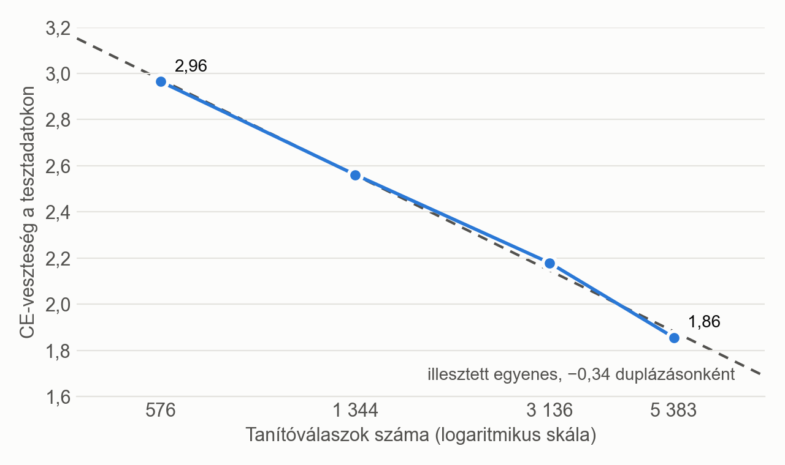
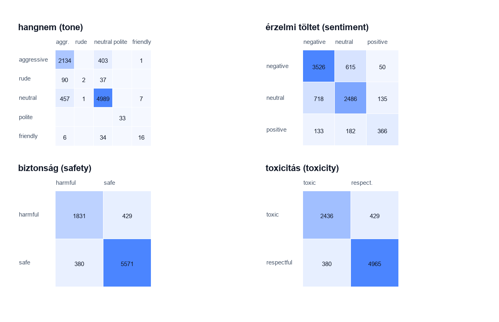

Absztrakt (magyar) + Abstract (angol)

Magyar cím: Nagy nyelvi modellek domain-specifikus desztillációja alapoktól tanított kis modellekbe
Angol cím: Domain-Specific Distillation of Large Language Models into Small Models Trained from Scratch

A nagy nyelvi modellek megjelenésével az intelligencia, a problémamegoldás és a döntéshozatal soha nem látott egyszerűséggel vált beépíthetővé a különböző szoftveres megoldásokba. Ezzel egyidejűleg az ilyen alkalmazások számításigénye és így futtatásának költsége is jelentősen megnőtt. Sok esetben fontos az ilyen modelleket lokálisan futtatni, akár szenzitív adatok, offline elérhetőség vagy megbízhatóság miatt. Ezeknél a feladatoknál viszont általában nincs szükség a modell teljes tudására, hiszen csak egy bizonyos feladatot lát el.
A dolgozat a domain-specifikus tudás desztillálását vizsgálja alapoktól tanított, jelentősen csökkentett paraméterszámú modellekbe és ügynökökbe. A vizsgált modellek elkészítéséhez és kiértékeléséhez használt saját keretrendszer jelentősen leegyszerűsíti a desztillálás folyamatát: a domain definiálását követően mindössze konfigurálással beállítható a tanítóadatok előállítása, maga a tanítás és a tanulómodell architektúrája. A tanítóadatok újrahasználhatóak több modell betanítására is.
A dolgozat több domaint is vizsgál: alapfeladatokat (text sentiment classification, posztgenerálás), illetve ügynökfeladatokat is (matematikai feladatok megoldása és magyarázata, kódbázisban végrehajtott keresés és magyarázás), és ezek mentén igyekszik megválaszolni olyan kérdéseket, mint például: kis méretű tanulómodellek mennyire képesek elsajátítani a tanármodell viselkedését? Különböző entrópiájú domaineknél hogyan érdemes a különböző veszteségeket használni vagy vegyíteni? Milyen módszerrel érdemes ügynököket desztillálni? Hogyan javul a teljesítmény a modell méretének függvényében? Milyen következtetések vonhatóak le nagyobb büdzséjű desztillálásokra?
A dolgozat több tanármodellt (Gemma 3 4B, Gemma 4 12B) használ, öt domaint vizsgál részletesen, és ezek közül kettőnél saját modellhám (harness) segítségével önálló ügynököket hoz létre.

1. BEVEZETÉS

1.1 A megoldandó probléma, motiváció
Az utóbbi években a mesterséges intelligencia és ezen belül a természetes nyelv feldolgozására képes modellek iránti igény jelentősen megnőtt egyéni és vállalati körökben is [1]. Ilyen modelleknek gyakori felhasználási területe lehet a kódírás, döntések programatikus meghozatala vagy a tanulás támogatása. Az ilyen feladatok ellátásához jelenleg a legegyszerűbb és sok esetben az egyetlen elérhető mód, ha a különböző felhőszolgáltatóktól vásárlunk hozzáférést, legyen egy előfizetés vagy API-hívás alapú számlázás. Ez viszont sok problémát felvet, például szenzitív adatoknál vagy kritikus infrastruktúra kódjánál nem feltétlenül használhatóak az ilyen megoldások, hiszen az adatok egy külső szolgáltató szerverein kerülnek feldolgozásra, tehát kikerülnek a vállalat ellenőrzése alól. Egy másik probléma lehet a megbízhatóság, hiszen ha a modellre infrastruktúraként tekintünk, sebezhetőséget jelenthet, ha a modell válaszminősége a kontrollunkon kívül változik, például mert a szolgáltató eltérő architektúrájú hardverről szolgálja ki a modellt [2], vagy mert új védőkorlátokat vezet be [3]. Újabb probléma lehet az ilyen modellek költsége vagy elérhetősége [3]. Ahogy a legmodernebb és legjobb modellek egyre drágább áron vagy csak előfizetések mögé rejtve lesznek elérhetőek, nem feltétlenül lesz az intelligencia mindenki számára elérhető.
Nyílt súlyú modellek is elérhetőek, igaz, a legtöbb benchmarkon és valós tapasztalatok alapján a zászlóshajó zárt súlyú modellektől jelentősen elmaradnak, legalábbis ez tapasztalható 2026 októberéig [4]. Ha felhőszolgáltató infrastruktúrájáról szolgáljuk ki ezeket, a fent említett problémák csak részben mérsékelhetőek, lokális hardveren a hihetetlen memória és grafikus számításigény miatt pedig sokszor nem lehetséges a megfelelő minőségben kiszolgálni ezeket a modelleket. A 2026 júliusában megjelent Kimi K3, az egyik legjobb benchmarkeredményt elérő nyílt súlyú modell [5], 2,8 billió paraméterből áll, amelyből tokenenként 104 milliárd aktív, és a súlyai még a kiadott, 4 bites (MXFP4) formátumban is nagyjából 1,56 TB-ot foglalnak [6]. Pusztán a súlyok betöltéséhez tehát 80 GB-os A100 adatközponti minőségű GPU-kból is legalább húszra lenne szükség.
Erre kínál megoldást a desztillálás, amikor is egy nagyobb modell viselkedését próbáljuk meg közelíteni egy jelentősen kisebb számítási kapacitást igénylő tanulómodellel. Ez a folyamat veszteségesen tömöríti a tanármodell tudását, tehát általában elmondható, hogy a kisebb tanulómodell válaszminősége (a tömörítés mértékétől függően) rosszabb lesz.
A modern LLM-ek egyik legértékesebb tulajdonsága, hogy egy modell szinte bármire használható. Ha erről hajlandóak vagyunk részben lemondani, és csak egy specifikus képességét szeretnénk megtartani, a tömörítés során sokkal nagyobb hatékonysággal tudjuk megőrizni az adott domainen az eredeti modell válaszminőségét.
A dolgozat ezért egy olyan általános megoldást mutat be, amely lehetővé teszi a domain-specifikus desztillálást. Mindezt olyan példákon keresztül, melyek bemutatják a módszer hatékonyságát és előnyeit. Bemutatásra kerül például egy olyan matematikai feladatokat megoldó és magyarázó ügynök, amely akár egy középkategóriás okostelefonon is offline elfut, vagy akár egy középkategóriás laptopon is lokálisan futtatható kódmagyarázó ügynök.

1.2 A dolgozat célja
A dolgozat célja egy olyan keretrendszer megtervezése és implementálása, amellyel egy nagy nyelvi modell adott szakterületre vonatkozó tudása kis méretű, alapoktól tanított nyelvi modellekbe vagy ágensekbe desztillálható. A dolgozat vizsgálja a tudásdesztilláció és a kis méretű nagy nyelvi modellek tanításának módszereit, a nyelvi modellekre épülő ágensek felépítését, valamint a rendelkezésre álló eszközöket. A keretrendszer funkcionalitása lefedi a tanítóadatok előállítását a tanármodellel, a tanulómodell tanítását és a tanítás kiértékelését. A keretrendszer lehetővé teszi a kis modell architektúrájának és a tanítási folyamat finom szabályozását, és a desztilláció lefolyásáról részletes elemzést ad. A rendszer moduláris szemlélettel lett megtervezve, új szakterületek és ágensek külön modulként hozzáadhatóak.

1.3 A dolgozat felépítése

2. A PROBLÉMA ELEMZÉSE, A SPECIFIKÁCIÓ KIDOLGOZÁSA

Az LLM-ek egyre nagyobb szerepet játszanak a különböző digitális rendszerekben. Gyorsíthatnak vagy automatizálhatnak bizonyos szoftverfejlesztési és kiberbiztonsági feladatokat, tehát eszközként válhatnak az állami, vállalati vagy személyes infrastruktúra részévé. Vagy lehetnek egy szoftver beépített elemei, például különböző moderációs eszközökben. Az is előfordulhat, hogy az LLM maga a szoftveres megoldás fő része, például egy oktató-magyarázó alkalmazásban. Az 1.1 fejezetben részletesebben kifejtett kiszámíthatósági, megbízhatósági és költségbeli okok miatt sok esetben ideális vagy szükségszerű lenne a lokális kiszolgálás. Szintén az 1.1 fejezetben kifejtett óriási hardverigény vagy a meglévő hardveren elfutó, de jelentősen rosszabb válaszminőségű modell miatt a lokálisan futtatott általános LLM-ek nem feltétlenül jelentenek megoldást.

2.1 Alapfogalmak
2.1.1 Nagy nyelvi modellek (LLM), transformer
Az LLM-ek olyan nagy, tanított statisztikai modellek, amelyeket általában óriási mennyiségű természetes szövegen és természetes szöveggel kapcsolatos feladaton tanítottak be [7]. A rövidítés az angol Large Language Model, vagyis nagy nyelvi modell kezdőbetűiből áll össze. Tanított statisztikai modellként a mesterséges intelligencia (Artificial Intelligence, röviden AI) egyik fajtája. A legtöbb ilyen modell a neurális hálók egy speciális architektúráját, a transformert használja. Az ilyen LLM-ek működtetik a modern chatbotokat, mint például a ChatGPT. További példa LLM-ekre az Anthropic Claude modellcsaládja, a Google Gemini és Gemma modelljei vagy az OpenAI GPT és gpt-oss modelljei. Az ilyen modellek képesek követni a természetes nyelven kiadott utasításokat, és válaszaikat is képesek természetes nyelven megfogalmazni. Nem teljes lista a képességeikről: fordítás, problémák megoldása, programkód írása, matematikai feladatok levezetése és megoldása, érvelés, beszélgetés.
Transformer (decoder-only).
A transformer egy, a Google által 2017-ben bemutatott speciális neurális háló architektúra, amelyet elsősorban szövegek fordítására hoztak létre [8]. Az OpenAI kutatói kimutatták [9], hogy ha ezt az architektúrát tovább skálázzák (nagyobb modell, több adat és több számítás), az így kapott modell teljesítménye kiszámítható módon javul. A transformer architektúra újítása a figyelemmechanizmusra való kizárólagos támaszkodás volt [8]. Ennek lényege, hogy miután a szöveget tokenekre bontjuk, és ezek a tokenek jelentésük szerint elhelyezésre kerülnek egy nagy dimenziójú térben. Az irányoknak jelentése is van, például kimutatták [10], hogy bizonyos reprezentációkban a király és a királynő közötti különbségvektor ebben a térben nagyon hasonlít a férfi és a nő közötti különbségvektorra. Ahogy a szöveg áthalad a modellen, a tokenek térbeli reprezentációja folyamatosan mozoghat, ahogy a többi token befolyásolja a jelentésüket. Ez az egymásra "figyelés" és befolyásolás a figyelemmechanizmusnak köszönhető. Egy egyszerűsített példa lehet egy képzeletbeli modell, amely "zöld" és "macska" tokenre bontja ezt a kifejezést: "zöld macska". A modell elején a "macska" token térbeli elhelyezése az eredeti helyén lesz, de a modell végére átkerül a térbeli reprezentációja egy olyan helyre, hogy a "zöld" jelentést is magába enkódolja.
Az eredeti transformer két részből áll: egy kódolóból (encoder), amely a teljes bemeneti szöveget egyszerre dolgozza fel, így minden token az összes többi tokent figyelembe veheti, illetve egy dekódolóból (decoder), amely a kimenetet tokenenként állítja elő, és minden token csak az előtte lévőket látja [8]. Később elterjedtek az olyan modellek is, amelyek csak az egyik részt használják. A csak kódolót használó (encoder-only) modellek, mint például a BERT [11], a szöveg reprezentációját állítják elő, ezért elsősorban szövegek osztályozására és elemzésére alkalmasak, szöveg generálására viszont nem. A csak dekódolót használó (decoder-only) modellek, mint például a GPT- és a Gemma-modellek, autoregresszív módon generálnak szöveget [7], [12]. A mai LLM-ek többsége ilyen felépítésű [7]. A dolgozatban használt tanulómodellek is decoder-only transformerek.
A dolgozatban többször előkerül a bf16 és az NF4 formátum. Ezek számábrázolási formátumok, amelyek azt határozzák meg, hogy a modell súlyai, illetve a mentett logitok hány biten és milyen pontossággal kerülnek tárolásra. A bf16 (bfloat16) egy 16 bites lebegőpontos formátum, amely a 32 bites lebegőpontos számokkal azonos értéktartományt fed le, viszont csak 8 bites mantisszával, így nagyjából 2–3 értékes jegy pontosságú [13]. Az NF4 (4-bit NormalFloat) egy 4 bites kvantálási formátum, amelyben minden súly 16 lehetséges érték egyikére kerül kerekítésre, a súlyok blokkjaihoz pedig külön skálázótényező tartozik [14]. Egy paraméter így bf16-ban 2 bájtot, NF4-ben nagyjából fél bájtot foglal: a dolgozatban használt, közel 12 milliárd paraméteres Gemma 4 12B tanármodell súlyai bf16-ban körülbelül 24 GB, NF4-ben körülbelül 6 GB helyet igényelnek.

2.1.2 Token, be- és kimeneti szótár
A tokenek általában kis, szótag vagy szó méretű karakterláncok, de lehetnek önálló betűk vagy formázást segítő karakterek is [15]. Az LLM a szöveget tokenekre bontva kapja meg, ez azért fontos, mert így a szövegdarabokat el tudja helyezni térben, és már szám formájában tud velük dolgozni. A szöveg tokenekre bontását tokenizálásnak hívjuk. A folyamatot a tokenizer hajtja végre, amely modellenként eltérhet. Az eltérő tokenizerek különbözőképpen bonthatják fel a szöveget. Például a dolgozat egyik tanármodelljeként használt Gemma 4 12B tokenizerje ezt a szöveget: "Laczkó Örs youtube csatornájára érdemes feliratkozni" a következőképpen bontja fel: Lac | zk | ó | ▁Ö | rs | ▁youtube | ▁cs | ator | ná | j | ára | ▁é | rd | emes | ▁fel | irat | koz | ni (18 token, a ▁ jel a szóközt jelöli).
Általában a modell ugyanazt a tokenizert használja a szöveg értelmezésére és kimenetként is, a következő token generálásához. Általában a modell ki- és bemenete ugyanazokat a tokeneket tartalmazza, vagyis azokat a tokeneket, amelyeket képes olvasni, írni is tudja. Azoknak a tokeneknek az összességét, amelyeket a modell olvasni tud, bemeneti szótárnak, azokét pedig, amelyeket írni tud, kimeneti szótárnak hívjuk. A dolgozatban használt egyik optimalizációs módszer ezeknek a szótáraknak az aszimmetrikus, domainhez mért szűkítése.

2.1.3 Autoregresszív generálás, kimeneti eloszlás, hőmérséklet
Az autoregresszív modellek olyan statisztikai modellek, ahol a következő predikció függ az előtte lévőktől. Az LLM-eknél ez azt jelenti, hogy a generálás általában tokenenkénti, a generált token hozzáfűzésre kerül az eddigi szöveghez, és ezt a folyamatot az úgynevezett válaszlezáró tokenig (end-of-sequence token) folytatjuk [7]. Egyszerűbben fogalmazva, a modell tokenenként írja meg a válaszát, egy bizonyos lezáró token generálásáig, vagy valamilyen más külső lezáró ok miatt.
A modell szöveg generálásakor minden egyes tokennél ad egy becslést az összes, a kimeneti szótárában szereplő tokenre. Ez a becslés nyers számokban érkezik, úgynevezett logitokban. Ezt utána egy softmax függvénnyel valószínűségekké tudjuk alakítani, ahol az összes token valószínűségének összege 1 lesz [16]:
pᵢ = exp(zᵢ) / Σⱼ exp(zⱼ) (2.1)
ahol zᵢ az i-edik token logitja, pᵢ a valószínűsége, az összegzés pedig a kimeneti szótár összes tokenjére történik.
A softmax függvény egy T hőmérséklet (temperature) paraméterrel is kiegészíthető, amellyel a logitokat a valószínűségekké alakítás előtt elosztjuk [16]:
pᵢ = exp(zᵢ / T) / Σⱼ exp(zⱼ / T) (2.2)
T = 1 esetén a (2.1) képletet kapjuk vissza. Nagyobb hőmérséklet laposabb, „puhább” eloszlást ad, kisebb hőmérséklet pedig élesebbet, amely egyre inkább a legvalószínűbb tokenre koncentrálódik. Ez azért fontos, mert magasabb hőmérséklet mellett jobban kirajzolódnak a tanármodell kisebb valószínűségei is, így a tanulómodell jobban elsajátíthatja a tanármodell gondolkodását [16].
Azt, hogy egy eloszlás mennyire éles vagy puha, az entrópia méri [17]. Melynek számítási módja:
H = −Σᵢ pᵢ · ln pᵢ (2.3)
ahol pᵢ az i-edik token valószínűsége, az összegzés pedig a kimeneti szótár összes tokenjére történik. Ha a modell egyetlen tokenben teljesen biztos, az entrópia 0, és minél inkább megoszlik a valószínűség több token között, annál nagyobb. Kisebb entrópia tehát élesebb, nagyobb entrópia puhább eloszlást jelent. Természetes alapú logaritmussal számolva az entrópia mértékegysége a nat. A dolgozatban a tanármodell entrópiáját tokenenként számoljuk, majd a válaszok összes tokenjére átlagoljuk.

2.1.4 Tudásdesztilláció, tanár- és tanulómodell
Ha szeretnénk egy nagy modell tudását egy kisebbe átültetni, a desztillálás jó megoldás lehet. A desztillálás egy olyan tömörítő eljárás, amely során azt próbáljuk elérni, hogy egy kisebb modell (függvény) ugyanúgy viselkedjen, mint a nagyobb, több számítást igénylő modell [16]. A nagy modellt tanármodellnek, a kis modellt tanulómodellnek hívjuk. A desztilláció bővebb kifejtése a 3.1.1. fejezetben található. A tanulómodell a tanármodell predikcióiból tanul. Arra optimalizálunk, hogy valamilyen szempont szerint minél inkább kövesse a tanár viselkedését.

2.1.5 Veszteségek
A tanítás során szükségünk van valamilyen módszerre, amivel számszerűsíteni lehet a modell hibáját. Ezt a feladatot látják el a veszteségfüggvények, amelyek gradiense valamilyen szempont szerint optimalizációs irányt mutat az optimalizálónak. LLM-ek desztillálásánál több veszteségfüggvény is elérhető számunkra. A kereszt-entrópia (cross-entropy, röviden CE) a modellt kizárólag a tanítószövegben szereplő következő tokenre (desztillációnál a tanármodell által választottra) tanítja [17]. Ezzel szemben a Kullback–Leibler-divergencia (röviden KL) veszteség a tanulómodell teljes eloszlását a tanármodell eloszlásával hasonlítja össze [17], és így az optimalizálni kívánt cél nem csupán a következő helyes token eltalálása lesz, hanem az úgynevezett "dark knowledge" többlettudás is átadásra kerülhet. A dolgozat elsősorban ezzel a két veszteséggel foglalkozik, illetve ezeknek vegyítésével, amikor is valamilyen arányban a két veszteséget keverjük, ezáltal többcélú optimalizációt elérve [16]:
L = α · KL + (1 − α) · CE (2.4)
ahol α a KL-veszteség aránya, amelyet a keretrendszer a tanítás során fokozatosan változtathat. CE veszteség használatával a tanármodell következő tokenjének minél pontosabb becslése érhető el, míg KL veszteséggel a teljes eloszlás is követhető.

2.1.6 Ügynök, modellhám, kontextus
Az ügynökök (vagy ágensek) olyan megvalósításokat írnak le, ahol egy LLM-nek egy modellhám (harness) képességeket ad, ezzel cselekvőképessé téve azt [18]. A modellhám figyeli a modell kimenetét, és ha észrevesz egy speciális tokensorozatot, valamilyen funkciót hajt végre. A hám által adott képességek általában elmagyarázásra kerülnek a modell kontextusában. Például egy hám biztosíthat olyan képességet a modellnek, hogy visszautasítson egy kérést: ilyenkor, ha a modell válaszában megjelenik mondjuk az <out_of_scope> token, a hám egy előre programozott üzenettel automatikusan elutasítja a kérést, és az üzenet nem kerül be a modell kontextusába. Egy másik példa lehet, ha a modell szeretné megjelölni egy fájl bizonyos sorait, mondjuk megmutatásra vagy magyarázásra, akkor ez így nézhet ki: <scope> storage.py 9-11 </scope>, vagyis a storage.py fájl 9–11. sora.
A modell kontextusa (context) mindazon szövegek összessége, amelyeket a modell egy adott pillanatban lát. A kontextus hossza (context length) a benne lévő tokenek számával egyezik meg. A kontextuslimit (context limit) pedig az a szám, amennyi tokent a modell a kontextusában képes kezelni [7].

2.1.7 Kiértékelés
Ha van egy modellünk, hogyan tudjuk eldönteni, hogy jól vagy rosszul teljesít? Ha a veszteséget nézzük, vagyis hogy mekkora tévedés van a modell kimeneti valószínűségében, abból csak irányt tudunk olvasni, hogy tényleg fejlődött-e a modell. A különböző veszteségek és veszteségvegyítések során még kevésbé válik értelmezhetővé önmagában egy veszteség értéke. Ráadásul minket nem is feltétlenül a veszteség értéke érdekel, még ha kontextusba is tudnánk helyezni, hanem hogy a modell mennyire teljesít jól a tényleges tesztfeladatokon. Erre a dolgozat három fő metrikát használ. A helyes előzménnyel mért tokenpontosság (teacher forced) során a modell minden lépésben a helyes szöveget kapja, és ez alapján kell a következő tokent megjósolnia [17]. Ebből százalékos eredményt kapunk, vagyis hogy ha a modell kap valamilyen szöveget, mekkora valószínűséggel fog helyes következő tokent jósolni. Egy másik metrika a saját előzménnyel mért tokenpontosság (student only), ahol a modell saját magának állítja elő a szöveget, amely alapján a következő tokent is meg kell jósolnia. Egy korai hibás token könnyen elronthatja a modell teljes válaszát, a hiba úgymond eszkalálódik (compounding errors) [19]. Ez a metrika valamivel pontosabban tükrözi a modell valós tudását, hiszen azt mondja meg nekünk, hogy ha a modell teljes válaszát nézzük, a tokenek hány százaléka fog pozíciónként megegyezni a helyes válasszal (desztillációnál a tanármodell válaszával). Az is előfordulhat, hogy arra vagyunk kíváncsiak, hogy a modell helyesen oldotta-e meg a feladatot. Ez olyan feladatokon releváns, mint például a matematikai feladatok megoldása, egy szöveg hangulatának elemzése JSON-objektummal vagy a megfelelő kódrészlet kijelölése. Ez a metrika a feladatpontosság (task accuracy), vagyis hogy a modell a feladatok hány százalékát képes helyesen elvégezni (a dolgozatban a modell saját maga által generált válasza alapján, a tanármodell válaszához mérve).

2.2 A vizsgált domainek
A következő alfejezetekben rövid bemutatásra kerülnek a dolgozatban vizsgált domainek. A kiválasztásukról részletesebben a 4.4. fejezetben lehet olvasni.

2.2.1 Szöveghangulat-elemzés
Az első vizsgált domain a szöveghangulat-elemzés (text sentiment classification). A modell kap egy Reddit-kommentet, amelyet utána 4 tengely mentén kell kiértékelnie, egy JSON-objektumot használva. A kommentek egy Kaggle-adatbázisból [20] származnak. A kommentekből az URL-ek és a betűkön, számokon és alapvető írásjeleken kívüli karakterek törlésre, a törölt ([deleted], [removed]) kommentek, valamint a 3 tokennél rövidebb és a 25 tokennél hosszabb kommentek pedig kiszűrésre kerültek.
Egy példa a feladatra:

````
You only need 1 friend now, they changed how the Friend boost works

```json
{
  "tone": "neutral",
  "sentiment": "negative",
  "safety": "safe",
  "toxicity": "respectful"
}
````

A modell feladata a \n\n karakterek utáni rész generálása, és a "}" token állítja le a generálást. A domain strukturált, a Gemma 3 4B tokenenkénti átlagos entrópiája 0,02 nat, amely arra utal, hogy a domain eloszlása éles, tehát általában a tanármodell biztos a döntésében.

2.2.2 Matematikai szöveges feladatok megoldása (első verzió)
A következő domain a matematikai szöveges feladatok megoldásáról szól. A tanítópéldák 260 különböző sablont használva készültek. A sablonok 13 művelettípusba voltak bontva, például összeadás, kivonás, szorzás, osztás, két műveletből álló feladatok (például összeadás, majd szorzás) és összehasonlítás. A modell feladata a megadott levezetési váz kitöltése és a helyes megoldás leírása a "Solution:" után. A sablonok miatt fennáll a veszélye, hogy a modell a sablonok mintáját tanulja meg, és új szerkezetű feladatokat kevésbé képes megoldani (lásd 2.5.2. alfejezet).
Egy példa a feladatra:

```
Problem: "Olivia has 93 seeds and buys 67 more. Each seed grows 63 flowers. How many flowers total?"
A=?
B=?
C=?
D=A+B=?
E=D*C=?
Solution: ?;

93
B=67
C=63
D=A+B=160
E=D*C=10080
Solution: 10080;
```

A modell feladata a \n\n karakterek utáni rész generálása, és a ";" token állítja meg a generálást. A domain strukturált, a Gemma 3 4B tokenenkénti átlagos entrópiája kb. 0,003 nat, amely arra utal, hogy a domain eloszlása éles, tehát általában a tanármodell biztos a döntésében.

2.2.3 Posztgenerálás
Az utolsó vizsgált, nem ügynök domain, a posztgenerálás. A modell kap egy, a 2.2.1. alfejezetben megismert kommentet, és az a feladata, hogy generáljon egy olyan posztot, amelyre érkezhetne ez a komment.
Egy példa a feladatra:

```
Main problem was they showed it in slow motion. I thought it was a bit much by Bish

Seriously, the slow-motion replays in this game were infuriating. It felt like they were trying to draw out the drama and make it more intense, but it just made me feel like I was watching a highlight reel instead of a real game.  I agree, it was a bit much, and honestly, distracting. <end>
```

A modell feladata a \n\n karakterek utáni rész generálása, és az "<end>" jelölés állítja meg a generálást. A domain strukturálatlan, a Gemma 3 4B tokenenkénti átlagos entrópiája kb. 1,0 nat, amely arra utal, hogy a domain eloszlása puha, tehát általában a tanármodell több válasz között vacillál.

2.2.4 Matematikai feladatokat megoldó és magyarázó ügynök
Ez a domain a matematikai szöveges feladatmegoldó domain továbbfejlesztett, ügynökösített változata. A modellnek egy szöveges feladat levezetése és megoldása a feladata. A feladatok valódi, matematikai feladatokat tartalmazó adatbázisok (ASDiv [21], MAWPS [22]) feladataiból kiindulva készültek, ezeket mesterséges intelligencia (Claude Opus 5.5) ügynökök bővítették a megfelelő példaszám elérése érdekében. A modellnek ezenfelül kezelnie kell a saját kontextusát egy modellhám segítségével, el kell döntenie, hogy következő részfeladatot vagy kiegészítő kérdést lát. Amennyiben kiegészítő kérdésről van szó, a következő részfeladatnál a kiegészítő kérdések törlésre kerülnek a kontextusból, így a modell kontextusa nincs túlterhelve. Ezenfelül a modell megtanulja az oda nem illő kérdéseket elutasítani, amelyek be sem kerülnek a kontextusba.
Egy példa, a feladat megoldása után egy kiegészítő kérdéssel:

```
<task>The restaurant's Monday schedule calls for 16 lemons. Friday's schedule, with its fish special, calls for 5 times as many lemons. How many lemons does the Friday schedule call for?</task>
<solution>
lemons on Monday = 16
multiplier for Friday = 5
lemons on Friday = 16 * 5 = 80
Answer: 80
</solution>
<message>what did you do with 16 and 5? I don't get it</message>

<explanation>The word "times" means we need to multiply the numbers together. I multiplied 16 by 5 to find the total for Friday.</explanation>
```

Egy másik példa elutasított kérdésre:

```
<task>The restaurant's Monday schedule calls for 16 lemons. ...</task>
<solution>
...
</solution>
<message>this is the most boring day of my life</message>

<out_of_scope>
```

Ilyenkor a modell csak az <out_of_scope> jelölést írja le, a modellhám pedig egy előre megírt mondattal ("This question is outside the scope of this task.") válaszol. A <task> és <solution> blokkokban szereplő szövegek végig megmaradnak a modell kontextusában, a <question> és <explanation> blokkok a következő <task> blokknál törlődnek, az elutasított üzenet pedig be sem kerül a kontextusba. A magyarázatok miatt a feladatoknak csak egy része strukturált, a Gemma 4 12B tokenenkénti átlagos entrópiája 0,17 nat, amelyből az olvasható le, hogy a modell nem minden tokenben volt teljesen biztos, volt, ahol több megoldást is választott volna.

2.2.5 Kódkereső és -magyarázó ügynök
Ebben a feladatban a modell 20 (16 Python- és 4 HTML-) példaprojekt valamelyikének teljes kódját kapja meg egy előre meghatározott formátumban. A modell feladata, hogy megkeressen vagy megmagyarázzon egy kódrészletet. Ha magyaráznia kell, a modell akkor is először leszűkíti a kontextust a <scope> blokkot használva, majd a modellhám által leszűkített kontextus alapján megválaszolja a rá vonatkozó kérdést.
Egy példa a feladatra (kevesebb fájllal, rövidített fájlokkal bemutatva), 1. lépés:

```
<project>
<file name="main.py">
 1: """To-do list in the terminal."""
 2:
 3: from calendar_help import read_date
...
22: def ask_new_task(username):
23:     title = input("What needs doing? ")
24:     due = read_date(input("Due (today, tomorrow, YYYY-MM-DD or Enter): ") or "none")
25:     priority = parse_priority(input("Priority (h/m/l): ")) or "medium"
26:     print(add_task(username, Task(title, due, priority)) or "Added.")
...
</file>
<file name="jobs.py">
...
</file>
...
</project>
<message>How does ask_new_task work?</message>

<scope>
main.py 22-26
jobs.py 43-51
checks.py 6-13
checks.py 24-26
calendar_help.py 6-16
</scope>
```

2. lépés:

```
<context>
<file name="calendar_help.py">
 6: def read_date(text):
...
</file>
<file name="checks.py">
 6: def parse_priority(text):
...
</file>
<file name="main.py">
22: def ask_new_task(username):
23:     title = input("What needs doing? ")
24:     due = read_date(input("Due (today, tomorrow, YYYY-MM-DD or Enter): ") or "none")
25:     priority = parse_priority(input("Priority (h/m/l): ")) or "medium"
26:     print(add_task(username, Task(title, due, priority)) or "Added.")
</file>
<file name="jobs.py">
43: def add_task(username, task):
44:     """Put a new task on the user's list. None when it worked, otherwise why not."""
45:     problem = title_problem(task.title)
46:     if problem:
47:         return problem
48:     jobs = tasks_of(username)
49:     jobs.append(task.to_data())
50:     save_tasks(username, jobs)
51:     return None
</file>
</context>
<message>How does ask_new_task work?</message>

<explanation>
The `ask_new_task` function in `main.py` collects information from the user to create a new task. It uses `read_date` from `calendar_help.py` to interpret the due date, `parse_priority` from `checks.py` to determine the urgency, and then calls `add_task` in `jobs.py` to save the new task to the user's list.
</explanation>
```

A modell a \n\n rész után kezdi meg a válaszadást. A Gemma 4 12B tokenenkénti átlagos entrópiája itt is 0,17 nat, amely gyakorlatilag megegyezik a matematikai ügynökével.

2.3 A probléma elemzése
A megoldandó feladat tehát egy nagy modell (későbbiekben tanármodell) sokrétű tudásának egy domainre koncentráltan hatékonyan kinyerni. Gyakorlatilag a tanármodell oly módú tömörítése, ahol nem számít a modell teljesítményének romlása más területeken, csak az számít, hogy a vizsgált területen a lehető legjobban másolja a tanárát. A probléma több részre bontható.

2.3.1 A domain
Először is szükség van domainek definiálására. Itt megadhatjuk azt az utasítást, amit a tanármodell követve a tanítóadatokat elő tudja állítani. A domain feladata a kimeneti szótár tokenjeinek meghatározása (a bemeneti szótárat a keretrendszer a domain adataiból automatikusan állítja elő), a megállást jelző token szolgáltatása, illetve ügynökdesztillálás esetén a modellhám biztosítása.

2.3.2 A tanítóadatok előállítása
Ha van egy domainünk, ahhoz, hogy a tanár viselkedése másolható legyen, szükségünk van a tanártól adatokra. A tanítóadatok a következőképpen kerülnek előállításra: a keretrendszert használva bekonfigurálhatunk akár több adatgenerálási feladatot egy sorban, amelyek szekvenciálisan végrehajtódnak. Minden adatgenerálási feladat meghatározza, hogy melyik tanármodellt használva melyik domainen mennyi példát generáljon a keretrendszer. Az adatgenerálás során a tanármodell megkap egy feladatot, amelyre lépésenként (autoregresszív módon) választ ad. Minden lépésben mentésre kerül a tanár kimeneti eloszlása, vagyis hogy a tanármodell milyen valószínűséggel hogyan folytatná a szöveget. Ha a domain optimalizációs okokból így határozza meg, a tanármodell egy megadott választ pontoz egyetlen futtatással, az eloszlás ilyenkor is minden tokennél mentésre kerül. Egy később kifejtett optimalizációs stratégiának köszönhetően (a kimeneti szótár csökkentése) nem szükséges a teljes eloszlást elmenteni. Ez tovább optimalizálható: a mentett adatok mérete tovább csökkenthető, ha tokenenként csak a k legvalószínűbb token logitja kerül mentésre (top-k), vagy ha a tokeneket a tanármodell valószínűségei alapján mintavételezzük. A Gemma 3 modellek tanításánál például tokenenként 256, a tanár valószínűségei szerint mintavételezett logitot használtak [12]. Szükségesség híján a dolgozat ezt a stratégiát nem vizsgálja. A válaszadás akkor ér véget, amikor a tanármodell a domainben megadott záró tokent vagy a saját, szöveg végét jelző tokenjét használja. Ezenfelül, ha túllépi a megengedett válaszhosszt, a generálás leáll, és a példa elvetésre kerül.
A folyamat végén kapni fogunk egy mappát (batches/<domain>/<tanármodell>), amelyben .npz formátumú kötegek kerülnek. Egy kötegfájlban alapértelmezett beállítások mellett 32 példa található, amelyek egy-egy probléma tanítóadatát tárolják. Egy ilyen példa tartalmazza a feladatot szövegként, a modell válaszát szövegként, metaadatokat (például hogy a példa a tanító- vagy a tesztkészlethez tartozik), illetve egy steps listát, amelyben lépésenként el van mentve a válasz következő tokenje, a tanármodell által legvalószínűbbnek tartott token sorszáma a kimeneti szótárban, valamint a kimeneti szótár összes tokenjéhez tartozó nyers logitértékek, amelyekből az eloszlás kiszámolható. Összességében tehát ez a folyamat domainenként és tanármodellenként külön mappába, rendszerezve tárolja az adatokat olyan formában, hogy a 3.1.1. fejezetben bemutatott desztillációs tanítás végrehajtható legyen a tanulómodellen.

2.3.3 A tanulómodell és a tanítás
A következő kérdés a tanulómodell architektúrájának megválasztása. A keretrendszer alapértelmezett modellje egy sűrű, decoder-only transformer modell, amely a Gemma-modellekben is használt elemekre épül (RMSNorm normalizálás, rotary pozíciókódolás, kapuzott GELU előrecsatolt réteg), és amelynek konfigurálhatjuk rejtett dimenzióját (hidden dimension), figyelemfejeinek (attention head) és rétegeinek (layers) számát sok egyéb mellett. Ezenfelül a tanítási sorban saját modellt is átadhatunk a keretrendszernek, ha saját architektúrával szeretnénk kísérletezni, hiszen a keretrendszernek a könnyű, gyors, kontrollált és költséghatékony kísérletezésnek az elősegítése is célja.
A tanítóadatok előállításához hasonlóan a tanítás is egy soralapú szekvenciális rendszerre épül. A tanítóadatok előállításához és a diákmodellhez hasonlóan a desztilláció ezen része is teljes mértékben konfigurálható kell hogy legyen, hiszen a kísérleteket csak így lehet nagy számban, megbízhatóan és pontosan végrehajtani. Beállítható kell legyen a vizsgált veszteségvegyítésen felül számos más paraméter.

2.3.4 A kiértékelés
A modell betanulása után pedig fontos lépés a tanítás és a modell eredményeinek a kielemzése. A keretrendszer alaposan naplózza az összes fontos paramétert adatgenerálás és tanítás közben is. Visszakövethetjük a különböző folyamatokkal eltöltött időt, tanulás folyamán a veszteség- és pontosságértékeket, epochok közben a mini tesztadatsoron történő kiértékelést, epochok végén a teljes tesztadatokon történő értékelést.
Mivel a tanulómodell tanítása nem determinisztikus, általában több futtatás átlagával és szórásával, statisztikai próbával tudjuk igazolni a különböző módszerek hatékonyságát, így egy kísérletcímke-rendszer (experiment tag) is szükséges, amelynek segítségével több futtatás eredménye összevonható egy adatsorrá.

2.3.5 Integráció
Az utolsó problémakör pedig a kész modellek integrálása különböző felületekbe, legyen az egy terminálos alkalmazás, amelyben a betanított ügynökkel beszélgethetünk, vagy egy webalkalmazás, amely mutatja a modell és a modellhám által tett lépéseket egy chatfelületen.

2.4 Miért fontos nyílt súlyú LLM-et használni
A projekt a Hugging Face-ről letölthető, nyílt súlyú modellekre alapoz. A 3.1.1. fejezetben kifejtett általános LLM-desztillációs módszerek alapján két fő desztillációs módszer érhető el. Az egyik, amikor a modell kimeneti szövegén tanítjuk a tanulómodellünket, a másik pedig, amikor a kimeneti szöveg generálása közben a modell eloszlásán is. Az előbbi módszer zárt súlyú modellek kimenetén is elvégezhető, bár ez a felhasználási feltételekbe (terms of use) ütközhet [23]. A nyílt súlyú modelleknél általában nincs ilyen megkötés [24]. További előnye a nyílt súlyú modelleknek, hogy ha mi telepítettük ki (deployment), hozzáférhetünk a modell kimeneti eloszlásához, azt el tudjuk menteni, és így a modell kimeneti eloszlásában rejlő többletinformáción, a Hinton-féle "dark knowledge"-en [16] is taníthatjuk a tanulómodelleinket. Ráadásul az LLM-eknél ez az eloszlás különösen fontos (lásd 3.1.1. fejezet).

2.5 Lehetséges buktatók

2.5.1 A redukált szótár korlátai
A dolgozatban vizsgált tanulómodellek be- és kimeneti szótára optimalizációs célból, a domainhez igazítva, redukálva van. Ennek a módszernek fundamentális limitációja, hogy a modell bizonyos tokeneket nem tud olvasni vagy írni. Ez problémát okozhat, hiszen ha a modell olyan szöveget lát, amely nincs benne a bemeneti szótárában, akkor azt nem tudja felismerni, olyan szöveget pedig szintén nem képes generálni, amelyhez olyan tokent kellene használnia, amely nincs benne a kimeneti szótárában. Ezek ellen a problémák ellen kétféleképpen védekezhetünk, jól összeállított szótárakkal, illetve a kérés átirányításával vagy elutasításával. A korai kísérletek során a kimeneti szótár a lehetséges válaszok listájából vagy egy tanármodell által előre generált mintaszövegből készült. Később a kimeneti szótár a tanármodell válaszai alapján került felépítésre. Először a tanármodell előállítja a válaszait, majd egy második körben a teljes választ egyben átfuttatva a modellen kiolvashatók és menthetők a logitértékei. Mint kiderült, összességében messze adat- és számításkapacitás-hatékonyabb megoldás volt ez, hiszen nem kellett válaszokat eldobni azért, mert olyan tokeneket tartalmaztak, amelyek nem voltak benne az előre elkészített kimeneti szótárban. A bemeneti szótár mindvégig a tanító- és a tesztrekordokban előforduló összes token és a kimeneti szótár alapján került előállításra, kiegészítve egy ismeretlen (unknown) tokennel, amelyre a szótáron kívüli bemeneti tokenek leképeződnek. Az ismeretlen token sora nincs tanítva, így egy ilyen szó a modell számára gyakorlatilag üres helyként jelenik meg. Összességében tehát, ha a domain feladatai kellőképpen jól fel vannak építve, domainen belül csekély eséllyel kellene előfordulnia szótárhibának. Amennyiben mégis ilyen történne, a kérést tovább lehet irányítani egy olyan modellnek, amelynek nincsenek ilyen limitációi, vagy akár egy hibaüzenet is megjeleníthető. Szótárcsökkentés nélkül sem tudna a modell mit kezdeni azokkal a tokenekkel, amelyek a tanítóadatban nem fordulnak elő, mert ezek beágyazása nem kap tanítójelet. Hasonló a helyzet a kimeneti oldalon. Ha egy token sosem helyes válasz, a modell csak azt tanulja meg, hogy ne írja le, így a hozzá tartozó súlyok gyakorlatilag fölösleges költséget jelentenek a modellben. A tesztadatoknál előfordulhat, hogy van olyan token, amelynek a modellben van ki- vagy bemeneti sora, de a tanítóadatban sosem szerepelt. A redukált kimeneti szótárnak van egy kevésbé szembetűnő következménye is. A tanármodell eloszlásából csak a megtartott tokenekhez tartozó logitértékek kerülnek mentésre, a szótáron kívüli tokenekre jutó valószínűség elvész. A gyakorlatban ez csak minimális problémát jelent, hiszen a tanármodell valószínűségének túlnyomó része általában a szótárban szereplő tokenekre esik. Egy saját mérés szerint a szöveghangulat-elemző domainen a Gemma 3 4B valószínűségének kb. 99%-a a kimeneti szótáron belül maradt.

2.5.2 Programozottan előállított feladatok
A matematikai feladatmegoldó domain első verziójának feladatanyaga 260, 13 művelettípusba osztott sablont használt a feladatok előállítására. A mesterséges intelligenciát használó megoldások egyik óriási előnye, hogy olyan helyen is találnak mintákat, ahol az emberek nem, viszont a sablonos megoldásnál ez hátrány, abból a szempontból, hogy a modell nem feltétlenül csak azt tanulja meg, amit szeretnénk, hanem a sablonok logikáját is [25]. Ez azt eredményezheti, hogy ha a sablontól eltérő sorrendben szerepelnek egyébként jól ismert tokenek, a modell teljesítménye jelentősen romolhat [26]. Ennek veszélyét csökkentve a második verzióban már publikusan elérhető feladatbázisok (ASDiv [21], MAWPS [22]) feladataiból kiindulva, mesterséges intelligencia (Claude Opus 5.5 ügynökök) által írt feladatok lettek használva, így növelve a feladatszerkezetek változatosságát. A kódolóügynöknél hasonló, mesterséges intelligenciával bővített feladatadatbázis lett létrehozva, a korábbi programatikus feladatgenerálási hozzáálláshoz képest. Ha ezeket a modelleket élesben szeretnénk használni, több, nagyobb varianciájú adatra lenne szükség, mert most is megfigyelhető egyfajta "túltanulás". A módszer működőképességének bemutatására viszont megfelelőek a feladatbázisok.

2.5.3 A tanármodell hibáinak átvétele
Költséghatékonysági okokból a dolgozat 4, illetve 12 milliárd paraméteres tanármodelleket használ. Ezeknél vannak nagyságrendekkel nagyobb és jobban teljesítő nyílt súlyú modellek [5], [6], a legjobb zárt súlyú modellek pedig még ezeknél is jobban teljesítenek [4]. Ennek eredményeként a tanármodell válaszai néha hibásak. A desztillációs módszerek vizsgálatánál viszont ez kevésbé fontos, hiszen nem egy olyan rendszert szeretnénk létrehozni, amely jobb, vagy másképp viselkedik, mint a tanármodell, egyszerűen csak tömöríteni szeretnénk a tudását, a lehetséges hibáival együtt is. Ez azt is jelenti, hogy a tanármodell képességei egyfajta felső korlátot jelentenek a tanulómodell számára. Egyben viszont azt is jelenti, hogy ha egy módszer jól működik 4, illetve 12 milliárd paraméternél, akkor feltételezhetjük, hogy nagyobb modelleket is desztillálhatunk hasonlóan, tehát a felső korlát egy jobb tanármodellel tovább emelhető.

2.5.4 Az alapoktól tanítás adatigénye
Az alapoktól tanítás azt jelenti, hogy a modell véletlenszerűen van inicializálva, nincs semmilyen előtudása sem a nyelvről, sem az adott domainről, szemben például a finomhangolás módszerével, ahol egy meglévő modell meglévő tudása van tovább erősítve, bővítve (lásd 3.1.3. fejezet). A finomhangolás viszont elveszi a lehetőséget a saját méret és architektúra megválasztására, amelyre a dolgozat alapoz (be- és kimeneti szótár, rendkívül kis méret). Az alapoktól tanított modellnek így mindent a desztillációs adatokból kell megtanulnia, ezért jóval nagyobb mennyiségű adatra van szüksége. A matematikai feladatokat magyarázó ügynök domainen egy 224 beszélgetésből álló, 1345 tanítóválaszos próbatanítás végén az 5,9 millió paraméteres tanulómodell az 54 tesztfeladatból egyet sem oldott meg helyesen, pedig mindig a leggyakoribb választ adva 4 is helyes lett volna. Ugyanekkora tanulómodellt egyre több tanítóválaszon tanítva a tesztadatokon mért CE-veszteség egyenletesen csökkent (2.1. ábra). Rendre 576, 1344, 3136 és 5383 tanítóválasszal a veszteség 2,96, 2,56, 2,18 és 1,86 volt, vagyis a tanítóadat minden megduplázása átlagosan 0,34-dal csökkentette a veszteséget, és a vizsgált adatmennyiségeknél ez a javulás még nem lassult le.

2.1. ábra. A tesztadatokon mért CE-veszteség a tanítóválaszok számának függvényében
A feladatpontosság ennyi adattal viszont végig 0,8 és 2,4% között maradt, ami kevesebb, mint a mindig a leggyakoribb választ adva elérhető 6,1%. Nagyobb adatmennyiségnél már a feladatpontosság is jól mutatja az adat szerepét. Ugyanaz a 16,4 millió paraméteres tanulómodell 10 epoch alatt 64 554 tanítóválaszon a tesztfeladatok 49,5%-át oldotta meg helyesen, a háromszor ennyi, 195 980 tanítóválaszon pedig a veszteségtől és a futtatástól függően 68–72%-át, miközben mindig a leggyakoribb választ adva kb. 4% érhető el. A két mérés tesztkészlete eltérő méretű, de mindkettő a tanítás során nem látott feladatcsaládokból áll.

2.5.5 Helyes formátum, helytelen válasz
A strukturált domaineken félrevezető lehet a tanítás közben mért és a helyes előzménnyel mért pontosság. Például a szöveghangulat-elemző domainen meglehetősen gyorsan, pár száz példa alatt megjegyzi a modell a JSON-struktúrát. A saját előzménnyel mért és a feladatpontosságból viszont hamar kiderül, hogy míg a formátumot helyesen használja a modell, addig a mezők értékei nem feltétlenül helyesek. Sőt, nem csak a strukturált domaineken, de a matematikai feladatmegoldó ügynök domainen is előfordult a próbatanítás során, hogy a modell helyes formátumban, de a feladattól független, kitalált tárgyakkal és számokkal válaszolt. A szöveghangulat-elemző domainen ráadásul vannak címkék, amelyek alulreprezentáltak, ez a 2.2. ábrán látható tévesztési mátrixokból (confusion matrix) is kiderül.

2.2. ábra. Tévesztési mátrixok a szöveghangulat-elemző domainen
A 2.2. ábrán egy Gemma 3 4B tanármodellből desztillált, 4,9 millió paraméteres tanulómodell mezőnkénti tévesztési mátrixai láthatók. A tanulómodell 489 984 Reddit-kommenten tanult 3 epochon keresztül. A sorok a tanármodell, az oszlopok a tanulómodell címkéit mutatják. A mátrixok a 10 016 tesztkommentből azt a 8210-et tartalmazzák, amelyre a tanulómodell feldolgozható JSON-választ adott. A ritka hangnemcímkék közül a "rude" (durva) címkét a tanulómodell 129 esetből csak 2-szer, a "friendly" (barátságos) címkét 56 esetből 16-szor találta el, a gyakori "neutral" (semleges) és "aggressive" (agresszív) címkéket viszont nagyrészt eltalálta. Összességében a modell az értékek 86%-át találta el, szemben a mindig a leggyakoribb címkét adó megoldás 64%-ával.

2.5.6 A helyes és a saját előzménnyel mért pontosság eltérése
A 2.5.5. alfejezetben is olvasható, hogy a modell gyakran megjegyez struktúrákat. Ez nem csak a JSON-formátumra, de az objektum kulcsaira és azok értékeire is vonatkozik. A helyes előzménnyel mért pontosságnál előfordulhat, hogy például a 2 tokenre bomló "harmful" (káros) szó ("harm" és "ful") első tokenjét nem találja el a modell, de ha megkapja az érték első tokenjét, ez alapján egyszerűen be tudja fejezni. Az első token döntési pont, a második csak befejezi a döntést. Ezért fontos a saját előzménnyel mért pontosság is, amely azt is mutatja, ha a modell hibája eszkalálódik [19], vagyis egy korai hiba a teljes modellválaszt elrontja.

2.5.7 Az LLM nem mindig a legjobb megoldás
Fontos még megjegyezni, hogy a dolgozatban vizsgált domaineken nem feltétlenül egy LLM a legjobb megoldás. Például a szöveghangulat klasszifikálására egy klasszifikáló modell, mint például a BERT [11], valószínűleg jobban teljesítene. A dolgozatban viszont mégis LLM-mel vannak az ilyen problémák megoldva, ugyanis relatíve könnyebb kutatási felszínt biztosítanak, hiszen például a szöveghangulat-elemző domainen valódi Reddit-kommentek [20] vannak klasszifikálva, amelyek így nagyrészt mentesülnek a sablonok okozta problémáktól, amelyek részletesebben a 2.5.2. alfejezetben kerültek kifejtésre. Röviden tehát a könnyebben előállítható domainek és a kutatási szempontból megfelelő mennyiségű és minőségű adatok teszik indokolttá, hogy olyan domaineken is vizsgálja a dolgozat az LLM-eket, amelyekre más megoldások talán hatékonyabbak lennének. Az így leszűrt tanulságok más problémákra is alkalmazhatóak, és nagyban megegyeznek a szakirodalomban dokumentáltakkal.

2.6 Funkcionális és nem funkcionális követelmények - DRAFT, review before subbmitting
A rendszerrel szemben támasztott követelmények két csoportra bonthatóak. A funkcionális követelmények azt írják le, hogy mit kell tudnia a rendszernek, a nem funkcionális követelmények pedig azt, hogy milyen minőségben és milyen korlátok között. A követelmények a keretrendszerre és a rá épülő két ügynökre vonatkoznak, teljesülésüket a 8. fejezet ellenőrzi.
Funkcionális követelmények:
F1 – Új domain külön modulként hozzáadható. A domain megadja a feladatokat, a kiértékelés módját, a tanármodellnek szóló utasítást, a kimeneti szótár tokenjeit és a megállást jelző tokent, ügynök esetén pedig a modellhámot is. (2.3.1)
Nem funkcionális követelmények:
NF1 – Megbízhatóság: megszakításkor legfeljebb az utolsó mentés óta végzett munka vész el, a felhalmozott adatfájlok soha nem íródnak felül, és a keretrendszer elutasítja a nem egyező szótárral készült tanítóadatokat, illetve a nem egyező állapotból történő folytatást.

2.7 Használati esetek - DRAFT, review before subbmitting
A dolgozatban leírt rendszerek és azok eredményei többféle módon is felhasználhatóak.
Használhatják kutatók különböző architektúrák szisztematikus tesztelésére desztillált adatokon, domainenként. Használhatják különböző desztillációs módszerek és tömörítő módszerek tesztelésére és összehasonlítására is.
Használhatják fejlesztők, akik különböző vállalati, infrastrukturális vagy személyes feladatokra vagy problémákra keresnek egy hatékony, lokálisan futtatható megoldást.
A kész modelleket pedig természetesen használhatják végfelhasználók különböző felhasználási területeken.
A főbb használati esetek szereplőnként:
Kutató vagy fejlesztő:
HE1 – Tanítóadatok előállítása: kiválasztja a tanármodellt, és konfigurációval elindítja az adatok előállítását.

3. SZAKIRODALMI ÁTTEKINTÉS – LEHETSÉGES MEGKÖZELÍTÉSEK ÉS MEGOLDÁSOK

A következőkben bemutatásra kerülnek a jelenlegi módszerek, azok hiányosságai, illetve a domain-specifikus desztilláció által kínált megoldás.

3.1 Meglévő megoldások, hasonló rendszerek
3.1.1 Általános LLM-desztillációs módszerek
A tudásdesztilláció (knowledge distillation) egy tömörítési módszer, amely egy kisebb modellel próbálja minél pontosabban közelíteni a desztillálni kívánt nagyobb modellt. A kis modellt tanulómodellnek, a nagy modellt tanármodellnek hívják. A klasszikus tudásdesztilláció alapötletét Hinton és társai [16] fogalmazták meg, melynek lényege, hogy a tanulómodellt nemcsak a helyes válaszra tanítjuk meg, hanem a tanármodell teljes kimeneti eloszlására is. A tanulómodell így nemcsak a helyes választ, de a tanármodell bizonytalanságát, úgynevezett "dark knowledge"-t is képes megtanulni. Ez a bizonytalanság érdekes többletinformációt is magában hordoz, hiszen azt is megmutatja, hogy melyik rossz válaszok állnak közel a jóhoz. Ráadásul a nagy nyelvi modellek működéséből fakadóan kifejezetten fontos ez az információ, ugyanis gyakran előfordul, hogy egy LLM használata közben nem a legvalószínűbb (greedy decoding), hanem valamelyik más valószínű szóval folytatja a válaszadást, mivel a szöveget a legvalószínűbb tokenek mintavételével (sampling) generáljuk.
Egy másik gyakran használt tudásdesztillálási módszer nagy nyelvi modelleknél az eloszlás nélkül, csak a tanármodell kimeneti szövegén történő tanítás, az úgynevezett szekvenciaszintű desztilláció [27].
A nagy nyelvi modelleknél a desztillációt ma jellemzően általános céllal használják, tehát a tanulómodelltől azt várjuk, hogy a tanár minden képességét megtartsa. Erre példa a Gemma 2 modellcsalád [28], ahol a 2 és 9 milliárd paraméteres modelleket már desztillációval tanították. A szerzők kísérletében egy 7 milliárd paraméteres tanárból desztillált 2 milliárd paraméteres modell három benchmark átlagában 67,7 pontot ért el, szemben az ugyanannyi tokenen, desztilláció nélkül tanított változat 60,3 pontjával.
Vannak természetesen specifikusabban desztillált modellek, ilyenek például a DeepSeek-R1-Distill modellek [29], amelyeknél nagyjából 800 ezer, főként a DeepSeek-R1 érvelő (reasoning) modell által generált példán tanították tovább a kisebb, 1,5 és 70 milliárd paraméter közötti Qwen és Llama modelleket, kifejezetten az érvelési képességek átadására fókuszálva. Ebben a kísérletben eloszlás nélkül, csak a tanármodell szövegén tanították a tanulómodelleket.
Busbridge és társai [30] szerint a desztillált modell teljesítménye előre jelezhető a tanulómodell méretéből és a tanításra fordított számítási keretből, és ha a modell általános képességeit nézzük, akkor ez a tömörítés veszteséges. Ha viszont lemondunk az általánosságról, és csak egy szűk feladatra (domain-re) szeretnénk fókuszálni, a szükséges tudás egy jóval kisebb modellbe is beférhet.

3.1.2 Kvantálás
A desztillálás egy olyan tömörítőmódszer, amely a paraméterszám csökkentésére koncentrál, ezzel szemben a kvantálás (quantization) a meglévő súlyok helyigényét csökkenti. Míg egy nem kvantált LLM súlyait általában 16 biten szokták tárolni, kvantáláskor ez lecsökkenhet 8 vagy 4 bites precizitásra. A kvantálás a modell teljesítményének romlásával járhat, viszont így jelentősen nagyobb paraméterszámú modelleket is képesek vagyunk futtatni lokálisan, ezért az ilyen modellek futtatására ez az egyik legelterjedtebb módszer.
Előnye, hogy nem szükséges újratanítani a modellt: a GPTQ módszerrel [31] például egy 175 milliárd paraméteres modell nagyjából négy GPU-óra alatt 3 vagy 4 bitesre kvantálható, elhanyagolható pontosságvesztéssel, így egyetlen GPU-n is futtatható.
A kvantálás viszont csak a modell számábrázolásának pontosságát csökkenti, a modell felépítése és így a paraméterek száma változatlan marad, ugyanúgy a teljes modelltudás lesz tömörítve, csak kevesebb memóriát foglal. Dettmers és Zettlemoyer [32] kutatásából az is kiderül, hogy az adott memóriakeret mellett szinte mindig a 4 bites pontosság adja a legjobb eredményt. Tehát a kvantálással nagyjából négyszeres memóriacsökkenés érhető el, a dolgozatban vizsgált domain-specifikus desztillálásnál viszont a tanulómodellek a tanármodellnél akár százszor–húszezerszer kevesebb paraméterből is állhatnak. A desztillálás és kvantálás nem feltétlenül kizáró optimalizációs módszerek, tehát egy desztillált modellt lehet kvantálni is.

3.1.3 Modellfinomhangolás
A finomhangolás (fine-tuning) során egy már előtanított nagy nyelvi modellt tanítunk tovább egy szűkebb szakterületre, a domainnek megfelelő adatokon vagy környezetben (environment), például megerősítéses tanulással (RL). Előnye, hogy nem kell a modellt alapoktól tanítani, hiszen az alapvető nyelvi képességeket a modell már elsajátította. Ez a technika viszont a már létező előtanított (pre-trained) modellekhez köt, amelyek sok esetben nem is léteznek a dolgozatban vizsgált méretekben.
A finomhangolás költsége jelentősen csökkenthető paraméterhatékony módszerekkel. Ezek közül az egyik legelterjedtebb a LoRA [33], amely az eredeti súlyokat befagyasztja, és csak kis, alacsony rangú mátrixokat tanít mellettük. A szerzők ezzel a módszerrel a 175 milliárd paraméteres GPT-3 esetén a tízezred részére csökkentették a tanítandó paraméterek számát és a harmadára a szükséges GPU-memóriát. Az így kapott mátrixok utólag pedig beolvaszthatóak az eredeti súlyokba, így a folyamat végére nem változik a modell mérete.
A QLoRA [14] ezt a 3.1.2 fejezetben bemutatott kvantálással kombinálja. A módszer a modell súlyainak 4 bitesre kvantálása után, befagyasztott modell mellett tanítja a LoRA-mátrixokat. Így egy 65 milliárd paraméteres modell finomhangolásának memóriaigénye több mint 780 GB-ról 48 GB alá csökken, lényeges teljesítményromlás nélkül. A finomhangolás viszont csak a súlyok értékét változtatja meg, azok számát és elrendezését nem, tehát a finomhangolt modell futtatásához ugyanakkora hardver kell, mint az általános, nem finomhangolt modellhez.
Ezenfelül a domainre hangolás az általános képességek rovására is mehet: Biderman és társai [34] például a Llama-2-7B modellt finomhangolták tovább programozási és matematikai feladatokra, és azt tapasztalták, hogy a modell teljes finomhangolásakor jobban tanul a célterületen, viszont többet felejt a többi mért képességéből. Ezzel szemben a LoRA kevesebbet felejt, de kevesebbet is tanul.

3.1.4 Ügynökdesztillálás
A mai modern LLM-rendszerek nemcsak válaszolnak, hanem cselekedni is tudnak. Ez a modellhámnak (harness) köszönhető, amelynek az LLM szöveges formában, például tagek segítségével képes utasításokat adni, a hám pedig végrehajtja ezeket. Ennek egyik meghatározó korai példája a ReAct [18], ahol a modell felváltva generál gondolatmenetet és cselekvéseket, a cselekvésekkel pedig külső forrásokat, például egy egyszerű Wikipédia-API-t ér el. A modellek cselekvőképessége, vagyis hogy ügynökként tudnak viselkedni, a lehetőségek új osztályát nyitja meg. Erre példa a Claude Code [35], amely lehetővé teszi, hogy a modell fájlokat hozzon létre és szerkesszen, kezelje a saját kontextusát, és Bash-parancsokkal vezérelje a számítogép bizonyos funkcióit. A dolgozatban különös figyelmet kapott ez a terület, hiszen meglepően hasznos tud lenni egy cselekvésre képes kis LLM is.
Az ügynökök desztillálása már létező kutatási terület: Kang és társai [36] például egy 32 milliárd paraméteres tanármodell ügynökként végzett lépéssorozatain finomhangoltak 0,5 és 7 milliárd paraméter közötti előtanított modelleket, és már a 0,5 milliárd paraméteres ügynök is versenyképes volt a következő méretkategóriába tartozó, csak a tanár gondolatmenetén (chain-of-thought) tanított modellel. Ezek a tanulómodellek viszont előtanított modellek, a dolgozatban vizsgált ügynökök ennél jóval kisebbek, és alapoktól tanulnak.

3.1.5 Kis méretű nyelvi modellek

3.1.6 Desztillációs keretrendszerek és eszközök

3.2 Technológiák, módszerek összevetése

3.3 Következtetések

4. A MEGOLDÁSI MÓDSZER KIVÁLASZTÁSA ÉS INDOKLÁSA

4.1 Domain-specifikus desztillálás alapoktól tanított kis méretű modelleknél
A fenti módszerekkel szemben a dolgozatban tárgyalt, alapoktól tanított kis méretű modellekbe történő domain-specifikus desztillálás lehetővé teszi, hogy egy, az adott feladatra szabott, a nagy nyelvi modellek világában kis méretűnek számító modellel megtartsuk a tanármodell domain-specifikus tudásának nagy részét. Tekinthetünk a módszerre egy olyan tömörítési eljárásként, amelynek nem célja a modell teljes tudásának megőrzése, a tanulómodell a teljes kapacitását egy specifikus, szűk területre fordíthatja, így a méretéhez képest kifejezetten jó teljesítményt nyújthat. Mivel a modell alapoktól tanul, ezért a tanulómodell architektúráját is szabadon választhatjuk. A dolgozatban tárgyalt megoldás ezt ki is használja: például a modell be- és kimeneti szótárának redukciójával jelentősen csökkenthető a szükséges paraméterek száma, hiszen kis modelleknél a szótárhoz tartozó beágyazások a paraméterek jelentős részét teszik ki. A Gemma 3 270M modell 270 millió paraméteréből például 170 millió a 256 ezer tokenes szókincs beágyazásaihoz tartozik [37]. Az alapoktól tanulás hátránya, hogy a modell nem indul "alap megértéssel". Ez viszont a megfelelő veszteségek vegyítésével, például Kullback–Leibler-divergencia alapú veszteséggel, a tanármodell "dark knowledge"-ének átvételével valamelyest javítható. Hinton és társai [16] egy beszédfelismerési kísérletében például a tanármodell eloszlásán (soft targets) tanított modell a tanítóadatok mindössze 3%-ával is 57,0%-os pontosságot ért el, szemben a csak a helyes válaszokon tanított változat 44,5%-ával és a teljes adathalmazon tanított modell 58,9%-ával. Ráadásul ezek a modellek olyan kis méretűek is lehetnek, hogy a tanítóadatok előállításának és a modell betanításának költségeit akár egy magánszemély is fedezni tudja: a dolgozat két ügynökének tanítóadatai összesen kevesebb mint 150 dollárnyi bérelt GPU-időbe (A100 és RTX PRO 6000) kerültek, a tanulómodellek tanítása pedig többnyire lokálisan, egy RTX 4070 videokártyán, néhány tíz óra alatt történt.
A dolgozatban bemutatott keretrendszer a teljes desztillációs folyamatot kezeli, melynek lépései a következők:
(1) a domain definiálása (feladatok, kiértékelés, be- és kimeneti szótár stb.),
(2) a tanítóadatok előállítása (konfigurációval, soralapú megoldással, ahol többek között a tanármodell is beállítható),
(3) a tanulómodell definiálása és tanítása (a tanítás folyamata szintén soralapú, számos paraméter konfigurálható),
(4) a kiértékelés.

4.2 Az ügynökök felépítése: tanulómodell és modellhám
A dolgozat két fő példán keresztül mutatja be az ügynökdesztillálást. Az egyik egy egyszerű matematikai feladatokat megoldó és magyarázó LLM, ahol az ügynöknek kezelnie kell a saját kontextusát: el kell döntenie, hogy egy kérdésre válaszol, vagy a következő feladatra tér át, illetve el kell utasítania a feladathoz nem kapcsolódó üzeneteket. A másik vizsgált ágens egy olyan modell és hám kombinációja, amely képes egy 12–15 fájlból álló HTML- vagy Python-projektben megtalálni és szükség esetén megmagyarázni bizonyos kódrészeket.
Könnyen látható, hogy ezek a feladatkörök egyszerűen bővíthetőek és skálázhatóak úgy, hogy rendkívül hasznosak legyenek. Képzeljünk csak el egy offline, ingyenesen, akár telefonon is futtatható matematikai magyarázó ügynököt, amely a lemaradó gyerekeket segíthetné a tanórára való készülésben. Vagy egy olyan kódoló ügynököt, amely lokálisan, egy laptop videokártyáján pillanatok alatt ellátja az egyszerűbb feladatokat, ezzel megspórolva a külső szolgáltató költségét.

4.3 A tanármodellek kiválasztása

4.4 A vizsgált domainek kiválasztása

4.5 Választott technológiák

5. RÉSZLETES SPECIFIKÁCIÓ

6. TERVEZÉS – MUNKAFÁZISOK ÉS TAPASZTALATOK
7. MEGVALÓSÍTÁS

8. TESZTELÉS

9. EREDMÉNYEK BEMUTATÁSA, ÉRTÉKELÉSE, ÖSSZEVETÉS HASONLÓ RENDSZEREKKEL

10. A MEGVALÓSÍTÁS ELEMZÉSE, ALKALMAZÁSA, TOVÁBBFEJLESZTÉSI LEHETŐSÉGEK

11. ÖSSZEFOGLALÁS (magyarul)

12. SUMMARY (angolul)

13. IRODALOMJEGYZÉK

[1] J. S. Allen, "Monitoring AI adoption in the U.S. economy," FEDS Notes, Board of Governors of the Federal Reserve System, Washington, DC, USA, Apr. 3, 2026, doi: 10.17016/2380-7172.4032.
[2] Anthropic, "A postmortem of three recent issues," Anthropic Engineering, Sep. 17, 2025. Accessed: Oct. 29, 2026. [Online]. Available: https://www.anthropic.com/engineering/a-postmortem-of-three-recent-issues
[3] Anthropic, "Redeploying Fable 5," Anthropic News, Jun. 30, 2026. Accessed: Oct. 29, 2026. [Online]. Available: https://www.anthropic.com/news/redeploying-fable-5
[4] Artificial Analysis, "Announcing Artificial Analysis Intelligence Index v5," Oct. 27, 2026. Accessed: Oct. 29, 2026. [Online]. Available: https://artificialanalysis.ai/articles/artificial-analysis-intelligence-index-v5
[5] Artificial Analysis, "Kimi K3 achieves #3 in the Artificial Analysis Intelligence Index, comparable to Opus 4.8 and GPT-5.5," Jul. 17, 2026. Accessed: Oct. 29, 2026. [Online]. Available: https://artificialanalysis.ai/articles/kimi-k3-achieves-3-in-the-artificial-analysis-intelligence-index-comparable-to-opus-4-8-and-gpt-5-5
[6] Moonshot AI, "Kimi-K3," Hugging Face model card, 2026. Accessed: Oct. 29, 2026. [Online]. Available: https://huggingface.co/moonshotai/Kimi-K3
[7] W. X. Zhao et al., "A survey of large language models," 2023, arXiv:2303.18223. [Online]. Available: https://arxiv.org/abs/2303.18223
[8] A. Vaswani, N. Shazeer, N. Parmar, J. Uszkoreit, L. Jones, A. N. Gomez, Ł. Kaiser, and I. Polosukhin, "Attention is all you need," in Proc. Adv. Neural Inf. Process. Syst. (NeurIPS), vol. 30, 2017, pp. 5998–6008. [Online]. Available: https://arxiv.org/abs/1706.03762
[9] J. Kaplan et al., "Scaling laws for neural language models," 2020, arXiv:2001.08361. [Online]. Available: https://arxiv.org/abs/2001.08361
[10] T. Mikolov, W.-t. Yih, and G. Zweig, "Linguistic regularities in continuous space word representations," in Proc. 2013 Conf. North Amer. Chapter Assoc. Comput. Linguistics: Human Lang. Technol. (NAACL-HLT), Atlanta, GA, USA, 2013, pp. 746–751.
[11] J. Devlin, M.-W. Chang, K. Lee, and K. Toutanova, "BERT: Pre-training of deep bidirectional transformers for language understanding," in Proc. 2019 Conf. North Amer. Chapter Assoc. Comput. Linguistics: Human Lang. Technol. (NAACL-HLT), Minneapolis, MN, USA, 2019, pp. 4171–4186, doi: 10.18653/v1/N19-1423.
[12] Gemma Team, "Gemma 3 technical report," 2025, arXiv:2503.19786. [Online]. Available: https://arxiv.org/abs/2503.19786
[13] D. Kalamkar et al., "A study of BFLOAT16 for deep learning training," 2019, arXiv:1905.12322. [Online]. Available: https://arxiv.org/abs/1905.12322
[14] T. Dettmers, A. Pagnoni, A. Holtzman, and L. Zettlemoyer, "QLoRA: Efficient finetuning of quantized LLMs," in Proc. Adv. Neural Inf. Process. Syst. (NeurIPS), vol. 36, 2023. [Online]. Available: https://arxiv.org/abs/2305.14314
[15] T. Kudo and J. Richardson, "SentencePiece: A simple and language independent subword tokenizer and detokenizer for neural text processing," in Proc. 2018 Conf. Empirical Methods Natural Lang. Process.: Syst. Demonstrations, Brussels, Belgium, 2018, pp. 66–71, doi: 10.18653/v1/D18-2012.
[16] G. Hinton, O. Vinyals, and J. Dean, "Distilling the knowledge in a neural network," presented at the NIPS 2014 Deep Learning Workshop, 2015. [Online]. Available: https://arxiv.org/abs/1503.02531
[17] I. Goodfellow, Y. Bengio, and A. Courville, Deep Learning. Cambridge, MA, USA: MIT Press, 2016. [Online]. Available: https://www.deeplearningbook.org
[18] S. Yao et al., "ReAct: Synergizing reasoning and acting in language models," in Proc. 11th Int. Conf. Learn. Represent. (ICLR), 2023. [Online]. Available: https://arxiv.org/abs/2210.03629
[19] S. Bengio, O. Vinyals, N. Jaitly, and N. Shazeer, "Scheduled sampling for sequence prediction with recurrent neural networks," in Proc. Adv. Neural Inf. Process. Syst. (NeurIPS), vol. 28, 2015. [Online]. Available: https://arxiv.org/abs/1506.03099
[20] smagnan, "1 million Reddit comments from 40 subreddits," Kaggle dataset. Accessed: Oct. 31, 2026. [Online]. Available: https://www.kaggle.com/datasets/smagnan/1-million-reddit-comments-from-40-subreddits
[21] S.-Y. Miao, C.-C. Liang, and K.-Y. Su, "A diverse corpus for evaluating and developing English math word problem solvers," in Proc. 58th Annu. Meeting Assoc. Comput. Linguistics (ACL), 2020, pp. 975–984, doi: 10.18653/v1/2020.acl-main.92.
[22] R. Koncel-Kedziorski, S. Roy, A. Amini, N. Kushman, and H. Hajishirzi, "MAWPS: A math word problem repository," in Proc. 2016 Conf. North Amer. Chapter Assoc. Comput. Linguistics: Human Lang. Technol. (NAACL-HLT), San Diego, CA, USA, 2016, pp. 1152–1157, doi: 10.18653/v1/N16-1136.
[23] OpenAI, "Terms of use," Jan. 1, 2026. Accessed: Oct. 30, 2026. [Online]. Available: https://openai.com/policies/row-terms-of-use/
[24] Google, "Apache License 2.0 (Gemma 4 license)," Google AI for Developers, Apr. 1, 2026. Accessed: Oct. 30, 2026. [Online]. Available: https://ai.google.dev/gemma/docs/gemma_4_license
[25] R. Geirhos, J.-H. Jacobsen, C. Michaelis, R. Zemel, W. Brendel, M. Bethge, and F. A. Wichmann, "Shortcut learning in deep neural networks," Nat. Mach. Intell., vol. 2, no. 11, pp. 665–673, 2020, doi: 10.1038/s42256-020-00257-z.
[26] A. Patel, S. Bhattamishra, and N. Goyal, "Are NLP models really able to solve simple math word problems?" in Proc. 2021 Conf. North Amer. Chapter Assoc. Comput. Linguistics: Human Lang. Technol. (NAACL-HLT), 2021, pp. 2080–2094, doi: 10.18653/v1/2021.naacl-main.168.
[27] Y. Kim and A. M. Rush, "Sequence-level knowledge distillation," in Proc. 2016 Conf. Empirical Methods Natural Lang. Process. (EMNLP), Austin, TX, USA, 2016, pp. 1317–1327, doi: 10.18653/v1/D16-1139.
[28] Gemma Team, "Gemma 2: Improving open language models at a practical size," 2024, arXiv:2408.00118. [Online]. Available: https://arxiv.org/abs/2408.00118
[29] D. Guo et al., "DeepSeek-R1 incentivizes reasoning in LLMs through reinforcement learning," Nature, vol. 645, pp. 633–638, 2025, doi: 10.1038/s41586-025-09422-z.
[30] D. Busbridge, A. Shidani, F. Weers, J. Ramapuram, E. Littwin, and R. Webb, "Distillation scaling laws," in Proc. 42nd Int. Conf. Mach. Learn. (ICML), 2025. [Online]. Available: https://arxiv.org/abs/2502.08606
[31] E. Frantar, S. Ashkboos, T. Hoefler, and D. Alistarh, "GPTQ: Accurate post-training quantization for generative pre-trained transformers," in Proc. 11th Int. Conf. Learn. Represent. (ICLR), 2023. [Online]. Available: https://arxiv.org/abs/2210.17323
[32] T. Dettmers and L. Zettlemoyer, "The case for 4-bit precision: k-bit inference scaling laws," in Proc. 40th Int. Conf. Mach. Learn. (ICML), 2023, pp. 7750–7774.
[33] E. J. Hu, Y. Shen, P. Wallis, Z. Allen-Zhu, Y. Li, S. Wang, L. Wang, and W. Chen, "LoRA: Low-rank adaptation of large language models," in Proc. 10th Int. Conf. Learn. Represent. (ICLR), 2022. [Online]. Available: https://arxiv.org/abs/2106.09685
[34] D. Biderman et al., "LoRA learns less and forgets less," Trans. Mach. Learn. Res., 2024. [Online]. Available: https://arxiv.org/abs/2405.09673
[35] Anthropic, "Claude Code overview," Claude Code Docs. Accessed: Oct. 28, 2026. [Online]. Available: https://code.claude.com/docs/en/overview
[36] M. Kang, J. Jeong, S. Lee, J. Cho, and S. J. Hwang, "Distilling LLM agent into small models with retrieval and code tools," in Proc. Adv. Neural Inf. Process. Syst. (NeurIPS), vol. 38, 2025. [Online]. Available: https://arxiv.org/abs/2505.17612
[37] O. Lacombe, K. Kenealy, K. Black, R. Kumar, F. Visin, and J. Zhang, "Introducing Gemma 3 270M: The compact model for hyper-efficient AI," Google Developers Blog, Aug. 14, 2025. Accessed: Oct. 28, 2026. [Online]. Available: https://developers.googleblog.com/en/introducing-gemma-3-270m/

14. MELLÉKLETEK
